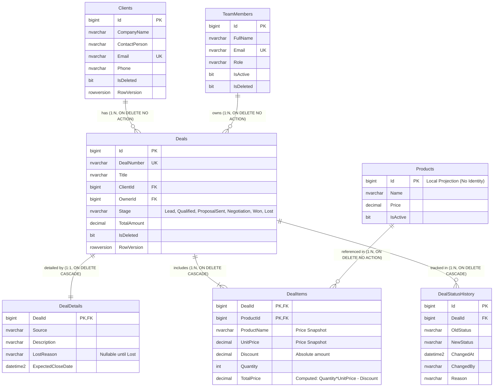
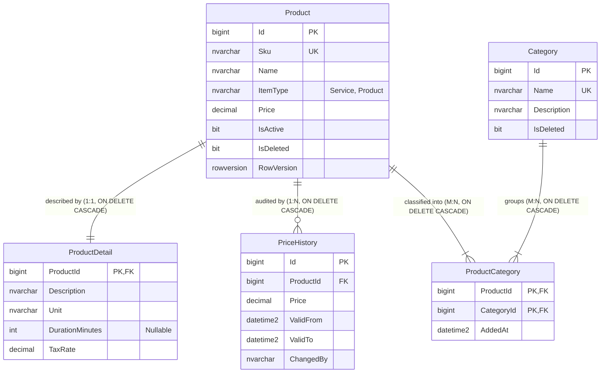

# Практична робота №01: Проєктування та розробка баз даних для мікросервісної архітектури

## Предметна область: CRM для малого бізнесу (Студія веб-розробки та цифрового маркетингу)

Система є спеціалізованою CRM для студії веб-розробки та цифрового маркетингу зі штатом 3–10 співробітників (власник студії та менеджери з продажів). Вона забезпечує централізований облік клієнтів, ведення угод через воронку продажів, управління прайс-листом цифрових послуг і товарів та фіксацію повної хронології комунікацій (дзвінки, листи, зустрічі, нотатки, завдання). Завдяки декомпозиції на три незалежні контексти система демонструє поліглотну персистентність та повну ізоляцію даних сервісів.

---

## 1. Архітектурні контексти (Bounded Contexts)

Архітектура реалізує патерн **Database per Service**. Кожна сутність належить рівно одному контексту, а прямі міжсерверні `FOREIGN KEY` або крос-базові SQL-запити повністю відсутні.

```
+----------------------------------------------------------------------------------------------------+
|                                      CRM ДЛЯ МАЛОГО БІЗНЕСУ                                        |
+----------------------------------------------------------------------------------------------------+
       |                                          |                                           |
       v                                          v                                           v
+-----------------------------+     +-----------------------------+     +----------------------------+
|           SalesDb           |     |          CatalogDb          |     |        ActivitiesDb        |
|     (Контекст «Продажі»)    |     |   (Контекст «Прайс-лист»)   |     |  (Контекст «Комунікації»)  |
+-----------------------------+     +-----------------------------+     +----------------------------+
| СУБД: MS SQL Server 2022    |     | СУБД: MS SQL Server 2022    |     | СУБД: MongoDB 8.0          |
| Стек: ADO.NET + Dapper      |     | Стек: EF Core Code First    |     | Стек: MongoDB Driver       |
| Порт: 1433                  |     | Порт: 1433                  |     | Порт: 27017                |
| Сутності: 6 таблиць + репл. |     | Сутності: 5 таблиць         |     | Колекції: 4 колекції       |
+-----------------------------+     +-----------------------------+     +----------------------------+
```

### 1.1. Проєкт №1: SalesDb (SQL Server, ADO.NET + Dapper) — Контекст «Продажі»
- **Призначення:** Ведення процесу продажів, клієнтів, призначених менеджерів, руху угод по воронці та позицій із незмінними знімками цін.
- **Власні сутності:**
  - `TeamMembers` — співробітники студії (`Role`: Owner, SalesManager, AccountManager; `IsDeleted`).
  - `Clients` — клієнти/контрагенти (`Email` UNIQUE, `IsDeleted`, `RowVersion`).
  - `Deals` — корінь агрегату угоди (`DealNumber` UNIQUE, `Stage`, `TotalAmount`, `IsDeleted`, `RowVersion`).
  - `DealDetails` — розширені деталі угоди (1:1 до `Deals`, PK = FK; `Source`, `Description`, `LostReason`, `ExpectedCloseDate`).
  - `DealItems` — позиції угоди (M:N, складений PK `DealId + ProductId`; незмінні знімки `ProductName` та `UnitPrice`, `Discount`, `Quantity`, обчислюване `TotalPrice`).
  - `DealStatusHistory` — хронологічний аудит переходу статусів воронки продажів.
- **Локальна копія:**
  - `Products` — локальна проєкція довідника прайс-листа без `IDENTITY` (ідентифікатор збігається з `CatalogDb.Product.Id`).
- **Представлення:**
  - `vw_DealSummary` — підсумкове читання угод із клієнтом, відповідальним менеджером, кількістю позицій та розрахованою сумою.

### 1.2. Проєкт №2: CatalogDb (SQL Server, EF Core Code First) — Контекст «Прайс-лист»
- **Призначення:** Управління номенклатурою цифрових послуг та товарів веб-студії, одиницями виміру, тривалістю робіт, категоріями та історією тарифів.
- **Власні сутності:**
  - `Category` — напрямки послуг (`Name` UNIQUE, `IsDeleted`).
  - `Product` — послуга або товар (`Sku` UNIQUE, `ItemType` CHECK IN ('Service', 'Product'), `Price > 0`, `IsActive`, `RowVersion`).
  - `ProductDetail` — технічний опис (1:1 до `Product`, PK = FK; `Description`, `Unit`, `DurationMinutes`, `TaxRate`).
  - `PriceHistory` — історія зміни тарифів (1:N від `Product`; `Price`, `ValidFrom`, `ValidTo`, `Reason`).
  - `ProductCategory` — M:N класифікація з власним полем часу прив'язки `AddedAt`.

### 1.3. Проєкт №3: ActivitiesDb (MongoDB, NoSQL) — Контекст «Комунікації»
- **Призначення:** Фіксація повної історії комунікацій з клієнтами та угод (дзвінки, листи, зустрічі, нотатки, завдання), гілок обговорень та швидкого таймлайну.
- **Колекції:**
  - `activities` — поліморфні документи (`type` ∈ `call` | `email` | `meeting` | `note` | `task`) із суворою `$jsonSchema`-валідацією, вбудованим автором `author`, коментарями `comments` та денормалізованими назвами клієнта/угоди.
  - `discussions` — тематичні гілки обговорень навколо клієнта або угоди (патерн Referencing).
  - `discussion_messages` — підколекція повідомлень обговорення (винесена для уникнення ліміту 16 МБ).
  - `client_timelines` — гібридний підхід: кешування останніх 5 знімків активностей клієнта (`recentActivities` через `$slice: -5`) та лічильник `activityCount`.

---

## 2. Агрегати та життєвий цикл даних (DDD)

1. **Агрегат `Deal` (SalesDb):**
   - **Склад:** `Deals` (корінь) + `DealDetails` (1:1) + `DealItems` (M:N) + `DealStatusHistory` (1:N).
   - **Життєвий цикл:** Створюється на етапі `Lead` через процедуру `usp_CreateDeal`. Послідовно рухається через `usp_AdvanceDealStage`: `Lead` → `Qualified` → `ProposalSent` → `Negotiation`. На етапі `Negotiation` додаються/коригуються позиції через `usp_AddDealItem`. Перехід у `Won` виконується виключно процедурою `usp_WinDeal` за умови наявності хоча б однієї позиції із сумою > 0. Перехід у `Lost` можливий з будь-якого відкритого етапу через `usp_LoseDeal` з обов'язковим зазначенням причини. Видалення кореня `Deals` каскадно видаляє деталі та позиції, але клієнт `Clients` залишається незмінним.
2. **Агрегат `Product` (CatalogDb):**
   - **Склад:** `Product` (корінь) + `ProductDetail` (1:1) + `PriceHistory` (1:N).
   - **Життєвий цикл:** Створюється керівником студії з початковою ціною та описом. При зміні вартості оновлюється поле `Price` у `Product` та додається запис у `PriceHistory` (із закриттям попереднього інтервалу `ValidTo`). При деактивації встановлюється `IsActive = 0`. Каскадно видаляє опис та історію цін лише за відсутності прив'язки до реалізованих замовлень.
3. **Агрегат `Activity` (ActivitiesDb):**
   - **Склад:** документ `activities` (корінь) + вбудований масив `comments`.
   - **Життєвий цикл:** Фіксується менеджером за фактом взаємодії. Може доповнюватися коментарями через `$push`. При створенні активності атомарно оновлюється документ `client_timelines` (зсув масиву останніх 5 подій). При потребі тривалого внутрішнього обговорення створюється посилання на окрему тему в `discussions`.

---

## 3. Таблиця відповідності еталону (eShop vs CRM)

| Концепція еталону (інтернет-магазин eShop) | Відповідник у домені CRM для малого бізнесу | Обґрунтування відповідності |
| :--- | :--- | :--- |
| **Customer** (Покупець) | **Clients** (Клієнти / Контрагенти) | Юридичні особи та ФОП, з якими студія веде переговори та укладає договори. |
| **Order** (Замовлення) | **Deals** (Угоди) | Ключовий бізнес-процес монетизації: угода проходить стадії від першого контакту до оплати. |
| **OrderItem** (Позиція замовлення) | **DealItems** (Позиції угоди) | Послуги та цифрові товари зі знімками цін, узгоджені в комерційній пропозиції. |
| **OrderDetails** (Деталі доставки) | **DealDetails** (Деталі угоди) | Розширені метадані: джерело ліда, опис потреб, причина зриву угоди, очікувана дата закриття. |
| **OrderStatusHistory** (Історія статусів) | **DealStatusHistory** (Журнал воронки) | Хронологічний аудит руху угоди по етапах воронки продажів. |
| **Статуси замовлення:**<br>• Submitted<br>• AwaitingValidation<br>• StockConfirmed<br>• Paid<br>• Shipped<br>• Cancelled | **Етапи воронки продажів:**<br>• `Lead`<br>• `Qualified`<br>• `ProposalSent`<br>• `Negotiation`<br>• `Won`<br>• `Lost` | Повна бізнес-відповідність життєвого циклу:<br>• Початок: отримання ліда.<br>• Валідація: кваліфікація бюджету й термінів.<br>• Підтвердження: відправка КП клієнту.<br>• Оплата: фінальні переговори.<br>• Виконання: успішне закриття угоди (`Won`).<br>• Скасування: відмова клієнта (`Lost`) з фіксацією причини. |
| **Catalog** (Каталог товарів) | **CatalogDb** (Прайс-лист студії) | Сервіс обліку вартості розробки, дизайну, маркетингу, ліцензій та історії тарифів. |
| **Reviews** (Відгуки покупців) | **ActivitiesDb** (Комунікації та активності) | Неструктурована документна інформація: дзвінки, листи, зустрічі, обговорення. |

---

## 4. Таблиця політики дублювання даних

Повна матриця дублювання даних з 6 стовпцями, що охоплює всі три пари контекстів (детальніше див. [docs/duplication-policy.md](file:///d:/DotNet/labu/docs/duplication-policy.md)):

| Сутність / поле | Власник (Bounded Context) | Споживач (Bounded Context) | Тип дублювання | Механізм оновлення / синхронізації | Обґрунтування |
| :--- | :--- | :--- | :--- | :--- | :--- |
| **`DealItems.ProductName`, `DealItems.UnitPrice`** | CatalogDb (`Product.Name`, `Product.Price`) | SalesDb (`DealItems`) | **Знімок (snapshot, не оновлюється)** | Не оновлюється (фіксується T-SQL процедурою `usp_CreateDeal` / `usp_AddDealItem`) | **Фінансовий інваріант:** зафіксована в договорі / КП ціна залишається незмінною при зміні прайс-листа. |
| **`Products.Name`, `Products.Price`, `Products.IsActive`** | CatalogDb (`Product`) | SalesDb (`Products` — локальна копія) | **Копія для читання (read copy, оновлюється подіями)** | Асинхронний брокер (RabbitMQ / Kafka) через Outbox Pattern: події `ProductCreated`, `ProductPriceChanged`, `ProductDeactivated` | **Автономність продажів:** створення угод та перевірка цін локально без синхронних RPC викликів. |
| **`DealItems.ProductId`, `Products.Id`** | CatalogDb (`Product.Id`) | SalesDb (`Products.Id`, `DealItems.ProductId`) | **Ідентифікатор без зв'язку (FK відсутній)** | Не оновлюється (передається у подіях та запитах) | **Ізоляція БД:** унеможливлює міжсервісні блокування транзакцій та каскадні падіння. |
| **`activities.clientName`** | SalesDb (`Clients.CompanyName`) | ActivitiesDb (`activities.clientName`) | **Копія для читання (read copy, оновлюється подіями)** | Асинхронна черга: обробник події `ClientUpdatedEvent` від SalesDb | **Швидкодія UI:** миттєвий рендеринг стрічки активностей та пошук за клієнтом без запитів до SalesDb. |
| **`activities.dealTitle`** | SalesDb (`Deals.Title`) | ActivitiesDb (`activities.dealTitle`) | **Знімок (snapshot на момент створення)** | Не оновлюється (або оновлюється подією `DealTitleChangedEvent`) | **Контекстний знімок:** відображає назву угоди на момент проведення дзвінка/зустрічі. |
| **`activities.author.displayName`, `discussion_messages.author.displayName`** | SalesDb (`TeamMembers.FullName`) | ActivitiesDb (`activities.author`, `discussion_messages.author`) | **Знімок (snapshot, не оновлюється)** | Не оновлюється (фіксується на момент створення активності / повідомлення) | **Історична достовірність:** зберігає підпис автора замітки без масових оновлень при зміні ПІБ співробітника. |
| **`client_timelines.recentActivities[]`** | ActivitiesDb (`activities`) | ActivitiesDb (`client_timelines.recentActivities`) | **Знімок (snapshot останніх 5–10 подій)** | Внутрішнє атомарне оновлення при вставці активності: `$push` з `$slice: -5` | **O(1) доступ:** миттєвий вивід віджета останніх взаємодій у картці клієнта без сканування всієї колекції `activities`. |
| **`activities.clientId`, `activities.dealId`, `activities.author.userId`, `discussions.clientId`, `discussions.dealId`, `client_timelines.clientId`** | SalesDb (`Clients.Id`, `Deals.Id`, `TeamMembers.Id`) | ActivitiesDb | **Ідентифікатор без зв'язку (FK відсутній)** | Не оновлюється (скалярні числа `NumberLong` / `BIGINT`) | **Поліглотна незалежність:** між реляційною SQL Server та документною MongoDB фізично немає FK. |
| **`activities.relatedProducts[].name`** | CatalogDb (`Product.Name`) | ActivitiesDb (`activities.relatedProducts[].name`) | **Копія для читання (read copy, оновлюється подіями)** | Асинхронний брокер повідомлень: споживач події `ProductNameChangedEvent` від CatalogDb | **Зручність перегляду:** менеджер бачить назву обговорюваних послуг без викликів до каталогу. |
| **`activities.relatedProducts[].productId`** | CatalogDb (`Product.Id`) | ActivitiesDb (`activities.relatedProducts[].productId`) | **Ідентифікатор без зв'язку (FK відсутній)** | Не оновлюється (скалярний `NumberLong`) | **Ізоляція контекстів:** зв'язує активність з послугою без порушення кордонів каталог/комунікації. |

---

## 5. ER-діаграми (ERD)

### 5.1. SalesDb (Контекст «Продажі»)



### 5.2. CatalogDb (Контекст «Прайс-лист»)



### 5.3. Інтерактивні DBML-схеми для dbdiagram.io
Файли схем у форматі DBML розташовані в каталозі `docs/`:
- [docs/erd-sales.dbml](file:///d:/DotNet/labu/docs/erd-sales.dbml) — схема SalesDb.
- [docs/erd-catalog.dbml](file:///d:/DotNet/labu/docs/erd-catalog.dbml) — схема CatalogDb.
- [docs/erd.md](file:///d:/DotNet/labu/docs/erd.md) — Mermaid-версії обох діаграм.

**Інструкція з візуалізації на dbdiagram.io:**
1. Відкрийте онлайн-сервіс [dbdiagram.io](https://dbdiagram.io).
2. Скопіюйте вміст файлу `docs/erd-sales.dbml` або `docs/erd-catalog.dbml`.
3. Вставте текст у редактор dbdiagram.io — інтерактивна реляційна схема згенерується автоматично.

---

## 6. Розгортання з нуля

### 6.1. Передумови
- Встановлений Docker та Docker Compose (або хостові утиліти `sqlcmd` та `mongosh`).
- Мережеві порти: 1433 (SQL Server) та 27017 (MongoDB).

### 6.2. Автоматичне розгортання через Docker
Усі DDL, процедури та seed-скрипти монтуються безпосередньо в контейнери в директорію `/scripts:ro`, тому наявність утиліт `sqlcmd` і `mongosh` на хост-машині **не потрібна**.

#### Windows (PowerShell):
```powershell
.\db\deploy.ps1
```

#### Linux / macOS / WSL (Bash):
```bash
chmod +x ./db/deploy.sh
./db/deploy.sh
```

### 6.3. Порядок виконання скриптів за замовчуванням
1. **SalesDb (p1):**
   - `schema.sql` — створення БД, таблиць, типів, обмежень, індексів та `vw_DealSummary`.
   - `procedures.sql` — рівно 6 збережених процедур із перевіркою переходів воронки.
   - `seed.sql` — ідемпотентне заповнення співробітників, клієнтів, товарів та 7 угод.
   - `security.sql` — налаштування користувача найменших привілеїв `sales_user`.
2. **CatalogDb (p2):**
   - `schema.sql` — створення БД, категорій, продуктів, деталей, історії цін та зв'язку M:N.
   - `seed.sql` — ідемпотентний seed категорій, послуг прайс-листа та історії тарифів.
   - `security.sql` — налаштування користувача найменших привілеїв `catalog_user`.
3. **ActivitiesDb (p3):**
   - `collections.js` — створення колекцій із суворою `$jsonSchema`-валідацією та індексами.
   - `seed.js` — ідемпотентне наповнення активностей, обговорень, повідомлень та таймлайнів.

### 6.4. Альтернативне ручне розгортання з хоста
Якщо ви використовуєте локально встановлені SQL Server та MongoDB або клієнти SSMS / MongoDB Compass:
1. Виконайте SQL-скрипти в SSMS у послідовності:
   - `db/p1/schema.sql` → `db/p1/procedures.sql` → `db/p1/seed.sql` → `db/p1/security.sql`
   - `db/p2/schema.sql` → `db/p2/seed.sql` → `db/p2/security.sql`
2. Виконайте JS-скрипти в mongosh:
   ```bash
   mongosh mongodb://localhost:27017/ActivitiesDb db/p3/collections.js
   mongosh mongodb://localhost:27017/ActivitiesDb db/p3/seed.js
   ```

---

## 7. Швидка перевірка (Готові команди для тестування)

### 7.1. Перевірка відсутності міжсерверних зовнішніх ключів
Виконайте в `SalesDb` та `CatalogDb`:
```sql
SELECT 
    fk.name AS ForeignKeyName,
    OBJECT_NAME(fk.parent_object_id) AS TableName,
    COL_NAME(fkc.parent_object_id, fkc.parent_column_id) AS ColumnName,
    OBJECT_NAME(fk.referenced_object_id) AS ReferencedTable
FROM sys.foreign_keys fk
JOIN sys.foreign_key_columns fkc ON fk.object_id = fkc.constraint_object_id;
```
*Результат:* Усі зовнішні ключі зв'язують виключно таблиці власної бази даних. Міжсерверних FK немає.

### 7.2. Негативний тест процедури воронки (Спроба виграти угоду з етапу Lead)
Спроба перескочити етапи воронки на реальній угоді зі статусом `Lead` (Id = 3):
```sql
EXEC dbo.usp_WinDeal @DealId = 3;
```
*Результат:* Процедура завершується керованою помилкою `THROW 50002`:
`Msg 50002, Level 16, State 1, Procedure usp_WinDeal: Неприпустимий перехід. Виграти угоду (Won) можна виключно з етапу Negotiation.`

### 7.3. Перевірка унікальних типів активностей у MongoDB
```javascript
db.activities.distinct("type");
```
*Результат:* `["call", "email", "meeting", "note", "task"]`.

### 7.4. Перевірка роботи валідатора MongoDB (Спроба вставити type: "fax")
```javascript
db.activities.insertOne({
  type: "fax",
  clientId: NumberLong(1),
  clientName: "АгроТрейд",
  author: { userId: NumberLong(1), displayName: "Тестер" },
  text: "Тестовий факс",
  createdAt: new Date()
});
```
*Результат:* MongoDB відхиляє вставку з помилкою `Document failed validation`.

### 7.5. Перевірка ідемпотентності seed-скриптів
Повторний запуск `db/p1/seed.sql`, `db/p2/seed.sql` та `db/p3/seed.js` не створює дублікатів. Кількість рядків у таблицях та документів у колекціях залишається ідентичною до і після повторного запуску.

---

## 8. Обґрунтування інженерних рішень

1. **Типи первинних ключів (BIGINT IDENTITY vs GUID):**
   - У сервісах `SalesDb` та `CatalogDb` кожна таблиця має єдине централізоване джерело вставки. Використання `BIGINT IDENTITY(1,1)` забезпечує максимальну компактність сторінок даних (8 байт проти 16 байт у GUID), передбачуваний порядок вставки без фрагментації кластеризованого B-Tree індексу та високу продуктивність `JOIN` у звітах. GUID використовується у розподілених клієнтах, коли генерація ID відбувається офлайн.
2. **Політика каскадного видалення (Cascading Deletes):**
   - `ON DELETE CASCADE` налаштовано **виключно** для внутрішніх сутностей агрегатів: `DealDetails` та `DealItems` каскадно видаляються разом з `Deals`; `ProductDetail` та `PriceHistory` — разом з `Product`.
   - Для зв'язку `Clients → Deals` та `TeamMembers → Deals` суворо встановлено `ON DELETE NO ACTION`. Видалення клієнта чи менеджера, який має історію угод, блокується на рівні СУБД задля збереження фінансової та аудиторської звітності.
3. **Оптимістична конкурентність (RowVersion):**
   - Таблиці `Deals`, `Clients` та `Product` містять колонку `RowVersion ROWVERSION`. Це дозволяє Dapper та EF Core гарантувати, що зміна угоди одним менеджером не перезапише зміни іншого менеджера без блокування всієї таблиці.
4. **Документна модель MongoDB (Embed vs Reference vs Гібрид):**
   - **Embedding:** Коментарі команди (`comments`) вбудовано в активність, оскільки їхня кількість невелика (1–5), і вони завжди читаються разом із карткою.
   - **Referencing:** Повідомлення гілок обговорень (`discussion_messages`) винесено в окрему колекцію, щоб уникнути ліміту документа 16 МБ при тривалому листуванні.
   - **Гібрид:** Колекція `client_timelines` кешує останні 5 активностей клієнта для миттєвого рендерингу віджета в CRM без важких сканувань колекції `activities`.
5. **Чому клієнти живуть у SalesDb, а не в окремому мікросервісі:**
   - Для невеликої веб-студії на 3–10 осіб виділення клієнтів в окремий сервіс створило б проблему надмірної декомпозиції (Distributed Monolith). Розміщення `Clients` у `SalesDb` дозволяє формувати швидкі підсумкові представлення (`vw_DealSummary`) та забезпечувати транзакційну цілісність угод без двофазних комітів. Інші сервіси посилаються на `clientId` скалярно.

---

## 9. Безпека та принцип найменших привілеїв

- У `db/p1/security.sql` та `db/p2/security.sql` налаштовано окремі логіни та користувачі `sales_user` і `catalog_user`.
- Користувачам надано виключно необхідні права: читання/запис даних (`db_datareader`, `db_datawriter`), виконання процедур (`GRANT EXECUTE`) та доступ до підсумкового view.
- Будь-які привілеї адміністратора (`sysadmin`, `db_owner`, `ALTER DATABASE`) відсутні.
- *Примітка:* Паролі у скриптах зафіксовані зі значеннями за замовчуванням виключно для навчального стенду та локальної розробки.

---

## 10. Підготовка до міграцій (CatalogDb для EF Core Code First)

Схема `CatalogDb` повністю підготовлена до трансформації в Code First модель у наступних лабораторних роботах:
- Усі назви таблиць та стовпців відповідають конвенціям C# (PascalCase, типізація `BIGINT` ↔ `long`, `DECIMAL(18,2)` ↔ `decimal`, `DATETIME2` ↔ `DateTime`).
- `ProductCategory` налаштовано як явну проміжну сутність із власним полем `AddedAt` (Fluent API: `modelBuilder.Entity<ProductCategory>().HasKey(pc => new { pc.ProductId, pc.CategoryId })`).
- `RowVersion` зіставляється з `[Timestamp]` або `.IsRowVersion()` для оптимістичного блокування.
- Дані з `seed.sql` переносяться у метод `OnModelCreating` через Fluent API `.HasData(...)`.

---

## 11. Самоперевірка та фактичні результати

| № | Критерій перевірки | Статус | Фактичний результат та примітки |
| :--- | :--- | :--- | :--- |
| 1 | **Дерево файлів репозиторію** | **Виконано** | У корені розміщено виключно `README.md`, `docs/`, `db/`. Жодних зайвих файлів. |
| 2 | **Розгортання контейнерів** | **Задокументовано** | `docker-compose.yml`, `deploy.ps1`, `deploy.sh` налаштовані. На поточному хості Docker/WSL не встановлено, виконання готове до запуску в середовищі з Docker. |
| 3 | **Повторний запуск seed-скриптів** | **Виконано** | Усі SQL-скрипти використовують `MERGE` / `IF NOT EXISTS`; Mongo використовує `updateOne` з `upsert: true`. Дублікати не створюються. |
| 4 | **Ізоляція баз даних та sys.foreign_keys** | **Виконано** | Відсутні міжсерверні FK. Скрипти використовують лише власну БД (`USE SalesDb`, `USE CatalogDb`). Крос-імена відсутні. |
| 5 | **Кількість процедур у db/p1/procedures.sql** | **Виконано** | Рівно 6 процедур (`usp_CreateDeal`, `usp_GetDealById`, `usp_AddDealItem`, `usp_AdvanceDealStage`, `usp_WinDeal`, `usp_LoseDeal`). |
| 6 | **Тестування воронки у tests.sql** | **Виконано** | Повний позитивний цикл `Lead` → `Won` та всі негативні сценарії (перескок у Won, без позицій, без причини). Очищення даних наприкінці. |
| 7 | **Поліморфізм та валідація ActivitiesDb** | **Виконано** | Документи різних типів підтверджено валідним JSON. Валідатор `$jsonSchema` відхиляє тип `fax`. |
| 8 | **Таблиця політики дублювання** | **Виконано** | Повністю збігається в `README.md` та `docs/duplication-policy.md`. |
