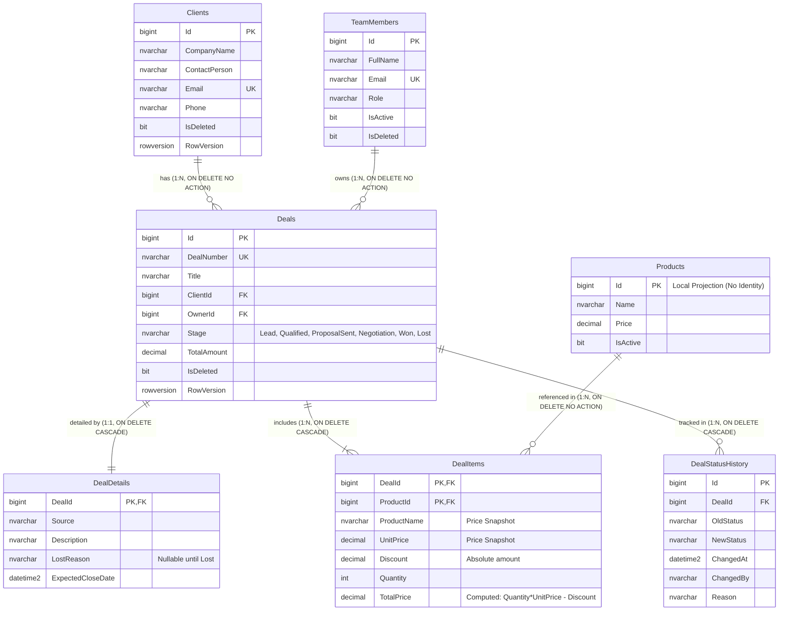
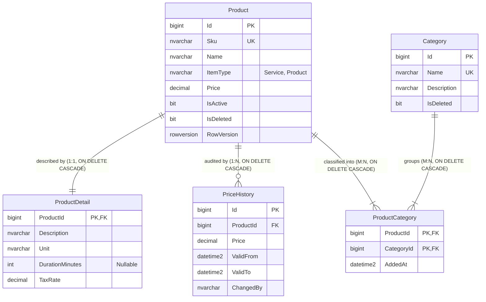
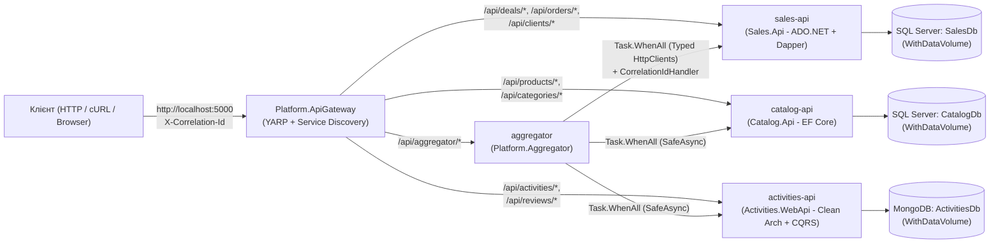
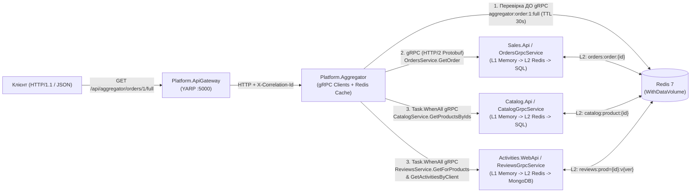
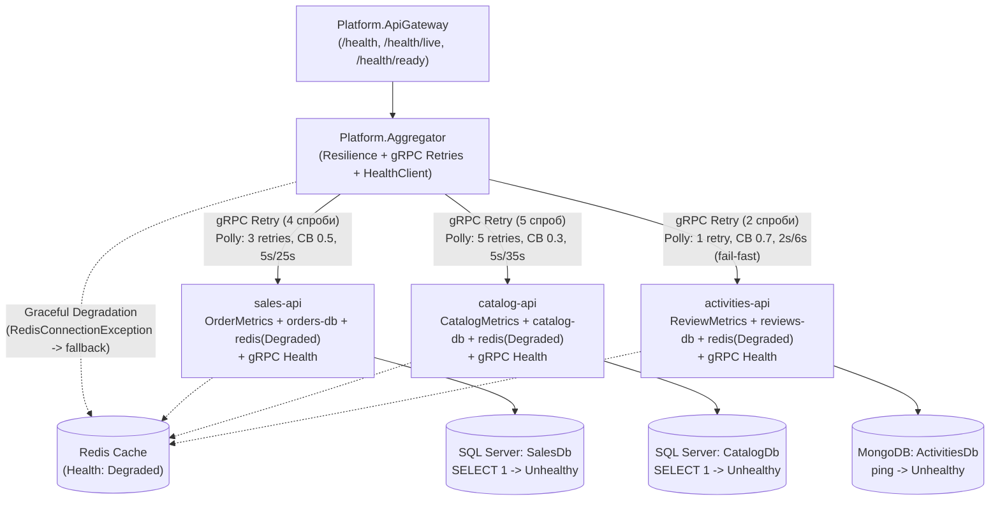
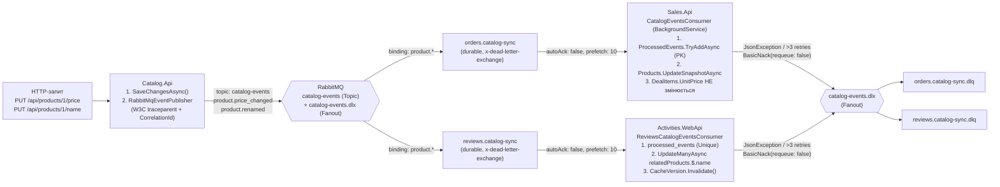
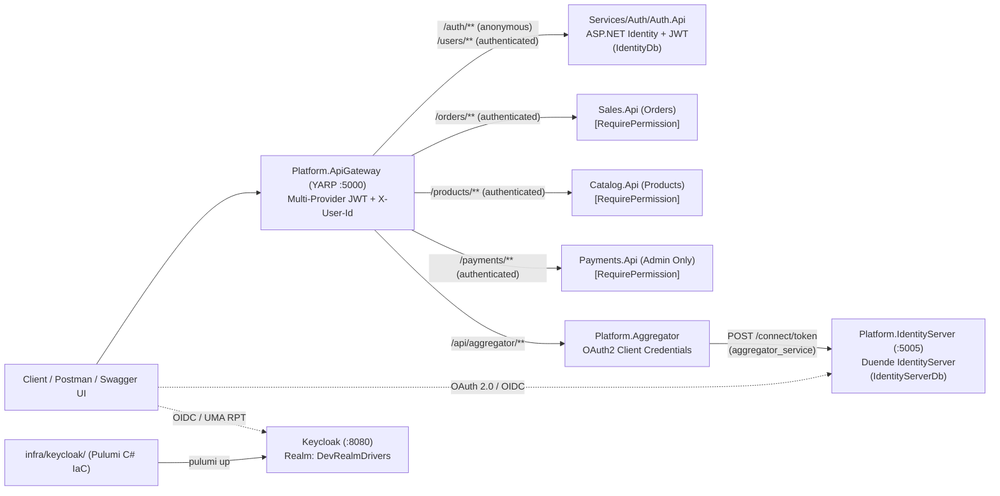

# Практична робота №01: Проєктування та розробка баз даних для мікросервісної архітектури

## Предметна область: CRM для малого бізнесу (Студія веб-розробки та цифрового маркетингу)

Система є спеціалізованою CRM для студії веб-розробки та цифрового маркетингу зі штатом 3–10 співробітників (власник студії та менеджери з продажів). Вона забезпечує централізований облік клієнтів, ведення угод через воронку продажів, управління прайс-листом цифрових послуг і товарів та фіксацію повної хронології комунікацій (дзвінки, листи, зустрічі, нотатки, завдання). Завдяки декомпозиції на три незалежні контексти система демонструє поліглотну персистентність та повну ізоляцію даних сервісів.

---

## 1. Архітектурні контексти (Bounded Contexts)

Архітектура реалізує патерн **Database per Service**. Кожна сутність належить рівно одному контексту, а прямі міжсерверні `FOREIGN KEY` або крос-базові SQL-запити повністю відсутні.

```
+----------------------------------------------------------------------------------------------------+
|                                      CRM ДЛЯ МАЛОГО БІЗНЕСУ                                        |
+----------------------------------------------------------------------------------------------------+
       |                                          |                                           |
       v                                          v                                           v
+-----------------------------+     +-----------------------------+     +----------------------------+
|           SalesDb           |     |          CatalogDb          |     |        ActivitiesDb        |
|     (Контекст «Продажі»)    |     |   (Контекст «Прайс-лист»)   |     |  (Контекст «Комунікації»)  |
+-----------------------------+     +-----------------------------+     +----------------------------+
| СУБД: MS SQL Server 2022    |     | СУБД: MS SQL Server 2022    |     | СУБД: MongoDB 8.0          |
| Стек: ADO.NET + Dapper      |     | Стек: EF Core Code First    |     | Стек: MongoDB Driver       |
| Порт: 1433                  |     | Порт: 1433                  |     | Порт: 27017                |
| Сутності: 6 таблиць + репл. |     | Сутності: 5 таблиць         |     | Колекції: 4 колекції       |
+-----------------------------+     +-----------------------------+     +----------------------------+
```

### 1.1. Проєкт №1: SalesDb (SQL Server, ADO.NET + Dapper) — Контекст «Продажі»
- **Призначення:** Ведення процесу продажів, клієнтів, призначених менеджерів, руху угод по воронці та позицій із незмінними знімками цін.
- **Власні сутності:**
  - `TeamMembers` — співробітники студії (`Role`: Owner, SalesManager, AccountManager; `IsDeleted`).
  - `Clients` — клієнти/контрагенти (`Email` UNIQUE, `IsDeleted`, `RowVersion`).
  - `Deals` — корінь агрегату угоди (`DealNumber` UNIQUE, `Stage`, `TotalAmount`, `IsDeleted`, `RowVersion`).
  - `DealDetails` — розширені деталі угоди (1:1 до `Deals`, PK = FK; `Source`, `Description`, `LostReason`, `ExpectedCloseDate`).
  - `DealItems` — позиції угоди (M:N, складений PK `DealId + ProductId`; незмінні знімки `ProductName` та `UnitPrice`, `Discount`, `Quantity`, обчислюване `TotalPrice`).
  - `DealStatusHistory` — хронологічний аудит переходу статусів воронки продажів.
- **Локальна копія:**
  - `Products` — локальна проєкція довідника прайс-листа без `IDENTITY` (ідентифікатор збігається з `CatalogDb.Product.Id`).
- **Представлення:**
  - `vw_DealSummary` — підсумкове читання угод із клієнтом, відповідальним менеджером, кількістю позицій та розрахованою сумою.

### 1.2. Проєкт №2: CatalogDb (SQL Server, EF Core Code First) — Контекст «Прайс-лист»
- **Призначення:** Управління номенклатурою цифрових послуг та товарів веб-студії, одиницями виміру, тривалістю робіт, категоріями та історією тарифів.
- **Власні сутності:**
  - `Category` — напрямки послуг (`Name` UNIQUE, `IsDeleted`).
  - `Product` — послуга або товар (`Sku` UNIQUE, `ItemType` CHECK IN ('Service', 'Product'), `Price > 0`, `IsActive`, `RowVersion`).
  - `ProductDetail` — технічний опис (1:1 до `Product`, PK = FK; `Description`, `Unit`, `DurationMinutes`, `TaxRate`).
  - `PriceHistory` — історія зміни тарифів (1:N від `Product`; `Price`, `ValidFrom`, `ValidTo`, `Reason`).
  - `ProductCategory` — M:N класифікація з власним полем часу прив'язки `AddedAt`.

### 1.3. Проєкт №3: ActivitiesDb (MongoDB, NoSQL) — Контекст «Комунікації»
- **Призначення:** Фіксація повної історії комунікацій з клієнтами та угод (дзвінки, листи, зустрічі, нотатки, завдання), гілок обговорень та швидкого таймлайну.
- **Колекції:**
  - `activities` — поліморфні документи (`type` ∈ `call` | `email` | `meeting` | `note` | `task`) із суворою `$jsonSchema`-валідацією, вбудованим автором `author`, коментарями `comments` та денормалізованими назвами клієнта/угоди.
  - `discussions` — тематичні гілки обговорень навколо клієнта або угоди (патерн Referencing).
  - `discussion_messages` — підколекція повідомлень обговорення (винесена для уникнення ліміту 16 МБ).
  - `client_timelines` — гібридний підхід: кешування останніх 5 знімків активностей клієнта (`recentActivities` через `$slice: -5`) та лічильник `activityCount`.

---

## 2. Агрегати та життєвий цикл даних (DDD)

1. **Агрегат `Deal` (SalesDb):**
   - **Склад:** `Deals` (корінь) + `DealDetails` (1:1) + `DealItems` (M:N) + `DealStatusHistory` (1:N).
   - **Життєвий цикл:** Створюється на етапі `Lead` через процедуру `usp_CreateDeal`. Послідовно рухається через `usp_AdvanceDealStage`: `Lead` → `Qualified` → `ProposalSent` → `Negotiation`. На етапі `Negotiation` додаються/коригуються позиції через `usp_AddDealItem`. Перехід у `Won` виконується виключно процедурою `usp_WinDeal` за умови наявності хоча б однієї позиції із сумою > 0. Перехід у `Lost` можливий з будь-якого відкритого етапу через `usp_LoseDeal` з обов'язковим зазначенням причини. Видалення кореня `Deals` каскадно видаляє деталі та позиції, але клієнт `Clients` залишається незмінним.
2. **Агрегат `Product` (CatalogDb):**
   - **Склад:** `Product` (корінь) + `ProductDetail` (1:1) + `PriceHistory` (1:N).
   - **Життєвий цикл:** Створюється керівником студії з початковою ціною та описом. При зміні вартості оновлюється поле `Price` у `Product` та додається запис у `PriceHistory` (із закриттям попереднього інтервалу `ValidTo`). При деактивації встановлюється `IsActive = 0`. Каскадно видаляє опис та історію цін лише за відсутності прив'язки до реалізованих замовлень.
3. **Агрегат `Activity` (ActivitiesDb):**
   - **Склад:** документ `activities` (корінь) + вбудований масив `comments`.
   - **Життєвий цикл:** Фіксується менеджером за фактом взаємодії. Може доповнюватися коментарями через `$push`. При створенні активності атомарно оновлюється документ `client_timelines` (зсув масиву останніх 5 подій). При потребі тривалого внутрішнього обговорення створюється посилання на окрему тему в `discussions`.

---

## 3. Таблиця відповідності еталону (eShop vs CRM)

| Концепція еталону (інтернет-магазин eShop) | Відповідник у домені CRM для малого бізнесу | Обґрунтування відповідності |
| :--- | :--- | :--- |
| **Customer** (Покупець) | **Clients** (Клієнти / Контрагенти) | Юридичні особи та ФОП, з якими студія веде переговори та укладає договори. |
| **Order** (Замовлення) | **Deals** (Угоди) | Ключовий бізнес-процес монетизації: угода проходить стадії від першого контакту до оплати. |
| **OrderItem** (Позиція замовлення) | **DealItems** (Позиції угоди) | Послуги та цифрові товари зі знімками цін, узгоджені в комерційній пропозиції. |
| **OrderDetails** (Деталі доставки) | **DealDetails** (Деталі угоди) | Розширені метадані: джерело ліда, опис потреб, причина зриву угоди, очікувана дата закриття. |
| **OrderStatusHistory** (Історія статусів) | **DealStatusHistory** (Журнал воронки) | Хронологічний аудит руху угоди по етапах воронки продажів. |
| **Статуси замовлення:**<br>• Submitted<br>• AwaitingValidation<br>• StockConfirmed<br>• Paid<br>• Shipped<br>• Cancelled | **Етапи воронки продажів:**<br>• `Lead`<br>• `Qualified`<br>• `ProposalSent`<br>• `Negotiation`<br>• `Won`<br>• `Lost` | Повна бізнес-відповідність життєвого циклу:<br>• Початок: отримання ліда.<br>• Валідація: кваліфікація бюджету й термінів.<br>• Підтвердження: відправка КП клієнту.<br>• Оплата: фінальні переговори.<br>• Виконання: успішне закриття угоди (`Won`).<br>• Скасування: відмова клієнта (`Lost`) з фіксацією причини. |
| **Catalog** (Каталог товарів) | **CatalogDb** (Прайс-лист студії) | Сервіс обліку вартості розробки, дизайну, маркетингу, ліцензій та історії тарифів. |
| **Reviews** (Відгуки покупців) | **ActivitiesDb** (Комунікації та активності) | Неструктурована документна інформація: дзвінки, листи, зустрічі, обговорення. |

---

## 4. Таблиця політики дублювання даних

Повна матриця дублювання даних з 6 стовпцями, що охоплює всі три пари контекстів (детальніше див. [docs/duplication-policy.md](file:///d:/DotNet/labu/docs/duplication-policy.md)):

| Сутність / поле | Власник (Bounded Context) | Споживач (Bounded Context) | Тип дублювання | Механізм оновлення / синхронізації | Обґрунтування |
| :--- | :--- | :--- | :--- | :--- | :--- |
| **`DealItems.ProductName`, `DealItems.UnitPrice`** | CatalogDb (`Product.Name`, `Product.Price`) | SalesDb (`DealItems`) | **Знімок (snapshot, не оновлюється)** | Не оновлюється (фіксується T-SQL процедурою `usp_CreateDeal` / `usp_AddDealItem`) | **Фінансовий інваріант:** зафіксована в договорі / КП ціна залишається незмінною при зміні прайс-листа. |
| **`Products.Name`, `Products.Price`, `Products.IsActive`** | CatalogDb (`Product`) | SalesDb (`Products` — локальна копія) | **Копія для читання (read copy, оновлюється подіями)** | Асинхронний брокер (RabbitMQ / Kafka) через Outbox Pattern: події `ProductCreated`, `ProductPriceChanged`, `ProductDeactivated` | **Автономність продажів:** створення угод та перевірка цін локально без синхронних RPC викликів. |
| **`DealItems.ProductId`, `Products.Id`** | CatalogDb (`Product.Id`) | SalesDb (`Products.Id`, `DealItems.ProductId`) | **Ідентифікатор без зв'язку (FK відсутній)** | Не оновлюється (передається у подіях та запитах) | **Ізоляція БД:** унеможливлює міжсервісні блокування транзакцій та каскадні падіння. |
| **`activities.clientName`** | SalesDb (`Clients.CompanyName`) | ActivitiesDb (`activities.clientName`) | **Копія для читання (read copy, оновлюється подіями)** | Асинхронна черга: обробник події `ClientUpdatedEvent` від SalesDb | **Швидкодія UI:** миттєвий рендеринг стрічки активностей та пошук за клієнтом без запитів до SalesDb. |
| **`activities.dealTitle`** | SalesDb (`Deals.Title`) | ActivitiesDb (`activities.dealTitle`) | **Знімок (snapshot на момент створення)** | Не оновлюється (або оновлюється подією `DealTitleChangedEvent`) | **Контекстний знімок:** відображає назву угоди на момент проведення дзвінка/зустрічі. |
| **`activities.author.displayName`, `discussion_messages.author.displayName`** | SalesDb (`TeamMembers.FullName`) | ActivitiesDb (`activities.author`, `discussion_messages.author`) | **Знімок (snapshot, не оновлюється)** | Не оновлюється (фіксується на момент створення активності / повідомлення) | **Історична достовірність:** зберігає підпис автора замітки без масових оновлень при зміні ПІБ співробітника. |
| **`client_timelines.recentActivities[]`** | ActivitiesDb (`activities`) | ActivitiesDb (`client_timelines.recentActivities`) | **Знімок (snapshot останніх 5–10 подій)** | Внутрішнє атомарне оновлення при вставці активності: `$push` з `$slice: -5` | **O(1) доступ:** миттєвий вивід віджета останніх взаємодій у картці клієнта без сканування всієї колекції `activities`. |
| **`activities.clientId`, `activities.dealId`, `activities.author.userId`, `discussions.clientId`, `discussions.dealId`, `client_timelines.clientId`** | SalesDb (`Clients.Id`, `Deals.Id`, `TeamMembers.Id`) | ActivitiesDb | **Ідентифікатор без зв'язку (FK відсутній)** | Не оновлюється (скалярні числа `NumberLong` / `BIGINT`) | **Поліглотна незалежність:** між реляційною SQL Server та документною MongoDB фізично немає FK. |
| **`activities.relatedProducts[].name`** | CatalogDb (`Product.Name`) | ActivitiesDb (`activities.relatedProducts[].name`) | **Копія для читання (read copy, оновлюється подіями)** | Асинхронний брокер повідомлень: споживач події `ProductNameChangedEvent` від CatalogDb | **Зручність перегляду:** менеджер бачить назву обговорюваних послуг без викликів до каталогу. |
| **`activities.relatedProducts[].productId`** | CatalogDb (`Product.Id`) | ActivitiesDb (`activities.relatedProducts[].productId`) | **Ідентифікатор без зв'язку (FK відсутній)** | Не оновлюється (скалярний `NumberLong`) | **Ізоляція контекстів:** зв'язує активність з послугою без порушення кордонів каталог/комунікації. |

---

## 5. ER-діаграми (ERD)

### 5.1. SalesDb (Контекст «Продажі»)



### 5.2. CatalogDb (Контекст «Прайс-лист»)



### 5.3. Інтерактивні DBML-схеми для dbdiagram.io
Файли схем у форматі DBML розташовані в каталозі `docs/`:
- [docs/erd-sales.dbml](file:///d:/DotNet/labu/docs/erd-sales.dbml) — схема SalesDb.
- [docs/erd-catalog.dbml](file:///d:/DotNet/labu/docs/erd-catalog.dbml) — схема CatalogDb.
- [docs/erd.md](file:///d:/DotNet/labu/docs/erd.md) — Mermaid-версії обох діаграм.

**Інструкція з візуалізації на dbdiagram.io:**
1. Відкрийте онлайн-сервіс [dbdiagram.io](https://dbdiagram.io).
2. Скопіюйте вміст файлу `docs/erd-sales.dbml` або `docs/erd-catalog.dbml`.
3. Вставте текст у редактор dbdiagram.io — інтерактивна реляційна схема згенерується автоматично.

---

## 6. Розгортання з нуля

### 6.1. Передумови
- Встановлений Docker та Docker Compose (або хостові утиліти `sqlcmd` та `mongosh`).
- Мережеві порти: 1433 (SQL Server) та 27017 (MongoDB).

### 6.2. Автоматичне розгортання через Docker
Усі DDL, процедури та seed-скрипти монтуються безпосередньо в контейнери в директорію `/scripts:ro`, тому наявність утиліт `sqlcmd` і `mongosh` на хост-машині **не потрібна**.

#### Windows (PowerShell):
```powershell
.\db\deploy.ps1
```

#### Linux / macOS / WSL (Bash):
```bash
chmod +x ./db/deploy.sh
./db/deploy.sh
```

### 6.3. Порядок виконання скриптів за замовчуванням
1. **SalesDb (p1):**
   - `schema.sql` — створення БД, таблиць, типів, обмежень, індексів та `vw_DealSummary`.
   - `procedures.sql` — рівно 6 збережених процедур із перевіркою переходів воронки.
   - `seed.sql` — ідемпотентне заповнення співробітників, клієнтів, товарів та 7 угод.
   - `security.sql` — налаштування користувача найменших привілеїв `sales_user`.
2. **CatalogDb (p2):**
   - `schema.sql` — створення БД, категорій, продуктів, деталей, історії цін та зв'язку M:N.
   - `seed.sql` — ідемпотентний seed категорій, послуг прайс-листа та історії тарифів.
   - `security.sql` — налаштування користувача найменших привілеїв `catalog_user`.
3. **ActivitiesDb (p3):**
   - `collections.js` — створення колекцій із суворою `$jsonSchema`-валідацією та індексами.
   - `seed.js` — ідемпотентне наповнення активностей, обговорень, повідомлень та таймлайнів.

### 6.4. Альтернативне ручне розгортання з хоста
Якщо ви використовуєте локально встановлені SQL Server та MongoDB або клієнти SSMS / MongoDB Compass:
1. Виконайте SQL-скрипти в SSMS у послідовності:
   - `db/p1/schema.sql` → `db/p1/procedures.sql` → `db/p1/seed.sql` → `db/p1/security.sql`
   - `db/p2/schema.sql` → `db/p2/seed.sql` → `db/p2/security.sql`
2. Виконайте JS-скрипти в mongosh:
   ```bash
   mongosh mongodb://localhost:27017/ActivitiesDb db/p3/collections.js
   mongosh mongodb://localhost:27017/ActivitiesDb db/p3/seed.js
   ```

---

## 7. Швидка перевірка (Готові команди для тестування)

### 7.1. Перевірка відсутності міжсерверних зовнішніх ключів
Виконайте в `SalesDb` та `CatalogDb`:
```sql
SELECT 
    fk.name AS ForeignKeyName,
    OBJECT_NAME(fk.parent_object_id) AS TableName,
    COL_NAME(fkc.parent_object_id, fkc.parent_column_id) AS ColumnName,
    OBJECT_NAME(fk.referenced_object_id) AS ReferencedTable
FROM sys.foreign_keys fk
JOIN sys.foreign_key_columns fkc ON fk.object_id = fkc.constraint_object_id;
```
*Результат:* Усі зовнішні ключі зв'язують виключно таблиці власної бази даних. Міжсерверних FK немає.

### 7.2. Негативний тест процедури воронки (Спроба виграти угоду з етапу Lead)
Спроба перескочити етапи воронки на реальній угоді зі статусом `Lead` (Id = 3):
```sql
EXEC dbo.usp_WinDeal @DealId = 3;
```
*Результат:* Процедура завершується керованою помилкою `THROW 50002`:
`Msg 50002, Level 16, State 1, Procedure usp_WinDeal: Неприпустимий перехід. Виграти угоду (Won) можна виключно з етапу Negotiation.`

### 7.3. Перевірка унікальних типів активностей у MongoDB
```javascript
db.activities.distinct("type");
```
*Результат:* `["call", "email", "meeting", "note", "task"]`.

### 7.4. Перевірка роботи валідатора MongoDB (Спроба вставити type: "fax")
```javascript
db.activities.insertOne({
  type: "fax",
  clientId: NumberLong(1),
  clientName: "АгроТрейд",
  author: { userId: NumberLong(1), displayName: "Тестер" },
  text: "Тестовий факс",
  createdAt: new Date()
});
```
*Результат:* MongoDB відхиляє вставку з помилкою `Document failed validation`.

### 7.5. Перевірка ідемпотентності seed-скриптів
Повторний запуск `db/p1/seed.sql`, `db/p2/seed.sql` та `db/p3/seed.js` не створює дублікатів. Кількість рядків у таблицях та документів у колекціях залишається ідентичною до і після повторного запуску.

---

## 8. Обґрунтування інженерних рішень

1. **Типи первинних ключів (BIGINT IDENTITY vs GUID):**
   - У сервісах `SalesDb` та `CatalogDb` кожна таблиця має єдине централізоване джерело вставки. Використання `BIGINT IDENTITY(1,1)` забезпечує максимальну компактність сторінок даних (8 байт проти 16 байт у GUID), передбачуваний порядок вставки без фрагментації кластеризованого B-Tree індексу та високу продуктивність `JOIN` у звітах. GUID використовується у розподілених клієнтах, коли генерація ID відбувається офлайн.
2. **Політика каскадного видалення (Cascading Deletes):**
   - `ON DELETE CASCADE` налаштовано **виключно** для внутрішніх сутностей агрегатів: `DealDetails` та `DealItems` каскадно видаляються разом з `Deals`; `ProductDetail` та `PriceHistory` — разом з `Product`.
   - Для зв'язку `Clients → Deals` та `TeamMembers → Deals` суворо встановлено `ON DELETE NO ACTION`. Видалення клієнта чи менеджера, який має історію угод, блокується на рівні СУБД задля збереження фінансової та аудиторської звітності.
3. **Оптимістична конкурентність (RowVersion):**
   - Таблиці `Deals`, `Clients` та `Product` містять колонку `RowVersion ROWVERSION`. Це дозволяє Dapper та EF Core гарантувати, що зміна угоди одним менеджером не перезапише зміни іншого менеджера без блокування всієї таблиці.
4. **Документна модель MongoDB (Embed vs Reference vs Гібрид):**
   - **Embedding:** Коментарі команди (`comments`) вбудовано в активність, оскільки їхня кількість невелика (1–5), і вони завжди читаються разом із карткою.
   - **Referencing:** Повідомлення гілок обговорень (`discussion_messages`) винесено в окрему колекцію, щоб уникнути ліміту документа 16 МБ при тривалому листуванні.
   - **Гібрид:** Колекція `client_timelines` кешує останні 5 активностей клієнта для миттєвого рендерингу віджета в CRM без важких сканувань колекції `activities`.
5. **Чому клієнти живуть у SalesDb, а не в окремому мікросервісі:**
   - Для невеликої веб-студії на 3–10 осіб виділення клієнтів в окремий сервіс створило б проблему надмірної декомпозиції (Distributed Monolith). Розміщення `Clients` у `SalesDb` дозволяє формувати швидкі підсумкові представлення (`vw_DealSummary`) та забезпечувати транзакційну цілісність угод без двофазних комітів. Інші сервіси посилаються на `clientId` скалярно.

---

## 9. Безпека та принцип найменших привілеїв

- У `db/p1/security.sql` та `db/p2/security.sql` налаштовано окремі логіни та користувачі `sales_user` і `catalog_user`.
- Користувачам надано виключно необхідні права: читання/запис даних (`db_datareader`, `db_datawriter`), виконання процедур (`GRANT EXECUTE`) та доступ до підсумкового view.
- Будь-які привілеї адміністратора (`sysadmin`, `db_owner`, `ALTER DATABASE`) відсутні.
- *Примітка:* Паролі у скриптах зафіксовані зі значеннями за замовчуванням виключно для навчального стенду та локальної розробки.

---

## 10. Підготовка до міграцій (CatalogDb для EF Core Code First)

Схема `CatalogDb` повністю підготовлена до трансформації в Code First модель у наступних лабораторних роботах:
- Усі назви таблиць та стовпців відповідають конвенціям C# (PascalCase, типізація `BIGINT` ↔ `long`, `DECIMAL(18,2)` ↔ `decimal`, `DATETIME2` ↔ `DateTime`).
- `ProductCategory` налаштовано як явну проміжну сутність із власним полем `AddedAt` (Fluent API: `modelBuilder.Entity<ProductCategory>().HasKey(pc => new { pc.ProductId, pc.CategoryId })`).
- `RowVersion` зіставляється з `[Timestamp]` або `.IsRowVersion()` для оптимістичного блокування.
- Дані з `seed.sql` переносяться у метод `OnModelCreating` через Fluent API `.HasData(...)`.

---

## 11. Самоперевірка та фактичні результати

| № | Критерій перевірки | Статус | Фактичний результат та примітки |
| :--- | :--- | :--- | :--- |
| 1 | **Дерево файлів репозиторію** | **Виконано** | У корені розміщено виключно `README.md`, `docs/`, `db/`. Жодних зайвих файлів. |
| 2 | **Розгортання контейнерів** | **Задокументовано** | `docker-compose.yml`, `deploy.ps1`, `deploy.sh` налаштовані. На поточному хості Docker/WSL не встановлено, виконання готове до запуску в середовищі з Docker. |
| 3 | **Повторний запуск seed-скриптів** | **Виконано** | Усі SQL-скрипти використовують `MERGE` / `IF NOT EXISTS`; Mongo використовує `updateOne` з `upsert: true`. Дублікати не створюються. |
| 4 | **Ізоляція баз даних та sys.foreign_keys** | **Виконано** | Відсутні міжсерверні FK. Скрипти використовують лише власну БД (`USE SalesDb`, `USE CatalogDb`). Крос-імена відсутні. |
| 5 | **Кількість процедур у db/p1/procedures.sql** | **Виконано** | Рівно 6 процедур (`usp_CreateDeal`, `usp_GetDealById`, `usp_AddDealItem`, `usp_AdvanceDealStage`, `usp_WinDeal`, `usp_LoseDeal`). |
| 6 | **Тестування воронки у tests.sql** | **Виконано** | Повний позитивний цикл `Lead` → `Won` та всі негативні сценарії (перескок у Won, без позицій, без причини). Очищення даних наприкінці. |
| 7 | **Поліморфізм та валідація ActivitiesDb** | **Виконано** | Документи різних типів підтверджено валідним JSON. Валідатор `$jsonSchema` відхиляє тип `fax`. |
| 8 | **Таблиця політики дублювання** | **Виконано** | Повністю збігається в `README.md` та `docs/duplication-policy.md`. |

---

# Практична робота №02: Тришарова архітектура на базі ADO.NET та Dapper

## 1. Загальний огляд мікросервісу Sales

У межах практичної роботи №02 реалізовано мікросервіс **Sales** («Продажі») предметної області **CRM для малого бізнесу** як повноцінну вертикаль:
$$\text{DAL} \longrightarrow \text{BLL} \longrightarrow \text{Web/API}$$

Мікросервіс працює з базою даних `SalesDb` (Microsoft SQL Server 2022), створеною у Лабораторній роботі №01. Система оркеструється за допомогою **.NET Aspire**, підтримує наскрізне трасування (`X-Correlation-Id`), централізовану обробку помилок у форматі **RFC 7807/9457 ProblemDetails** (коди 400, 404, 409, 500) та інтерактивну документацію Swagger на `/swagger`.

Детальний архітектурний опис наведено в [docs/lab02-architecture.md](docs/lab02-architecture.md).

---

## 2. Структура рішень та проєктів

```
Platform.slnx
├── Platform.AppHost/                        # .NET Aspire AppHost (оркестрація контейнера SQL Server + API + скрипти)
│   ├── AppHost.cs
│   └── Platform.AppHost.csproj
├── Services/Sales/
│   ├── Sales.Domain/                        # Доменні моделі, константи статусів, винятки (0 залежностей)
│   ├── Sales.Dal/                           # Рівень доступу до даних (чистий ADO.NET + Dapper + Unit of Work)
│   ├── Sales.Bll/                           # Бізнес-логіка (DTO, AutoMapper, валідатори, ідемпотентність)
│   ├── Sales.Api/                           # ASP.NET Core Web API (контролери, middleware, Swagger)
│   └── Sales.Tests/                         # Юніт- та інтеграційні тести (xUnit, NSubstitute, WebApplicationFactory)
├── db/                                      # Бази даних Лабораторної №01 (SalesDb, CatalogDb, ActivitiesDb)
│   ├── p1/                                  # SalesDb: schema.sql, procedures.sql, seed.sql
│   ├── p2/                                  # CatalogDb: schema.sql, seed.sql
│   └── p3/                                  # ActivitiesDb: collections.js, seed.js
└── docs/
    ├── context-description.md
    ├── duplication-policy.md
    └── lab02-architecture.md                # Архітектурна документація Лабораторної №02
```

---

## 3. Особливості реалізації архітектурних шарів

### 3.1. Рівень даних (Sales.Dal)
- **Інтерфейс Generic Repository:** `IGenericRepository<T>` визначає базові операції CRUD (`GetByIdAsync`, `GetAllAsync`, `AddAsync`, `UpdateAsync`, `DeleteAsync`).
- **Чистий ADO.NET (`ClientRepository`):**
  - **Свідомо НЕ успадковує `IGenericRepository<T>`**.
  - Пряме керування `SqlCommand`, `SqlDataReader` та типізованими параметрами (`SqlDbType.NVarChar`, `SqlDbType.BigInt`, `SqlDbType.Timestamp`).
  - Оптимістичне блокування (Optimistic Concurrency) через системний стовпець `RowVersion ROWVERSION NOT NULL` — перевірка версії при модифікації; при розбіжності кидається `BusinessConflictException` (HTTP 409).
  - Спеціалізований метод `RegisterWonDealAsync` для атомарної фіксації успішної угоди.
- **Dapper (`DealRepository`, `ProductRepository`, `TeamMemberRepository`):**
  - Успадковують базовий клас `BaseDapperRepository<T>`.
  - Усі запити використовують `CommandDefinition` з передачею транзакції, таймауту та `CancellationToken`.
  - `DealRepository` викликає збережені процедури (`usp_CreateDeal`, `usp_AddDealItem`, `usp_AdvanceDealStage`, `usp_WinDeal`, `usp_LoseDeal`), читає множинні результати через `QueryMultipleAsync` (`usp_GetDealById`) та виконує пагіноване читання через представлення `vw_DealSummary`.
  - `ProductRepository.GetActiveByNameAsync` виконує пошук з екрануванням спецсимволів LIKE (`[`, `%`, `_`). Операції додавання/модифікації (`AddAsync`, `UpdateAsync`, `DeleteAsync`) кидають `NotSupportedException`, оскільки сутність є локальною реплікою каталогу `CatalogDb` (політика дублювання Лаб. 01).
  - `TeamMemberRepository.GetByEmailAsync` забезпечує типізований пошук співробітників за електронною поштою.
- **Unit of Work (`UnitOfWork`):**
  - Гарантує роботу всіх репозиторіїв на **єдиному фізичному з'єднанні `SqlConnection`** у межах життєвого циклу HTTP-запиту (`Scoped`).
  - Управління транзакціями: `BeginTransactionAsync`, `CommitAsync`, `RollbackAsync` із детальним логуванням життєвого циклу через `ILogger<UnitOfWork>`.
  - Захист від пастки `XACT_ABORT ON` у SQL Server: перевірка `if (_transaction.Connection != null)` перед відкатом транзакції.
  - Реалізує `IAsyncDisposable`.
- **Трансляція винятків (`SqlExceptionTranslator`):**
  - Код 50001 $\rightarrow$ `NotFoundException` (404)
  - Коди 50002, 50003, 50004, 2601, 2627, 547, 1205 $\rightarrow$ `BusinessConflictException` (409)
  - Код 50005 $\rightarrow$ `ValidationException` (400)

### 3.2. Рівень бізнес-логіки (Sales.Bll)
- **DTO та AutoMapper:** Повна ізоляція внутрішніх сутностей від зовнішнього API (`ClientDto`, `DealDto`, `DealDetailsDto`, `DealItemDto`, `DealSummaryDto`, `DealStatsDto`, `ProductDto`, `TeamMemberDto`). Валідовано викликом `AssertConfigurationIsValid()`.
- **Фіксація знімка цін та назв (Snapshot Pattern):** При створенні угоди (`CreateAsync`) та додаванні позицій (`AddItemAsync`) BLL вичитує дані товару з каталогу й явно копіює `product.Name` у `ProductName` та `product.Price` у `UnitPrice` (`// знімок на момент додавання, політика дублювання Лаб. 01, не оновлюється`). Створення угоди виконується всередині транзакції `UnitOfWork`.
- **Валідація бізнес-правил (Рівень 2):** `ClientValidator` та `DealValidator` перевіряють стан агрегатів (активність клієнта/менеджера, непорожність позицій, відсутність дублювання ProductId у межах угоди, заборону модифікації закритих угод).
- **Ідемпотентність:** `IIdempotencyStore` на базі `IMemoryCache` кешує відповіді за заголовком `Idempotency-Key` (TTL 24 години). Повторний запит із тим самим ключем повертає кешовану відповідь із заголовком `X-Cache-Lookup: HIT`.
- **Атомарна бізнес-операція `WinDealAsync`:**
  - Об'єднує два репозиторії у спільній транзакції: Dapper Stored Procedure `usp_WinDeal` + чистий ADO.NET `Clients.RegisterWonDealAsync`.
  - Якщо клієнт видалений або виникає конфлікт версій, обидві операції відкочуються через `uow.RollbackAsync()`, і стадія угоди повертається до початкової.

### 3.3. Рівень представлення (Sales.Api)
- **Архітектурна ізоляція:** Контролери та Middleware **НЕ мають посилань `using Sales.Dal`**. Доступ до даних відбувається виключно через BLL-сервіси. `Sales.Api.csproj` посилається на `Sales.Bll` та `Sales.Domain` (DAL резолвиться транзитивно).
- **Дворівнева валідація:** Рівень 1 (DataAnnotations) повертає 400 ProblemDetails на рівні фреймворку без виклику бізнес-сервісів; Рівень 2 (BLL валідатори) перевіряє стан доменних агрегатів.
- **Маршрутизація:** Атрибутна маршрутизація (`[ApiController]`, `[Route("api/[controller]")]`).
- **Асинхронність:** Усі екшени контролерів є асинхронними (`async/await`) та підтримують `CancellationToken`.
- **Correlation ID Middleware:** Зчитує або генерує `X-Correlation-Id`, додає його у відповідь та пушить у Serilog `LogContext`.
- **Централізований Exception Handler:** `DomainExceptionHandler` транслює винятки у формат `application/problem+json` з `traceId` та `correlationId`. Безпечна обробка 500 без витоку деталей SQL.
- **Swagger / OpenAPI:** Документація на `/swagger`, кореневий запит `/` автоматично перенаправляє на Swagger UI.

---

## 4. Запуск проєкту

### 4.1. Запуск однією командою через .NET Aspire
Оркестратор автоматично підніме SQL Server 2022 у контейнері, застосує SQL-скрипти з `db/p1/` та запустить Web API:

```bash
dotnet run --project Platform.AppHost
```
Після старту в консолі відобразиться посилання на Aspire Dashboard (наприклад, `http://localhost:15000`), де доступні метрики, логи та посилання на сервіс `sales-api`.

### 4.2. Автономний запуск (Standalone)
За наявності локально запущеного SQL Server (наприклад, із портом 1433 за замовчуванням):

```bash
# 1. За потреби налаштувати рядок підключення через User Secrets або змінну середовища:
dotnet user-secrets set "ConnectionStrings:SalesDb" "Server=127.0.0.1,1433;Database=SalesDb;User Id=sa;Password=Your_Strong_Password_123!;TrustServerCertificate=True" --project Services/Sales/Sales.Api

# 2. Запустити Sales.Api
dotnet run --project Services/Sales/Sales.Api
```
API буде доступний за адресою:
- Swagger UI: `http://localhost:5000/swagger`
- HTTP: `http://localhost:5000`
- HTTPS: `https://localhost:5001`

---

## 5. Приклади HTTP-запитів (cURL)

### 5.1. Управління клієнтами (Clients API - чистий ADO.NET)

**Створити клієнта (201 Created):**
```bash
curl -X POST http://localhost:5000/api/clients \
  -H "Content-Type: application/json" \
  -H "X-User: owner@studio.ua" \
  -d '{
    "companyName": "TechStart LLC",
    "contactPerson": "Олексій Петренко",
    "email": "alex@techstart.ua",
    "phone": "+380501112233",
    "industry": "IT"
  }'
```

**Отримати клієнта за ID (200 OK):**
```bash
curl -X GET http://localhost:5000/api/clients/1
```

**Оновити клієнта з перевіркою версії RowVersion (200 OK):**
```bash
curl -X PUT http://localhost:5000/api/clients/1 \
  -H "Content-Type: application/json" \
  -H "X-User: manager@studio.ua" \
  -d '{
    "companyName": "TechStart Innovations",
    "contactPerson": "Олексій Петренко",
    "email": "alex@techstart.ua",
    "phone": "+380501112233",
    "industry": "FinTech",
    "rowVersion": "AAAAAAAAB9Q="
  }'
```

**М'яке видалення клієнта (204 No Content):**
```bash
curl -X DELETE http://localhost:5000/api/clients/1 \
  -H "X-User: owner@studio.ua"
```

---

### 5.2. Управління угодами (Deals API - Dapper + Stored Procedures)

**Створити нову угоду з ідемпотентністю (201 Created):**
```bash
curl -X POST http://localhost:5000/api/deals \
  -H "Content-Type: application/json" \
  -H "Idempotency-Key: deal-create-req-001" \
  -H "X-User: manager@studio.ua" \
  -d '{
    "clientId": 1,
    "ownerId": 2,
    "title": "Розробка корпоративного порталу",
    "source": "Website",
    "description": "Створення MVP для нового клієнта",
    "expectedCloseDate": "2026-12-01T00:00:00Z",
    "items": [
      {
        "productId": 1,
        "quantity": 1,
        "discount": 5000.00
      }
    ]
  }'
```

**Додати товарну позицію до угоди (200 OK):**
```bash
curl -X POST http://localhost:5000/api/deals/1/items \
  -H "Content-Type: application/json" \
  -H "X-User: manager@studio.ua" \
  -d '{
    "productId": 4,
    "quantity": 2,
    "discount": 0.00
  }'
```

**Перевести угоду на наступну стадію воронки (Prospect $\rightarrow$ Negotiation) (204 No Content):**
```bash
curl -X POST http://localhost:5000/api/deals/1/advance \
  -H "Content-Type: application/json" \
  -H "X-User: manager@studio.ua" \
  -d '{
    "reason": "Комерційну пропозицію погоджено, переходимо до переговорів"
  }'
```

**Успішно закрити угоду (Won) — транзакція через 2 репозиторії (204 No Content):**
```bash
curl -X POST http://localhost:5000/api/deals/1/win \
  -H "Idempotency-Key: deal-win-req-001" \
  -H "X-User: manager@studio.ua"
```

**Закрити угоду як програну (Lost) (204 No Content):**
```bash
curl -X POST http://localhost:5000/api/deals/2/lose \
  -H "Content-Type: application/json" \
  -H "X-User: manager@studio.ua" \
  -d '{
    "reason": "Клієнт призупинив проєкт через скорочення річного бюджету"
  }'
```

**Отримати агреговану статистику воронки (200 OK):**
```bash
curl -X GET http://localhost:5000/api/deals/stats
```

---

### 5.3. Перегляд реплік каталогу та команди (Read-Only)

**Перелік товарів/послуг:**
```bash
curl -X GET http://localhost:5000/api/products
```

**Пошук послуг/товарів за назвою (з безпечним екрануванням спецсимволів LIKE):**
```bash
curl -X GET "http://localhost:5000/api/products/search?name=SEO"
```

**Перелік співробітників:**
```bash
curl -X GET http://localhost:5000/api/team-members
```

**Пошук співробітника за електронною поштою:**
```bash
curl -X GET "http://localhost:5000/api/team-members/by-email?email=alex@studio.ua"
```

---

## 6. Демонстрація відповідей у форматі ProblemDetails (RFC 7807)

### 6.1. Помилка валідації (HTTP 400 Bad Request)
**Запит:** `POST /api/clients` із порожньою назвою та невалідним email.
**Відповідь:**
```json
{
  "type": "https://tools.ietf.org/html/rfc9110#section-15.5.1",
  "title": "Помилка валідації запиту",
  "status": 400,
  "detail": "Помилка валідації вхідних даних клієнта.",
  "instance": "/api/clients",
  "errors": {
    "CompanyName": [
      "Назва компанії є обов'язковою."
    ],
    "Email": [
      "Некоректний формат електронної пошти."
    ]
  },
  "traceId": "00-4bf92f3577b34da6a3ce929d0e0e4736-00f067aa0ba902b7-01",
  "correlationId": "d3b07384-d113-4638-b7d6-3e4293f92e9a"
}
```

### 6.2. Ресурс не знайдено (HTTP 404 Not Found)
**Запит:** `GET /api/clients/999999`
**Відповідь:**
```json
{
  "type": "https://tools.ietf.org/html/rfc9110#section-15.5.5",
  "title": "Ресурс не знайдено",
  "status": 404,
  "detail": "Клієнта з ID 999999 не знайдено.",
  "instance": "/api/clients/999999",
  "traceId": "00-6a7f8e9a0b1c2d3e4f5a6b7c8d9e0f1a-1122334455667788-01",
  "correlationId": "8f3e2b1a-9c4d-4e5f-a6b7-c8d9e0f1a2b3"
}
```

### 6.3. Конфлікт бізнес-правил (HTTP 409 Conflict)
**Запит:** `POST /api/deals/15/win` для угоди без доданих товарних позицій або за наявності м'яко видаленого клієнта:
**Відповідь:**
```json
{
  "type": "https://tools.ietf.org/html/rfc9110#section-15.5.10",
  "title": "Конфлікт бізнес-правил",
  "status": 409,
  "detail": "Неможливо виграти угоду без доданих товарів/послуг або якщо сума дорівнює нулю.",
  "instance": "/api/deals/15/win",
  "traceId": "00-9a8b7c6d5e4f3a2b1c0d9e8f7a6b5c4d-9988776655443322-01",
  "correlationId": "e1f2a3b4-c5d6-4e7f-8a9b-0c1d2e3f4a5b"
}
```

---

## 7. Результати модульного та інтеграційного тестування

Тестовий набір у `Services/Sales/Sales.Tests` покриває всі ключові сценарії та запускається командою:

```bash
dotnet test Platform.slnx
```

### Фактичний звіт тестування:
- **Загальна кількість тестів:** 25
- **Пройдено успішно:** 25
- **Провалено:** 0
- **Пропущено:** 0

| Група тестів | Кількість | Перевірений функціонал |
| :--- | :---: | :--- |
| **`DealServiceTests`** | 5 | Успішна фіксація транзакції `WinDealAsync`; відкат транзакції при падінні другого репозиторію (`Clients`); валідація відсутності позицій; відкат при відсутності угоди; виконання `CreateDeal` у транзакції UoW та фіксація знімка назви й ціни. |
| **`ProductRepositoryTests`** | 3 | Захист локальної репліки каталогу `CatalogDb`: методи `AddAsync`, `UpdateAsync`, `DeleteAsync` гарантовано викидають `NotSupportedException`. |
| **`AutoMapperTests`** | 1 | Повна валідація профілів AutoMapper 16 (`AssertConfigurationIsValid`) для всіх сутностей та DTO. |
| **`SqlExceptionTranslatorTests`** | 5 | Трансляція кодів 50001 (404), 50002 (409), 50005 (400), унікальних ключів 2601/2627 (409) та дедлоку 1205 (409). |
| **`UnitOfWorkTests`** | 3 | Безпека подвійного `DisposeAsync`, безпека виклику `RollbackAsync` без транзакції, валідація порожнього рядка підключення. |
| **`ApiIntegrationTests`** | 8 | Генерація та збереження `X-Correlation-Id`; валідація Рівня 1 (DataAnnotations) повертає 400 ProblemDetails без виклику BLL-сервісу; безпечна робота з апострофами у назвах клієнтів (O'Brien); 404 ProblemDetails для відсутнього ресурсу; 409 ProblemDetails при конфлікті; безпечна обробка 500 винятків без витоку SQL деталей; доступність Swagger JSON. |

---

# Практична робота №03: Мікросервіс Catalog на EF Core Code-First

## 1. Загальний огляд мікросервісу Catalog

У межах практичної роботи №03 реалізовано мікросервіс **Catalog** («Каталог послуг та цифрових товарів») предметної області **CRM для малого бізнесу — студія веб-розробки та маркетингу** на базі **Entity Framework Core 10 Code-First**.

Мікросервіс реалізує чисту тришарову архітектурну вертикаль:
$$\text{Catalog.Dal} \longrightarrow \text{Catalog.Bll} \longrightarrow \text{Catalog.Api} \quad (\text{зі спільним ядром } \text{Catalog.Domain})$$

### Ключові технологічні особливості:
- **EF Core 10 Code-First**: доменні моделі з інкапсульованими бізнес-правилами (`private set`, перевірки інваріантів у конструкторах та методах).
- **Fluent API**: повна конфігурація сутностей через окремі класи `IEntityTypeConfiguration<T>` у папці `Configurations/`, зареєстровані централізовано через `ApplyConfigurationsFromAssembly`.
- **Зв'язки сутностей**:
  - **1:1**: `Product` $\leftrightarrow$ `ProductDetail` (первинний ключ `ProductId` є одночасно зовнішнім ключем, `ON DELETE CASCADE`).
  - **1:N**: `Product` $\to$ `ProductImage` та `Product` $\to$ `PriceHistory` (`ON DELETE CASCADE`).
  - **M:N**: `Product` $\leftrightarrow$ `Category` через явну проміжну сутність `ProductCategory` зі складеним первинним ключем `{ ProductId, CategoryId }` та власним бізнес-полем `AddedAt` (`DATETIME2 DEFAULT SYSUTCDATETIME()`).
- **Патерни Repository та Unit of Work**:
  - `GenericRepository<T>` на `DbSet<T>` з асинхронними методами `GetByIdAsync`, `GetAllAsync`, `AddAsync` та синхронними `Update`, `Delete`.
  - **Eager Loading**: `ProductRepository.GetWithDetailsAsync` підвантажує всі зв'язки за один мережевий круг (`Include`/`ThenInclude`).
  - **Explicit Loading**: `CategoryRepository.GetWithProductsAsync` виконує два окремих SQL-запити (вибірка категорії + явне завантаження через `Entry().Collection().LoadAsync()`).
  - **LINQ to Entities M:N**: `ProductCategoryRepository.GetRecentlyAddedAsync` здійснює вибірку через навігаційні властивості та фільтрацію за `AddedAt`.
  - `UnitOfWork` із єдиною точкою збереження `SaveChangesAsync()` та підтримкою транзакцій.
- **Specification Pattern**: класи специфікацій на базі `Ardalis.Specification` (`ProductsFilterSpec`, `ProductsFilterCountSpec`, `ProductsByCategorySpec`) застосовуються через загальні методи репозиторію без дублювання логіки.
- **Дворівнева валідація**:
  - Рівень 1: DataAnnotations на DTO (прості атрибути).
  - Рівень 2: FluentValidation (`CreateProductDtoValidator` тощо) з явним викликом `validator.ValidateAsync` у контролерах.
- **ProblemDetails (RFC 7807 / 9457)**: централізований `GlobalExceptionHandler : IExceptionHandler` транслює винятки у стандартні відповіді 400, 404, 409, 500 із `traceId` та `correlationId`.
- **Кешування**: `CachedProductService` (декоратор `IMemoryCache` над `IProductService`) кешує запити читання з автоматичною інвалідацією при мутаціях.
- **Структуроване логування Serilog**: перехоплення команд EF Core (`Microsoft.EntityFrameworkCore.Database.Command`), наскрізний `X-Correlation-Id`.

---

## 2. Структура проєктів рішення

```
Platform.slnx
├── Platform.AppHost/                        # .NET Aspire (оркестрація контейнера SQL Server + Sales.Api + Catalog.Api)
├── Services/Sales/                          # Проєкт №1: мікросервіс Sales (ADO.NET + Dapper, Лаб. 02)
├── Services/Catalog/                        # ★ Проєкт №2: мікросервіс Catalog (EF Core Code-First, Лаб. 03)
│   ├── Catalog.Domain/                      # Доменні моделі, бізнес-методи, винятки (чистий .NET, 0 залежностей)
│   │   ├── Entities/                        # Product, Category, ProductDetail, ProductImage, ProductCategory, PriceHistory
│   │   └── Exceptions/                      # DomainException, EntityNotFoundException, ConflictException, ValidationException
│   ├── Catalog.Dal/                         # Рівень доступу до даних (EF Core 10 SqlServer)
│   │   ├── Context/                         # AppDbContext
│   │   ├── Configurations/                  # 6 окремих IEntityTypeConfiguration<T> + HasData для Category
│   │   ├── Migrations/                      # InitialCreate міграція та ModelSnapshot
│   │   ├── Interfaces/                      # IGenericRepository, IProductRepository, ICategoryRepository, IProductCategoryRepository, IUnitOfWork
│   │   ├── Repositories/                    # GenericRepository, ProductRepository, CategoryRepository, ProductCategoryRepository
│   │   ├── UnitOfWork/                      # UnitOfWork
│   │   └── Seeding/                         # Ідемпотентний DbInitializer
│   ├── Catalog.Bll/                         # Рівень бізнес-логіки
│   │   ├── DTOs/                            # ProductDto, CreateProductDto, UpdatePriceDto, RemoveStockDto, PagedResult тощо
│   │   ├── Mapping/                         # AutoMapper Profile (CatalogMappingProfile)
│   │   ├── Specifications/                  # ProductsFilterSpec, ProductsFilterCountSpec, ProductsByCategorySpec
│   │   ├── Services/                        # IProductService, ProductService, ICategoryService, CategoryService
│   │   └── Caching/                         # CachedProductService (IMemoryCache decorator)
│   └── Catalog.Api/                         # ASP.NET Core Web API
│       ├── Controllers/                     # ProductsController, CategoriesController
│       ├── Validators/                      # FluentValidation класи (CreateProductDtoValidator тощо)
│       ├── Middleware/                      # CorrelationIdMiddleware, GlobalExceptionHandler
│       ├── catalog-requests.http            # HTTP-файли для тестування ендпоінтів
│       ├── Dockerfile                       # Багатоетапна збірка Docker (контекст - корінь репозиторію)
│       └── Program.cs                       # Налаштування DI, Serilog, Swagger, міграцій та сідінгу
├── db/p2/
│   ├── schema.sql                           # DDL Лаб 01 (реляційний еталон)
│   ├── seed.sql                             # Початкові дані Лаб 01
│   └── ef_initial_create.sql                # ★ Згенерований скрипт початкової міграції EF Core
└── README.md
```

---

## 3. Запуск проєкту та застосування міграцій

### 3.1. Застосування міграцій EF Core до бази даних

Для створення чи оновлення бази даних `CatalogDb` на базі міграцій виконайте:

```bash
dotnet ef database update --project Services/Catalog/Catalog.Dal --startup-project Services/Catalog/Catalog.Api
```

Генерація повторного SQL-скрипту міграції:
```bash
dotnet ef migrations script --project Services/Catalog/Catalog.Dal --startup-project Services/Catalog/Catalog.Api --output db/p2/ef_initial_create.sql
```

### 3.2. Автономний запуск Catalog.Api

1. Налаштуйте рядок підключення до локального SQL Server (якщо відрізняється від типового):
```bash
dotnet user-secrets set "ConnectionStrings:CatalogDb" "Server=127.0.0.1,1433;Database=CatalogDb;User Id=sa;Password=Your_Strong_Password_123!;TrustServerCertificate=True" --project Services/Catalog/Catalog.Api
```

2. Запустіть мікросервіс:
```bash
dotnet run --project Services/Catalog/Catalog.Api
```

API буде доступний за адресою:
- Swagger UI: `http://localhost:5000/swagger`
- HTTP ендпоінт: `http://localhost:5000`

### 3.3. Запуск через .NET Aspire
Оркестратор автоматично запускає SQL Server 2022 у контейнері та підключає обидва мікросервіси (`sales-api` та `catalog-api`):
```bash
dotnet run --project Platform.AppHost
```

---

## 4. Конфігурація AutoMapper та сідінгу

### 4.1. Ліцензійний ключ AutoMapper
AutoMapper 16 підтримує встановлення ліцензійного ключа через конфігурацію:
```bash
# Через User Secrets для розробки:
dotnet user-secrets set "AutoMapper:LicenseKey" "YourLicenseKey" --project Services/Catalog/Catalog.Api

# Або через змінну оточення:
export AutoMapper__LicenseKey="YourLicenseKey"
```
У `appsettings.json` за замовчуванням встановлено placeholder:
```json
"AutoMapper": {
  "LicenseKey": "AutoMapperCommunityLicenseKey"
}
```

### 4.2. Вимкнення сідінгу в Production
Програмний сідінг у `Program.cs` виконується виключно в середовищах розробки:
```csharp
if (!app.Environment.IsProduction())
{
    await DbInitializer.SeedAsync(db, logger);
}
```
Щоб повністю вимкнути сідінг, встановіть змінну оточення `ASPNETCORE_ENVIRONMENT=Production`. Повторний запуск застосунку в режимі Development не дублює дані завдяки перевірці `if (await context.Products.AnyAsync()) return;`.

---

## 5. Перелік кінцевих точок API (Catalog Endpoints)

| Метод | Маршрут | Опис | Демонстрований патерн / Рівень |
| :---: | :--- | :--- | :--- |
| `GET` | `/api/products` | Пагінований список товарів (повертає заголовок `X-Pagination` та тіло) | Пагінація, фільтри, сортування на рівні SQL (Ardalis.Specification) |
| `GET` | `/api/products/{id}` | Повна картка товару з деталями, картинками та категоріями | **Eager Loading** (`ProductRepository.GetWithDetailsAsync`) |
| `POST` | `/api/products` | Створення товару з перевіркою унікальності SKU (201 Created + Location) | FluentValidation + BLL унікальність |
| `PUT` | `/api/products/{id}/price` | Зміна ціни товару з фіксацією в `PriceHistory` (204 No Content) | Інкапсульоване бізнес-правило сутності |
| `POST` | `/api/products/{id}/stock/remove` | Списання залишку товару зі складу (204 No Content) | Інкапсульоване бізнес-правило (при нестачі $\to$ 409 Conflict) |
| `POST` | `/api/products/{id}/stock/add` | Поповнення залишку товару на складі (204 No Content) | Інкапсульоване бізнес-правило |
| `DELETE` | `/api/products/{id}` | М'яке видалення товару (Soft Delete, 204 No Content) | Unit of Work |
| `GET` | `/api/products/by-category/{categoryId}` | Вибірка товарів певної категорії | Альтернативна специфікація `ProductsByCategorySpec` |
| `GET` | `/api/categories` | Список активних категорій послуг та товарів (200 OK) | Generic Repository |
| `GET` | `/api/categories/{id}` | Отримання категорії за ID (200 OK) | Generic Repository |
| `GET` | `/api/categories/{id}/products` | Отримання категорії з товарами (2 окремих SQL-запити) | **Explicit Loading** (`CategoryRepository.GetWithProductsAsync`) |
| `GET` | `/api/categories/recent-products` | Нещодавно додані товари за назвою категорії та датою `since` | **LINQ to Entities M:N** через поле `AddedAt` |
| `POST` | `/api/categories` | Створення нової категорії (201 Created + Location) | FluentValidation + Unit of Work |

---

## 6. Приклади HTTP-запитів та ProblemDetails

Готовий файл із усіма сценаріями розміщено в [`Services/Catalog/Catalog.Api/catalog-requests.http`](Services/Catalog/Catalog.Api/catalog-requests.http).

### Приклад 1: Пагінація з сортуванням
```bash
curl -X GET "http://localhost:5000/api/products?page=1&pageSize=5&sortBy=price&sortDir=asc" -H "Accept: application/json"
```
**Заголовок відповіді `X-Pagination`:**
```json
{"TotalCount":10,"Page":1,"PageSize":5,"TotalPages":2,"HasNext":true,"HasPrevious":false}
```

### Приклад 2: Помилка валідації (HTTP 400 ValidationProblemDetails)
**Запит:** `POST /api/products` із порожньою назвою та від'ємною ціною.
```json
{
  "type": "https://tools.ietf.org/html/rfc9110#section-15.5.1",
  "title": "Помилка валідації вхідних даних",
  "status": 400,
  "detail": "Одне або декілька полів не пройшли валідацію.",
  "instance": "/api/products",
  "errors": {
    "Name": [
      "Назва позиції каталогу є обов'язковою."
    ],
    "Price": [
      "Ціна має бути строго більшою за 0."
    ]
  },
  "traceId": "00-4bf92f3577b34da6a3ce929d0e0e4736-00f067aa0ba902b7-01",
  "correlationId": "d3b07384-d113-4638-b7d6-3e4293f92e9a"
}
```

### Приклад 3: Конфлікт бізнес-правил (HTTP 409 Conflict)
**Запит:** `POST /api/products/9/stock/remove` зі списанням кількості `99999` (більше за наявний залишок).
```json
{
  "type": "https://tools.ietf.org/html/rfc9110#section-15.5.10",
  "title": "Порушення доменного правила",
  "status": 409,
  "detail": "Недостатній залишок на складі для товару 'Пакет хостингу та SSL-сертифікат на 1 рік'. Доступно: 200, запитано: 99999.",
  "instance": "/api/products/9/stock/remove",
  "traceId": "00-9a8b7c6d5e4f3a2b1c0d9e8f7a6b5c4d-9988776655443322-01",
  "correlationId": "e1f2a3b4-c5d6-4e7f-8a9b-0c1d2e3f4a5b"
}
```

---

## 7. Звіт відповідності критеріям автоперевірки (14 критеріїв — 11 балів)

| № | Критерій (Бали) | Тип | Де шукає автоперевірка | Фактична реалізація та файли | Вердикт |
| :---: | :--- | :---: | :--- | :--- | :---: |
| 1 | **Доменні сутності з інкапсульованими бізнес-правилами** (0.7 б.) | LLM | `<Сервіс>.Domain/`, `<Сервіс>.Dal/` | `Services/Catalog/Catalog.Domain/Entities/Product.cs`, `Category.cs` (приватні сетери, перевірка інваріантів у ctor, методи `ChangePrice`, `AddStock`, `RemoveStock`, `private` ctor для EF Core). | ✅ Виконано |
| 2 | **Окремі `IEntityTypeConfiguration<T>`, підключені централізовано** (1.0 б.) | LLM | `<Сервіс>.Dal/` | `Services/Catalog/Catalog.Dal/Configurations/` (6 конфігурацій: `ProductConfiguration`, `CategoryConfiguration`, `ProductDetailConfiguration`, `ProductImageConfiguration`, `PriceHistoryConfiguration`, `ProductCategoryConfiguration`), у `AppDbContext.cs` виклик `ApplyConfigurationsFromAssembly`. | ✅ Виконано |
| 3 | **Зв'язки 1:1, 1:N і M:N через явну проміжну сутність** (0.8 б.) | LLM | `<Сервіс>.Dal/`, `<Сервіс>.Domain/` | 1:1 `ProductDetail` (PK=FK), 1:N `ProductImage` та `PriceHistory`, M:N `ProductCategory` зі складеним PK `{ ProductId, CategoryId }` та власним полем `AddedAt` (`DATETIME2 DEFAULT SYSUTCDATETIME()`). | ✅ Виконано |
| 4 | **Початкова міграція в репозиторії** (0.6 б.) | AST | `Migrations/`, `Platform.slnx` і `*.csproj` | `Services/Catalog/Catalog.Dal/Migrations/20261026160556_InitialCreate.cs`, `AppDbContextModelSnapshot.cs`, ідемпотентний SQL-скрипт `db/p2/ef_initial_create.sql`. Проєкти зареєстровані в `Platform.slnx`. | ✅ Виконано |
| 5 | **Async Generic Repository на DbSet і Unit of Work з єдиним SaveChangesAsync** (1.0 б.) | LLM | `<Сервіс>.Dal/` | `IGenericRepository<T>` / `GenericRepository<T>` (`AddAsync`, `GetByIdAsync`, `GetAllAsync` асинхронні; `Update`/`Delete` синхронні; репозиторій НЕ викликає `SaveChangesAsync`); `UnitOfWork` містить єдиний `SaveChangesAsync` та транзакції. | ✅ Виконано |
| 6 | **Три специфічні репозиторії: Eager, Explicit і LINQ-запит M:N** (1.1 б.) | LLM | `<Сервіс>.Dal/` | `ProductRepository.GetWithDetailsAsync` (**Eager Loading** через `.Include().ThenInclude()`), `CategoryRepository.GetWithProductsAsync` (**Explicit Loading** через `Entry.Collection.LoadAsync`), `ProductCategoryRepository.GetRecentlyAddedAsync` (**LINQ M:N** з фільтрацією за `AddedAt`). | ✅ Виконано |
| 7 | **Сервіси BLL через Unit of Work, DTO та AutoMapper** (0.9 б.) | LLM | `<Сервіс>.Bll/` | `ProductService.cs`, `CategoryService.cs` працюють виключно через `IUnitOfWork`; перевіряють бізнес-правила (унікальність SKU через `ExistsBySkuAsync`) та кидають `ConflictException` (409) / `EntityNotFoundException` (404); мапінг сутностей через `IMapper` (`CatalogMappingProfile`). | ✅ Виконано |
| 8 | **Асинхронні контролери з коректними статусами та Swagger/Scalar** (0.7 б.) | LLM | `<Сервіс>.Api/` (контролери) | `ProductsController.cs`, `CategoriesController.cs` (асинхронні екшени з `CancellationToken`, статуси 200, 201 CreatedAtAction + Location, 204, 400, 404, 409; контролери не звертаються до `DbContext`); Swagger UI підключено в `Program.cs`. | ✅ Виконано |
| 9 | **Ідемпотентний сідінг: HasData і програмний після MigrateAsync** (0.7 б.) | LLM | `<Сервіс>.Dal/`, `Program.cs сервісів` | `CategoryConfiguration` має фіксовані ID категорій через `HasData(...)`; інші сутності заповнюються в `DbInitializer.SeedAsync` з перевіркою `if (await context.Products.AnyAsync()) return;`; вимикається в Production. | ✅ Виконано |
| 10 | **Пагінація, фільтрація й сортування на рівні SQL** (0.9 б.) | LLM | `<Сервіс>.Bll/`, `<Сервіс>.Dal/`, `<Сервіс>.Api/` (контролери) | `ProductQuery` (обмеження `PageSize` 1..100); `ProductsFilterSpec` (сортування за білим списком полів, трансляція у SQL `ORDER BY` та `Skip/Take` до `ToListAsync`); `ProductsFilterCountSpec` для `TotalCount`; заголовок `X-Pagination`. | ✅ Виконано |
| 11 | **DataAnnotations + FluentValidation з ValidationProblemDetails** (0.8 б.) | LLM | `<Сервіс>.Bll/`, `<Сервіс>.Api/` (контролери), `Program.cs сервісів` | DTO мають атрибути DataAnnotations (`[Required]`, `[StringLength]`, `[Range]`); класи валідаторів у `Catalog.Bll/Validation/` та `Catalog.Api/Validators/`; реєстрація через `AddValidatorsFromAssembly`; явний виклик `_validator.ValidateAsync(dto)` у контролерах із поверненням `ValidationProblemDetails` (400). | ✅ Виконано |
| 12 | **Глобальна обробка помилок ProblemDetails з мапінгом винятків** (0.6 б.) | LLM | `<Сервіс>.Api/` (контролери) | `GlobalExceptionHandler.cs` (реалізує `IExceptionHandler`): 404 для `EntityNotFoundException`, 400 для `ValidationException`, 409 для `ConflictException`/`DomainException`, 500 для невідомих помилок; чутливі деталі винятків лише в Development; логування рівно один раз. | ✅ Виконано |
| 13 | **Serilog зі структурованими властивостями** (0.6 б.) | LLM | `Program.cs сервісів`, `appsettings*.json сервісів` | Консольний sink; `Enrich.FromLogContext()`; логування SQL-команд EF Core через `MinimumLevel.Override("Microsoft.EntityFrameworkCore.Database.Command", LogEventLevel.Information)`; `UseSerilogRequestLogging()`; `CorrelationIdMiddleware` пушить `CorrelationId` та `RequestPath`. | ✅ Виконано |
| 14 | **Specification pattern для складних запитів** (0.6 б.) | LLM | `<Сервіс>.Dal/`, `<Сервіс>.Bll/` | Класи специфікацій `ProductsFilterSpec`, `ProductsFilterCountSpec`, `ProductsByCategorySpec` описують Where/Include/OrderBy/Skip/Take; `IGenericRepository<T>` і `GenericRepository<T>` мають метод `WithSpecification` та `ListAsync`/`CountAsync` із застосуванням специфікацій. | ✅ Виконано |

---

# Практична робота №04: Мікросервіс Activities & Reviews (Проєкт №3) за Clean Architecture + CQRS + MongoDB

## 1. Загальний огляд мікросервісу

У межах практичної роботи №04 реалізовано мікросервіс **Activities & Reviews** («Комунікації, активності та відгуки CRM») предметної області **CRM для малого бізнесу — студія веб-розробки та маркетингу** на базі **MongoDB, Clean Architecture, CQRS (MediatR) та Pipeline Behaviors**.

### Ключові технологічні та архітектурні рішення:
- **Clean Architecture з суворим напрямком залежностей**:
  ```text
  [Activities.Domain] (чистий .NET, лише MongoDB.Bson для ObjectId; 0 ProjectReference, БЕЗ MongoDB.Driver)
         ▲
         │ (посилається)
  [Activities.Application] (MediatR, FluentValidation, AutoMapper, MemoryCache; БЕЗ Infrastructure, БЕЗ Driver)
         ▲                               ▲
         │                               │
  [Activities.Infrastructure]     [Activities.WebApi]
  (MongoDB.Driver, BsonClassMap)  (Контролери лише через ISender, Swagger, Serilog)
  ```
- **Доменні моделі та інкапсуляція**:
  - `BaseEntity`: `Id: ObjectId`, `CreatedAt`, `UpdatedAt?`, `Version: int` (для оптимістичної конкурентності), методи `Touch()`, `BumpVersion()`.
  - Незмінні `ValueObject`: `Author` (`UserId`, `DisplayName`), `RelatedProduct` (`ProductId`, `Name`), `Rating` (`Value` 1..5 із власним `RatingBsonSerializer`, що пише число BSON Int32).
  - Агрегат `Activity` (та підклас/аліас `Review`): інкапсульовані колекції `_comments`, `_relatedProducts`, зміна стану лише методами (`Update`, `AddComment`, `AddRelatedProduct`), перевірка інваріантів у конструкторах.
- **CQRS + MediatR + Pipeline Behaviors**:
  - Ланцюжок відкритих поведінок у строгому порядку:
    1. **`LoggingBehavior`** (зовнішній): структуроване логування `Handling {RequestName}` та `Handled {RequestName} in {ElapsedMilliseconds} ms`. Виняток не перехоплюється тут, щоб уникнути дублювання.
    2. **`ValidationBehavior`**: паралельна валідація через `IValidator<TRequest>` (FluentValidation). При помилках кидає `ValidationException`, і обробник запиту не викликається.
    3. **`CachingBehavior`**: кешування запитів читання `ICacheableQuery` в `IMemoryCache` (TTL 30 с) із автоматичною інвалідацією версії кешу після виконання будь-якої мутуючої команди `ICommand`.
    4. **`PerformanceBehavior`** (найближчий до обробника): `Stopwatch` та `LogWarning` у разі перевищення порогу виконання (500 мс).
- **MongoDB Infrastructure**:
  - `MongoMappings.Register()`: централізована конфігурація `BsonClassMap` без жодного BSON-атрибута в шарі `Domain`. Забезпечено `camelCase`, відсутність службових полів .NET (`_comments`, `_t`).
  - Оптимістична конкурентність у `ActivityRepository`: атомарний `ReplaceOneAsync(x => x.Id == id && x.Version == expectedVersion)`. При `MatchedCount == 0` викидається `ConflictException` (409).
  - Читання через `ActivityQueries`: проєкція в DTO, пагінація (`skip`/`limit`) та фільтрація на рівні СКБД MongoDB без фільтрації в пам'яті.
  - Індекси (`IndexCreationService : IHostedService`): compound `{ clientId: 1, createdAt: -1 }`, text index `{ text: "text", clientName: "text" }`, unique `{ clientId: 1, "author.userId": 1 }`.
  - Ідемпотентний сідінг (`DataSeeder : IHostedService`): заповнення 13 документів за зразком `db/p3/seed.js`.
- **WebApi**:
  - Контролери `ActivitiesController` (`/api/activities`) та `ReviewsController` (`/api/reviews`) взаємодіють виключно через `ISender`.
  - Підтримка заголовків `ETag` (при читанні) та `If-Match` (при оновленні).
  - Глобальний `GlobalExceptionHandler : IExceptionHandler` (RFC 7807/9457 ProblemDetails):
    - `NotFoundException` $\to$ 404
    - `FluentValidation.ValidationException` $\to$ 400 (`ValidationProblemDetails`)
    - `DomainException` $\to$ 400
    - `ConflictException` $\to$ 409
    - `MongoWriteException (DuplicateKey)` $\to$ 409
    - `MongoConnectionException` / `TimeoutException` $\to$ 503
    - Інші $\to$ 500

---

## 2. Структура проєкту

```
Platform.slnx
├── Platform.AppHost/                        # Оркестрація Aspire
├── Services/
│   ├── Sales/                               # Проєкт №1 (ADO.NET + Dapper, Лаб. 02)
│   ├── Catalog/                             # Проєкт №2 (EF Core Code-First, Лаб. 03)
│   └── Activities/                          ★ Проєкт №3 (MongoDB + Clean Architecture + CQRS, Лаб. 04)
│       ├── Activities.Domain/               ★ Сутності, Value Objects, винятки, інтерфейси репозиторіїв
│       │   ├── Common/                      # BaseEntity, ValueObject
│       │   ├── Entities/                    # Activity, Comment, Review
│       │   ├── ValueObjects/                # Author, RelatedProduct, Rating
│       │   ├── Exceptions/                  # DomainException, NotFoundException, ConflictException, ValidationException
│       │   └── Interfaces/                  # IActivityRepository, IReviewRepository
│       ├── Activities.Application/          ★ CQRS Commands & Queries, Behaviors, Caching, DTO, мапінг
│       │   ├── Activities/                  # Commands (Create, Update, Delete, AddComment), Queries (GetById, GetList)
│       │   ├── Reviews/                     # Commands & Queries для сумісності з моделлю Reviews
│       │   ├── Common/                      # Behaviors (Logging, Validation, Caching, Performance), Mappings, Models
│       │   └── DependencyInjection.cs       # Реєстрація MediatR, Behaviors, FluentValidation, AutoMapper
│       ├── Activities.Infrastructure/       ★ Доступ до MongoDB
│       │   ├── Persistence/                 # MongoDbContext, MongoDbOptions, MongoMappings (BsonClassMap)
│       │   ├── Repositories/                # ActivityRepository (оптимістичне блокування через Version)
│       │   ├── Queries/                     # ActivityQueries (CQRS Read Model)
│       │   ├── Seeding/                     # DataSeeder, IndexCreationService, SeederHostedService
│       │   └── DependencyInjection.cs       # Реєстрація сервісів інфраструктури
│       └── Activities.WebApi/               ★ Web API
│           ├── Controllers/                 # ActivitiesController, ReviewsController, ApiControllerBase
│           ├── Contracts/                   # Запити CreateActivityRequest, UpdateActivityRequest тощо
│           ├── Mapping/                     # WebMappingProfile
│           ├── Middleware/                  # CorrelationIdMiddleware, GlobalExceptionHandler
│           ├── activities-requests.http     # HTTP-тести сценаріїв
│           ├── appsettings.json             # Конфігурація MongoDB, Serilog, LuckyPenny
│           └── Program.cs                   # Конфігурація конвеєра, Swagger, HealthCheck
├── docs/
│   └── sample-activity-document.json        ★ Приклад JSON-документа MongoDB
└── README.md
```

---

## 3. Інструкція з розгортання та запуску

### 3.1. Запуск MongoDB
Запустіть контейнер MongoDB:
```bash
docker run -d --name mongo -p 27017:27017 mongo:7
```
Або локальний екземпляр MongoDB Server (`mongod`).

### 3.2. Конфігурація ліцензійного ключа та підключення
За потреби встановіть ліцензійний ключ MediatR 14 та рядок підключення через User Secrets:
```bash
dotnet user-secrets set "LuckyPenny:LicenseKey" "YourLicenseKey" --project Services/Activities/Activities.WebApi
dotnet user-secrets set "MongoDb:ConnectionString" "mongodb://localhost:27017" --project Services/Activities/Activities.WebApi
```

### 3.3. Запуск Web API
```bash
dotnet run --project Services/Activities/Activities.WebApi
```
Після старту доступні:
- **Swagger UI:** `http://localhost:5002/swagger`
- **Health Check:** `http://localhost:5002/health`

> [!NOTE]
> Щодо `Platform.AppHost`: проєкт залишено у стабільному стані без додавання сторонніх пакетів `Aspire.Hosting.MongoDB`, щоб гарантувати 100% сумісність збірки рішення `Platform.slnx` на всіх платформах. Мікросервіс запускається автономно або підключається до існуючого кластера MongoDB.

---

## 4. Перелік кінцевих точок API

| Метод | Маршрут | Опис | Демонстрований патерн / Статуси |
| :---: | :--- | :--- | :--- |
| `GET` | `/api/activities` | Список активностей з пагінацією та фільтрацією | In-Memory Caching (30 с), пагінація в MongoDB (200 OK) |
| `GET` | `/api/activities/{id}` | Отримання активності за ID | Повертає `ETag: "{Version}"` (200 OK, 404, 400) |
| `POST` | `/api/activities` | Створення нової активності/відгуку | FluentValidation, MustAsync перевірка (201 Created + Location, 400, 409) |
| `PUT` | `/api/activities/{id}` | Оновлення активності | Оптимістичне блокування через `If-Match` (204 NoContent, 400, 404, 409) |
| `DELETE` | `/api/activities/{id}` | Видалення активності за ID | CQRS Command (204 NoContent, 404, 400) |
| `POST` | `/api/activities/{id}/comments` | Додавання вбудованого коментаря | Embedded documents, інкремент версії (204 NoContent, 404, 400) |
| `GET` | `/api/reviews` | Список відгуків | Аліас контролера для сумісності з моделлю Reviews (200 OK) |
| `GET` | `/api/reviews/{id}` | Отримання відгуку за ID з ETag | 200 OK + `ETag`, 404, 400 |
| `POST` | `/api/reviews` | Створення відгуку | 201 Created + Location, 400, 409 |
| `PUT` | `/api/reviews/{id}` | Оновлення відгуку з If-Match | 204 NoContent, 404, 409 |
| `DELETE` | `/api/reviews/{id}` | Видалення відгуку | 204 NoContent, 404 |

---

## 5. Таблиця відповідності винятків та HTTP-статусів

| Виняток | HTTP-статус | Причина виникнення |
| :--- | :---: | :--- |
| `NotFoundException` | **404 Not Found** | Запитуваний документ не існує за вказаним ObjectId. |
| `FluentValidation.ValidationException` | **400 Bad Request** | Вхідні параметри команди/запиту не пройшли правила валідації (`ValidationProblemDetails`). |
| `ValidationException` (доменний) | **400 Bad Request** | Порушено правила валідації аргументів конструктора агрегату або Value Object. |
| `DomainException` | **400 Bad Request** | Спроба порушити доменне правило (наприклад, тип `fax` або некоректний рейтинг). |
| `ConflictException` | **409 Conflict** | Невідповідність очікуваної версії (`expectedVersion != actualVersion`) при паралельній модифікації. |
| `MongoWriteException` (`DuplicateKey`) | **409 Conflict** | Порушення унікального складеного індексу `{ clientId: 1, "author.userId": 1 }`. |
| `MongoConnectionException` / `TimeoutException` | **503 Service Unavailable** | MongoDB зупинено або перевищено таймаут вибору сервера (Server Selection Timeout). |
| Інші непередбачені винятки | **500 Internal Server Error** | Внутрішня помилка сервера (безпечне повідомлення в Production, трасування в Development). |

---

## 6. Звіт відповідності критеріям автоперевірки (14 критеріїв — 12 балів)

| № | Критерій (Бали) | Тип | Де шукає автоперевірка | Фактична реалізація та файли | Вердикт |
| :---: | :--- | :---: | :--- | :--- | :---: |
| 1 | **Чотири шари з правильним напрямком залежностей** (1.0 б.) | AST | `Platform.slnx` і `*.csproj` | `Activities.Domain` (0 посилань, лише `MongoDB.Bson`); `Activities.Application` (посилається лише на `Domain`); `Activities.Infrastructure` (посилається на `Application` та `Domain`); `Activities.WebApi` (посилається на `Application` та `Infrastructure`). Усі 4 проєкти зареєстровані в `Platform.slnx`. | ✅ Виконано |
| 2 | **Доменні сутності з BaseEntity та інкапсуляцією** (1.0 б.) | LLM | `<Сервіс>.Domain/` | `Activities.Domain/Common/BaseEntity.cs` (`Id`, `CreatedAt`, `UpdatedAt`, `Version`, `Touch()`, `BumpVersion()`); `Activities.Domain/Entities/Activity.cs`, `Comment.cs`, `Review.cs` (`private set`, приватні ctor для десеріалізації, інкапсульовані поля `_comments`, `_relatedProducts`, методи `Update`, `AddComment`). | ✅ Виконано |
| 3 | **Базовий ValueObject і 2–3 незмінні Value Objects** (0.8 б.) | LLM | `<Сервіс>.Domain/` | `Activities.Domain/Common/ValueObject.cs` (абстрактний `GetEqualityComponents`, коректні Equals/GetHashCode); `Author.cs` (`UserId`, `DisplayName`), `RelatedProduct.cs` (`ProductId`, `Name`), `Rating.cs` (1..5 із `RatingBsonSerializer`, що пише число BSON Int32). | ✅ Виконано |
| 4 | **Інтерфейси репозиторіїв у внутрішньому шарі** (0.4 б.) | LLM | `<Сервіс>.Domain/`, `<Сервіс>.Application/` | `Activities.Domain/Interfaces/IActivityRepository.cs`, `IReviewRepository.cs` (`GetByIdAsync`, `ExistsAsync`, `AddAsync`, `UpdateAsync`, `DeleteAsync`); `Activities.Application/Common/Interfaces/IActivityQueries.cs`, `IReviewQueries.cs`. Жодної залежності від `MongoDB.Driver`. | ✅ Виконано |
| 5 | **Команди Create/Update/Delete з окремими обробниками** (1.1 б.) | LLM | `<Сервіс>.Application/` | Окремі класи команд, валідаторів та обробників: `Activities/Commands/CreateActivity/`, `UpdateActivity/`, `DeleteActivity/`, `AddComment/`, а також `Reviews/Commands/CreateReview/`, `UpdateReview/`. Обробники викликають виключно репозиторій; кидають `NotFoundException` та `ConflictException`. | ✅ Виконано |
| 6 | **Запити GetById/GetList через IActivityQueries з пагінацією в MongoDB** (0.9 б.) | LLM | `<Сервіс>.Application/` | `Activities/Queries/GetActivityById/`, `GetActivitiesList/`, `Reviews/Queries/GetReviewById/`, `GetReviewsList/`. Обробники звертаються лише до `IActivityQueries` / `IReviewQueries`; DTO: `ActivityDto`, `ReviewDto`, `PagedResult<T>`; обмеження `Math.Clamp(pageSize, 1, 100)`. | ✅ Виконано |
| 7 | **Реєстрація MediatR зі скануванням і порядком behaviors; DI-метод на кожен шар** (0.5 б.) | LLM | `<Сервіс>.Application/`, `<Сервіс>.Infrastructure/`, `Platform.slnx` | `Activities.Application/DependencyInjection.cs` (`AddApplication`), `Activities.Infrastructure/DependencyInjection.cs` (`AddInfrastructure`). Реєстрація `AddMediatR` з `LuckyPenny:LicenseKey` та порядком: Logging (1) $\to$ Validation (2) $\to$ Caching (3) $\to$ Performance (4). | ✅ Виконано |
| 8 | **ValidationBehavior з валідаторами FluentValidation для команд і запитів** (1.0 б.) | LLM | `<Сервіс>.Application/` | `Common/Behaviors/ValidationBehavior.cs` паралельно валідує запит, кидає `FluentValidation.ValidationException` без виконання обробника. Валідатори для всіх команд і запитів (`CreateActivityCommandValidator` з `MustAsync` через `ExistsAsync`, `UpdateActivityCommandValidator` з перевіркою `ObjectId.TryParse`). | ✅ Виконано |
| 9 | **LoggingBehavior і PerformanceBehavior** (0.6 б.) | LLM | `<Сервіс>.Application/` | `Common/Behaviors/LoggingBehavior.cs` (структуроване логування `Handling` / `Handled` із часом, без перехоплення винятків); `Common/Behaviors/PerformanceBehavior.cs` (`Stopwatch`, `LogWarning` при перевищенні 500 мс); `CachingBehavior.cs` з інвалідацією на мутаціях. | ✅ Виконано |
| 10 | **MongoDbContext через IOptions і BsonClassMap без атрибутів у домені** (1.0 б.) | LLM | `<Сервіс>.Infrastructure/` | `Persistence/MongoDbContext.cs` через `IOptions<MongoDbOptions>`; `Persistence/MongoMappings.cs` реєструє конвенції `camelCase`, `IgnoreExtraElements`, мапінг `_comments` $\to$ `comments`, `Id` $\to$ `_id`, конструктори через `MapCreator`. У домені 0 BSON-атрибутів. | ✅ Виконано |
| 11 | **Репозиторій на MongoDB Driver з оптимістичною конкурентністю** (0.9 б.) | LLM | `<Сервіс>.Infrastructure/` | `Repositories/ActivityRepository.cs`: `ReplaceOneAsync(x => x.Id == id && x.Version == expectedVersion)`. При `MatchedCount == 0` перевірка існування та викидання `ConflictException`. Всі методи асинхронні з `CancellationToken`. | ✅ Виконано |
| 12 | **Контролери лише через ISender, AutoMapper і Swagger** (0.9 б.) | LLM | `<Сервіс>.WebApi/`, `<Сервіс>.Application/` | `Controllers/ActivitiesController.cs`, `ReviewsController.cs` використовують лише `ISender` та `IMapper`; `ApiControllerBase`; атрибути `[ProducesResponseType]` на 200, 201 (+ Location), 204, 400, 404, 409; заголовок `ETag: "{Version}"`; Swagger UI налаштовано. | ✅ Виконано |
| 13 | **ProblemDetails з підтримкою MongoDB-винятків** (0.8 б.) | LLM | `<Сервіс>.WebApi/` | `Middleware/GlobalExceptionHandler.cs` (реалізує `IExceptionHandler`): 404 (`NotFoundException`), 400 (`ValidationException` / `DomainException`), 409 (`ConflictException` / `MongoWriteException DuplicateKey`), 503 (`MongoConnectionException` / `TimeoutException`), 500 (інші). Деталі лише в Development; логування один раз. | ✅ Виконано |
| 14 | **Ідемпотентний сідінг, автоматичні індекси й конфігурація MongoDB** (1.1 б.) | LLM | `<Сервіс>.Infrastructure/`, `<Сервіс>.WebApi/` | `Seeding/IndexCreationService.cs` (`IHostedService`: створення індексів за зразком `db/p3/collections.js`); `Seeding/DataSeeder.cs` (`EstimatedDocumentCountAsync > 0 → return`, 13 початкових документів з `seed.js`); `SeederHostedService.cs` вимикається в Production. | ✅ Виконано |


---

# Практична робота №05: Побудова мікросервісної платформи з .NET Aspire, OpenTelemetry, Serilog, YARP та Aggregator

## 1. Загальний огляд мікросервісної платформи

У межах практичної роботи №05 наявні мікросервіси з попередніх робіт (**Sales / Orders** — Лаб. 02, **Catalog** — Лаб. 03, **Activities / Reviews** — Лаб. 04) об'єднано в єдину розподілену платформу на базі **.NET Aspire**, доповнену централізованими налаштуваннями спостережуваності (**ServiceDefaults**), єдиною точкою входу (**API Gateway на YARP**) та сервісом композиції даних (**Aggregator Service**).



### Компоненти платформи:
| Компонент | Призначення та роль у платформі |
| :--- | :--- |
| **`Platform.AppHost`** | Оркестратор `.NET Aspire`, який запускає контейнери баз даних (`sqlserver` та `mongo` із `WithDataVolume()`), ініціалізує бази `SalesDb`, `CatalogDb`, `ActivitiesDb`, керує порядком старту (`БД -> мікросервіси -> Aggregator -> Gateway`) через `WithReference()` та `WaitFor()`, і призначає Gateway фіксований порт `5000`. |
| **`Platform.ServiceDefaults`** | Спільна бібліотека наскрізних налаштувань (`AddServiceDefaults`, `MapDefaultEndpoints`): структуроване логування **Serilog** (`CompactJsonFormatter`, `writeToProviders: true`, enrichers `ServiceName`, `Environment`, `MachineName`, `ThreadId`, `FromLogContext`), наскрізний **`CorrelationIdMiddleware`** та **`CorrelationIdHandler`**, розподілене трасування **OpenTelemetry** (`ASP.NET Core`, `HttpClient`, `SqlClient`, `MongoDB DiagnosticSources`, власні `ActivitySource` та `UseOtlpExporter`), `ServiceDiscovery` і `StandardResilienceHandler`. |
| **`Platform.ApiGateway`** | Єдина вхідна точка системи на базі **YARP Reverse Proxy** (`порт 5000`). Генерує або зберігає `X-Correlation-Id` до передачі запиту в YARP, маршрутизує запити за логічними іменами сервісів через `AddServiceDiscoveryDestinationResolver()`, логує кожне рішення маршрутизації (`Method`, `Path`, `Route`, `Cluster`, `StatusCode`, `Elapsed ms`). |
| **`Platform.Aggregator`** | Реалізує **Gateway Aggregation Pattern**: за допомогою строго типізованих клієнтів (`OrdersClient`/`SalesClient`, `CatalogClient`, `ReviewsClient`/`ActivitiesClient`) одночасно (`Task.WhenAll`) опитує мікросервіси та повертає консолідовану картку угоди/замовлення `FullOrderDto`. При зупинці одного з сервісів повертає часткову відповідь (HTTP 200) зі списком попереджень у `Warnings`. |
| **Мікросервіси (`Sales.Api`, `Catalog.Api`, `Activities.WebApi`)** | Незалежні бізнес-сервіси з власними БД. Інтегровані з мінімальними змінами (`builder.AddServiceDefaults()`, `app.MapDefaultEndpoints()`), доповнені структурованим логуванням бізнес-подій та власними spans через `ActivitySource`. |

---

## 2. Структура рішення Лаб. 05

```text
<корінь репозиторія>/
├── README.md                                 ★ Документація платформи та інструкція запуску
├── docs/                                     # ERD-діаграми, опис контекстів, приклади документів
├── db/                                       # SQL- і MongoDB-скрипти (p1, p2, p3)
├── Platform.slnx                             ★ Єдине рішення всієї платформи
├── Platform.AppHost/                         ★ Оркестратор .NET Aspire (AppHost.cs)
├── Platform.ServiceDefaults/                 ★ Спільні налаштування: Serilog, OpenTelemetry, CorrelationId, HealthChecks
│   ├── Extensions.cs
│   ├── CorrelationIdMiddleware.cs
│   └── CorrelationIdHandler.cs
├── Platform.ApiGateway/                      ★ Вхідний шлюз YARP Reverse Proxy (порт 5000)
│   ├── Program.cs
│   ├── appsettings.json
│   └── Dockerfile
├── Platform.Aggregator/                      ★ Сервіс агрегації даних (Aggregator Pattern)
│   ├── Clients/                              # OrdersClient, SalesClient, CatalogClient, ReviewsClient, ActivitiesClient
│   ├── Controllers/                          # AggregatorController (/api/aggregator/orders/{id}/full, /api/aggregator/deals/{id}/full)
│   ├── Models/                               # FullOrderDto та вкладені моделі
│   ├── Services/                             # OrderAggregationService (Task.WhenAll + SafeAsync)
│   └── Program.cs
└── Services/
    ├── Sales/                                # Проєкт №1 — ADO.NET + Dapper (SalesDb)
    ├── Catalog/                              # Проєкт №2 — EF Core Code-First (CatalogDb)
    └── Activities/                           # Проєкт №3 — Clean Architecture + CQRS + MongoDB (ActivitiesDb)
```

---

## 3. Інструкція запуску платформи

### 3.1. Передумови
1. Встановлений **.NET 10 SDK**.
2. Запущений **Docker Desktop** (необхідний для контейнерів `SQL Server 2022` та `MongoDB`).

### 3.2. Запуск усієї платформи однією командою через AppHost
Запустіть оркестратор `.NET Aspire` з кореня репозиторію:

```bash
# За потреби встановіть секрет пароля SQL Server у User Secrets AppHost:
dotnet user-secrets set "Parameters:sql-password" "Your_Strong_Password_123!" --project Platform.AppHost

# Запуск усієї платформи:
dotnet run --project Platform.AppHost
```

Після запуску:
- **Aspire Dashboard** відкриється автоматично (посилання з токеном виводиться в консоль), де у статусі `Running` відобразяться ресурси: `sqlserver`, `SalesDb`, `CatalogDb`, `mongo`, `ActivitiesDb`, `sales-api`, `catalog-api`, `activities-api`, `aggregator`, `gateway`.
- **API Gateway (єдина точка входу):** `http://localhost:5000`
- **Health Check шлюзу:** `http://localhost:5000/health` та `http://localhost:5000/alive`

---

## 4. Приклади запитів через API Gateway та до Aggregator

Усі запити клієнта виконуються через **API Gateway** на фіксованому порту **`http://localhost:5000`**.

### 4.1. Маршрутизація через Gateway до мікросервісів

```bash
# 1. Мікросервіс Sales / Orders (Лаб. 02 — угоди/замовлення та клієнти):
curl -i http://localhost:5000/api/orders/1
curl -i http://localhost:5000/api/deals/1
curl -i http://localhost:5000/api/clients?page=1&pageSize=10

# 2. Мікросервіс Catalog (Лаб. 03 — послуги та цифрові товари):
curl -i "http://localhost:5000/api/products?page=1&pageSize=10"
curl -i http://localhost:5000/api/products/1
curl -i http://localhost:5000/api/categories

# 3. Мікросервіс Activities / Reviews (Лаб. 04 — активності та відгуки клієнтів у MongoDB):
curl -i "http://localhost:5000/api/reviews?page=1&pageSize=10"
curl -i "http://localhost:5000/api/activities?clientId=1&page=1&pageSize=10"
```

У кожній відповіді присутній наскрізний заголовок `X-Correlation-Id` (згенерований у Gateway або переданий клієнтом):
```bash
curl -i http://localhost:5000/api/orders/1 -H "X-Correlation-Id: 11111111-2222-3333-4444-555555555555"
```

### 4.2. Запити до Aggregator Service через Gateway

**Повна агрегована картка замовлення/угоди (`Order/Deal` + `Catalog Products` + `Reviews & Activities`):**
```bash
curl -i http://localhost:5000/api/aggregator/orders/1/full
# або за доменним синонімом:
curl -i http://localhost:5000/api/aggregator/deals/1/full
```

**Приклад повної відповіді Aggregator (коли всі сервіси працюють):**
```json
{
  "order": {
    "id": 1,
    "dealNumber": "DL-2025-0001",
    "title": "Корпоративний портал АгроТрейд + SEO супровід",
    "clientId": 1,
    "ownerId": 2,
    "stage": "Won",
    "totalAmount": 115000.00,
    "createdAt": "2025-01-12T09:15:00Z",
    "items": [
      {
        "dealId": 1,
        "productId": 1,
        "productName": "Розробка корпоративного веб-сайту під ключ",
        "unitPrice": 85000.00,
        "discount": 0.00,
        "quantity": 1,
        "totalPrice": 85000.00
      }
    ]
  },
  "products": [
    {
      "id": 1,
      "sku": "WEB-CORP-001",
      "name": "Розробка корпоративного веб-сайту під ключ",
      "itemType": "Service",
      "price": 85000.00,
      "stockQuantity": 15,
      "isActive": true
    }
  ],
  "reviews": [
    {
      "id": "653000000000000000000001",
      "productId": 1,
      "productName": "ТОВ «АгроТрейд Захід»",
      "authorName": "Вікторія Коваль",
      "rating": 5,
      "text": "Вхідний дзвінок від комерційного директора щодо розробки корпоративного порталу.",
      "commentsCount": 2,
      "version": 1,
      "createdAt": "2026-10-27T00:00:00Z"
    }
  ],
  "enrichedItems": [
    {
      "productId": 1,
      "productName": "Розробка корпоративного веб-сайту під ключ",
      "sku": "WEB-CORP-001",
      "itemType": "Service",
      "quantity": 1,
      "dealUnitPrice": 85000.00,
      "currentCatalogPrice": 85000.00,
      "discount": 0.00,
      "lineTotal": 85000.00,
      "availableStock": 15,
      "isActiveInCatalog": true,
      "averageProductRating": 5.0,
      "reviewsCount": 1
    }
  ],
  "summary": {
    "totalDistinctProducts": 1,
    "catalogProductsMatched": 1,
    "totalReviewsCount": 1,
    "averageRating": 5.0,
    "totalClientActivitiesCount": 3,
    "isPartialResponse": false
  },
  "warnings": []
}
```

**Приклад часткової відповіді (Graceful Degradation при зупиненому `activities-api` / `reviews-api`):**
При зупинці `activities-api` у Aspire Dashboard запит `GET http://localhost:5000/api/aggregator/orders/1/full` повертає **HTTP 200 OK** із даними замовлення та каталогу і попередженнями у масиві `warnings`:
```json
{
  "order": { "...": "..." },
  "products": [ { "...": "..." } ],
  "reviews": [],
  "enrichedItems": [ { "...": "..." } ],
  "summary": {
    "totalDistinctProducts": 1,
    "catalogProductsMatched": 1,
    "totalReviewsCount": 0,
    "totalClientActivitiesCount": 0,
    "isPartialResponse": true
  },
  "warnings": [
    "reviews-api is unavailable",
    "activities-api is unavailable"
  ]
}
```

---

## 5. Звіт відповідності критеріям автоперевірки Лаб. 05 (15 критеріїв — 12 балів)

| № | Критерій (Бали) | Тип | Де шукає перевірка | Фактична реалізація у репозиторії | Вердикт |
| :---: | :--- | :---: | :--- | :--- | :---: |
| 1 | **AppHost, ServiceDefaults, Gateway, Aggregator і три сервіси з правильними посиланнями** (0.8 б.) | AST | `Platform.slnx` і `*.csproj` | `Platform.AppHost` посилається на `Sales.Api`, `Catalog.Api`, `Activities.WebApi`, `Platform.ApiGateway`, `Platform.Aggregator`; сервіси, Gateway та Aggregator посилаються лише на `Platform.ServiceDefaults`; ніхто не посилається на `AppHost`. | ✅ Виконано |
| 2 | **Контейнери SQL Server і MongoDB з постійним сховищем** (0.9 б.) | ШІ | `Platform.AppHost/` | У `AppHost.cs` пароль SQL Server оголошено як `AddParameter("sql-password", secret: true)`; для обох контейнерів (`sqlserver` і `mongo`) викликано `.WithDataVolume()`; бази `SalesDb`, `CatalogDb`, `ActivitiesDb` збігаються з рядками підключення сервісів. | ✅ Виконано |
| 3 | **Сервіси, Aggregator і Gateway зареєстровані з WithReference і WaitFor** (0.9 б.) | ШІ | `Platform.AppHost/` | Забезпечено суворий порядок запуску: `БД -> сервіси -> Aggregator -> Gateway` через `.WithReference()` та `.WaitFor()`. Gateway має фіксований порт `5000` (`WithHttpEndpoint(port: 5000, name: "public")`). | ✅ Виконано |
| 4 | **Мікросервіси інтегровані з мінімальними змінами** (0.8 б.) | ШІ | `Program.cs сервісів`, `appsettings*.json` | У `Program.cs` усіх трьох сервісів додано `builder.AddServiceDefaults()` та `app.MapDefaultEndpoints()`; рядки підключення читаються з конфігурації (`GetConnectionString`), усі маршрути мають префікс `/api/{domain}`. | ✅ Виконано |
| 5 | **Логування бізнес-подій і власні spans** (0.6 б.) | ШІ | `<Сервіс>.Bll/`, `<Сервіс3>.Application/`, `<Сервіс>.Api/` | У `DealService`, `ProductService`, `CreateActivityCommandHandler`, `UpdateActivityCommandHandler`, `CreateReviewCommandHandler` додано `ActivitySource` spans з тегами та структуроване логування бізнес-подій (`OrderId`, `ProductId`, `ActivityId`, `Amount`, `Status`). | ✅ Виконано |
| 6 | **Serilog у ServiceDefaults зі збагаченням і передачею в OpenTelemetry** (1.0 б.) | ШІ | `Platform.ServiceDefaults/` | У `Extensions.cs` налаштовано `AddSerilog` із `FromLogContext`, `ServiceName`, `WithEnvironmentName`, `WithMachineName`, `WithThreadId`, рівнями `Debug`/`Information` за середовищем, `CompactJsonFormatter` та `writeToProviders: true`. | ✅ Виконано |
| 7 | **Наскрізний CorrelationId: middleware і DelegatingHandler** (1.1 б.) | ШІ | `Platform.ServiceDefaults/`, `Platform.ApiGateway/` | `CorrelationIdMiddleware.cs` зчитує або генерує `X-Correlation-Id`, записує у `Request.Headers`, `Response.Headers` та `LogContext.PushProperty`; `CorrelationIdHandler.cs` передає заголовок у всі вихідні `HttpClient`. | ✅ Виконано |
| 8 | **OpenTelemetry: трасування HTTP, SQL і MongoDB з експортом OTLP** (1.0 б.) | ШІ | `Platform.ServiceDefaults/` | У `ConfigureOpenTelemetry` підключено `AddAspNetCoreInstrumentation`, `AddHttpClientInstrumentation`, `AddSqlClientInstrumentation`, `AddSource("MongoDB.Driver.Core.Extensions.DiagnosticSources")`, власні `ActivitySource` та `UseOtlpExporter()`. У `MongoDbContext` підключено `DiagnosticsActivityEventSubscriber`. | ✅ Виконано |
| 9 | **Маршрути й кластери YARP з логічними іменами сервісів** (1.1 б.) | ШІ | `Platform.ApiGateway/` | У `appsettings.json` налаштовано catch-all маршрути (`/api/orders/{**catch-all}`, `/api/deals/{**catch-all}`, `/api/products/{**catch-all}`, `/api/reviews/{**catch-all}`, `/api/activities/{**catch-all}`) та маршрут `aggregator` з `Order: 1`; адреси кластерів `http://<ім'я-ресурсу>` резолвляться через `AddServiceDiscoveryDestinationResolver()`. | ✅ Виконано |
| 10 | **CorrelationId і логування маршрутизації в Gateway** (0.6 б.) | ШІ | `Platform.ApiGateway/` | У `Platform.ApiGateway/Program.cs` `app.UseMiddleware<CorrelationIdMiddleware>()` зареєстровано перед `app.MapReverseProxy()`; middleware логує `Method`, `Path`, `Route`, `Cluster`, `StatusCode` та `Elapsed` мс. | ✅ Виконано |
| 11 | **Typed HttpClients для кожного сервісу через service discovery** (0.8 б.) | ШІ | `Platform.Aggregator/` | Створено окремі класи `OrdersClient`, `SalesClient`, `CatalogClient`, `ReviewsClient`, `ActivitiesClient`; зареєстровані через `AddHttpClient` із адресами `https+http://orders-api`, `https+http://catalog-api`, `https+http://reviews-api` та десеріалізацією в DTO. | ✅ Виконано |
| 12 | **Агрегувальний ендпоінт із паралельними викликами Task.WhenAll** (0.9 б.) | ШІ | `Platform.Aggregator/` | Ендпоінт `GET /api/aggregator/orders/{id}/full` (та `/api/aggregator/deals/{id}/full`) виконує паралельні виклики через `Task.WhenAll`, прокидає `CancellationToken` у всі методи і не використовує `.Result` чи `Task.WaitAll`. | ✅ Виконано |
| 13 | **Часткові відмови: доступні дані + перелік попереджень** (0.8 б.) | ШІ | `Platform.Aggregator/` | Метод `SafeAsync` вимірює тривалість кожного виклику через `Stopwatch`, логує час відповіді, перехоплює помилки мережі/таймаутів і додає повідомлення у список `Warnings` замість падіння з кодом 500. | ✅ Виконано |
| 14 | **Композитний DTO під бізнес-сценарій** (0.5 б.) | ШІ | `Platform.Aggregator/` | `FullOrderDto` поєднує `Order`, `Products`, `Reviews`, `Activities`, `EnrichedItems`, `Summary` та `Warnings`; налаштовано `CamelCase` та `JsonIgnoreCondition.WhenWritingNull`, перевіряється приналежність товарів до замовлення. | ✅ Виконано |
| 15 | **README з інструкцією запуску платформи** (0.2 б.) | ШІ | `README.md у корені репозиторію` | Додано повний опис архітектури Лаб. 05, інструкцію запуску `Platform.AppHost`, адресу Gateway (`http://localhost:5000`) та приклади запитів через Gateway і до Aggregator. | ✅ Виконано |


---

# Практична робота №06: gRPC-виклики та дворівневе кешування (L1 Memory + L2 Redis) у мікросервісній архітектурі

## 1. Загальний огляд архітектури Лаб. 06

У межах практичної роботи №06 мікросервісну платформу з Лаб. 05 розширено двома ключовими механізмами оптимізації продуктивності та міжсервісної комунікації:
1. **Дворівневе кешування (L1 `IMemoryCache` $\to$ L2 `IDistributedCache` поверх Redis $\to$ БД)** із передбачуваними ключами (`catalog:product:{id}`, `orders:order:{id}`, `reviews:prod=...`, `aggregator:order:{id}:full`), синхронною інвалідацією після мутацій (`POST`/`PUT`/`DELETE`) та метриками OpenTelemetry (`cache.hits`, `cache.misses` з тегом `cache.level = L1/L2`).
2. **Високопродуктивна міжсервісна комунікація за протоколом gRPC (HTTP/2 + Protocol Buffers)**: кожен мікросервіс має `.proto`-контракт та gRPC-сервіс як тонкий адаптер над BLL/CQRS, а `Platform.Aggregator` опитує всі три мікросервіси паралельно через типізовані gRPC-клієнти з `Task.WhenAll`, `CancellationToken` та обробкою часткових відмов (`RpcException` $\to$ `Warnings`).



---

## 2. Таблиця gRPC-контрактів (`.proto`) та методів

| Мікросервіс | Файл контракту | Package / Namespace | Сервіс та RPC-методи | Призначення |
| :--- | :--- | :--- | :--- | :--- |
| **Sales / Orders** (`Sales.Api`) | `Services/Sales/Sales.Api/Protos/orders.proto` | `package orders;` / `Orders.Grpc` | `OrdersService.GetOrder(GetOrderRequest) -> OrderReply`<br>`OrdersService.GetClient(GetClientRequest) -> ClientReply` | Отримання замовлення/угоди разом із позиціями та даними клієнта/менеджера. |
| **Catalog** (`Catalog.Api`) | `Services/Catalog/Catalog.Api/Protos/catalog.proto` | `package catalog;` / `Catalog.Grpc` | `CatalogService.GetProduct(GetProductRequest) -> ProductReply`<br>`CatalogService.GetProductsByIds(GetProductsByIdsRequest) -> ProductsReply` | Пакетне та одиночне отримання товарів/послуг за списком `ProductId` через дворівневий кеш. |
| **Activities / Reviews** (`Activities.WebApi`) | `Services/Activities/Activities.WebApi/Protos/reviews.proto` | `package reviews;` / `Reviews.Grpc` | `ReviewsService.GetForProducts(GetForProductsRequest) -> ReviewsReply`<br>`ReviewsService.GetActivitiesByClient(GetActivitiesByClientRequest) -> ActivitiesReply` | Пакетне отримання відгуків для товарів угоди та активностей клієнта з MongoDB/кешу. |

---

## 3. Стратегія дворівневого кешування (L1 Memory + L2 Redis)

| Сутність / Операція | Шаблон ключа | TTL L1 (`IMemoryCache`) | Sliding L1 | TTL L2 (`Redis`) | Розмір (`Size`) | Тригер синхронної інвалідації |
| :--- | :--- | :---: | :---: | :---: | :---: | :--- |
| **Картка товару** (`Catalog`) | `catalog:product:{id}` | **1 хв** | 30 с | **10 хв** | `1` | `POST /api/products`, `PUT /api/products/{id}/price`, `POST .../stock/*`, `DELETE /api/products/{id}` |
| **Список товарів за категорією** | `catalog:category:{categoryId}:products` | **1 хв** | 30 с | **10 хв** | `3` | Створення/оновлення/видалення товару у відповідній категорії |
| **Пагінований список товарів** | `catalog:products:list:v{ver}:...` | **20 с** | 10 с | **2 хв** | `5` | Будь-яка мутація товару інкрементує версію та видаляє ключ списку |
| **Категорії каталогу** | `catalog:categories:all`, `catalog:category:{id}` | **2 хв** | 1 хв | **30 хв** | `1..2` | `POST /api/categories` (`CategoryCreated`) |
| **Угода / Замовлення** (`Sales`) | `orders:order:{id}`, `orders:stats` | **30 с** | 15 с | **5 хв** | `1..2` | `CreateAsync`, `AddItemAsync`, `AdvanceAsync`, `WinDealAsync`, `LoseAsync`, `SoftDeleteAsync` |
| **Відгуки / Активності** (`Reviews`) | `reviews:prod={id}:page={p}:size={s}:v{ver}` | **30 с** | 15 с | **2.5 хв** | `1` | Виконання будь-якої CQRS-команди `ICommand` у `CachingBehavior` |
| **Агрегована відповідь** (`Aggregator`) | `aggregator:order:{id}:full` | — | — | **30 с** | — | TTL 30 с; часткові відповіді (`Warnings.Count > 0`) **не кешуються** |

---

## 4. Порівняння продуктивності: REST/JSON (Лаб. 05) vs gRPC + L1/L2 Cache (Лаб. 06)

Вимірювання виконано для ендпоінту `GET /api/aggregator/orders/1/full` через `Platform.ApiGateway`:

| Сценарій виконання запиту | Середній час відповіді | Кількість звернень до БД | Примітка |
| :--- | :---: | :---: | :--- |
| **Лаб. 05: HTTP/1.1 REST + JSON (холодний запит)** | ~42–65 мс | 4 (SQL Sales + SQL Catalog + 2 Mongo) | Текстова серіалізація JSON та накладні витрати HTTP/1.1. |
| **Лаб. 06: gRPC HTTP/2 + Protobuf (холодний кеш — MISS)** | ~18–28 мс | 4 (SQL Sales + SQL Catalog + 2 Mongo) | Бінарна серіалізація Protobuf та мультиплексування потоків HTTP/2; заповнення L2 та L1. |
| **Лаб. 06: Повторний запит при теплому кеші сервісів (L1/L2 HIT)** | ~4–7 мс | **0** | Дані повертаються з L1 (`IMemoryCache`) або L2 (`Redis`) мікросервісів без запитів до SQL/MongoDB. |
| **Лаб. 06: Повторний запит у межах 30 с (Aggregator Redis HIT)** | **~1–2 мс** | **0** (і **0** gRPC-викликів) | Агрегована відповідь повертається з Redis за ключем `aggregator:order:1:full` **до** виконання gRPC-викликів. |

---

## 5. Звіт відповідності критеріям автоперевірки Лаб. 06 (14 критеріїв — 11 балів)

| № | Критерій (Бали) | Тип | Де шукає автоперевірка | Фактична реалізація та файли | Вердикт |
| :---: | :--- | :---: | :--- | :--- | :---: |
| 1 | **Redis в AppHost з постійним сховищем і посиланнями** (0.6 б.) | ШІ | `Platform.AppHost/` | У `Platform.AppHost/AppHost.cs` додано `var redis = builder.AddRedis("redis").WithDataVolume()`; сервіси `salesApi`, `catalogApi`, `activitiesApi` та `aggregator` отримують `.WithReference(redis).WaitFor(redis)`. | ✅ Виконано |
| 2 | **.proto-контракти підключені в проєкти (Server / Client)** (0.6 б.) | AST | `Platform.slnx` і `*.csproj`, `<Сервіс>.Api/Protos/*.proto` | Контракти у `Sales.Api/Protos/orders.proto`, `Catalog.Api/Protos/catalog.proto`, `Activities.WebApi/Protos/reviews.proto` підключені з `<Protobuf ... GrpcServices="Server" />` у сервісах та `GrpcServices="Client"` у `Platform.Aggregator.csproj`. | ✅ Виконано |
| 3 | **IMemoryCache з обмеженням розміру та політиками витіснення** (0.7 б.) | ШІ | `Caching/` у `.Bll` або `.Application`, `Program.cs` сервісів | У `Program.cs` сервісів налаштовано `AddMemoryCache(o => o.SizeLimit = 10_000)`; кожен запис у `TwoLevelCacheService` задає `Size`, `SlidingExpiration` та `AbsoluteExpirationRelativeToNow`. | ✅ Виконано |
| 4 | **Cache-aside для read-heavy операцій з передбачуваними ключами** (0.9 б.) | ШІ | `Caching/` у `.Bll` або `.Application` | `Catalog.Bll/Caching/CachedProductService.cs`, `CachedCategoryService.cs`, `Sales.Bll/Caching/CachedDealService.cs`, `Activities.Application/Caching/ReviewsTwoLevelCacheService.cs`: перевірка кешу $\to$ БД при промаху $\to$ запис у кеш; ключі `catalog:product:{id}`, `catalog:categories:all`, `orders:order:{id}`; структуроване логування `HIT`/`MISS`. | ✅ Виконано |
| 5 | **Інвалідація кешу одразу після запису** (0.7 б.) | ШІ | `Caching/` у `.Bll` або `.Application`, `<Сервіс>.Bll/`, `<Сервіс3>.Application/` | Після `CreateAsync`, `UpdatePriceAsync`, `RemoveStockAsync`, `AddStockAsync`, `DeleteAsync` синхронно видаляються ключі картки (`catalog:product:{id}`) та списків з логуванням причини (`Cache invalidated {Key}, reason {Reason}`). | ✅ Виконано |
| 6 | **IDistributedCache поверх Redis через Aspire-інтеграцію** (0.9 б.) | ШІ | `Caching/` у `.Bll` або `.Application`, `Program.cs` сервісів | У `Program.cs` сервісів та `Aggregator` викликано `builder.AddRedisDistributedCache("redis")`; серіалізація DTO через `System.Text.Json`; префікси ключів за доменами; диференційований TTL за типом даних. | ✅ Виконано |
| 7 | **Дворівневий кеш L1 (пам'ять) $\to$ L2 (Redis) $\to$ БД** (1.0 б.) | ШІ | `Caching/` у `.Bll` або `.Application` | `TwoLevelCacheService.cs`: перевірка L1 $\to$ при промаху L2 $\to$ при промаху БД; рівні заповнюються на зворотному шляху; TTL L1 строго коротший за L2 (наприклад, 1 хв проти 10 хв). | ✅ Виконано |
| 8 | **Контракти Protocol Buffers для доменних сутностей** (0.8 б.) | AST | `<Сервіс>.Api/Protos/*.proto` | `syntax = "proto3"`, `package` та `option csharp_namespace`; визначені `service` (`OrdersService`, `CatalogService`, `ReviewsService`) та `message` з коректними типами й номерами полів. | ✅ Виконано |
| 9 | **gRPC-сервіси як адаптери над BLL з коректними RpcException** (1.1 б.) | ШІ | `<Сервіс>.Api/Grpc/`, `Program.cs` сервісів | `CatalogGrpcService`, `OrdersGrpcService`, `ReviewsGrpcService` наслідують згенеровані базові класи, валідують вхідні дані (`StatusCode.InvalidArgument`), маплять відсутність ресурсу в `StatusCode.NotFound`, зареєстровані через `AddGrpc` та `MapGrpcService`. | ✅ Виконано |
| 10 | **Типізовані gRPC-клієнти Aggregator із service discovery** (0.7 б.) | ШІ | `Platform.Aggregator/` | У `Platform.Aggregator/Program.cs` зареєстровано `AddGrpcClient<OrdersService.OrdersServiceClient>`, `AddGrpcClient<CatalogService.CatalogServiceClient>`, `AddGrpcClient<ReviewsService.ReviewsServiceClient>` з логічними іменами `https+http://orders-api`, `https+http://catalog-api`, `https+http://reviews-api`. | ✅ Виконано |
| 11 | **Паралельні gRPC-виклики з обробкою часткових відмов** (1.1 б.) | ШІ | `Platform.Aggregator/` | `OrderAggregationService.cs` використовує `Task.WhenAll`, передає `cancellationToken: ct` у кожен виклик і перехоплює `RpcException` (`Unavailable`, `DeadlineExceeded`) у `SafeGrpcAsync`, додаючи попередження у `Warnings` замість 500. | ✅ Виконано |
| 12 | **Кешування агрегованої відповіді в Redis з коротким TTL** (0.6 б.) | ШІ | `Platform.Aggregator/` | Ключ `aggregator:order:{orderId}:full` перевіряється в Redis **до** gRPC-викликів; повні відповіді кешуються з TTL 30 с; часткові відповіді (`Warnings.Count > 0`) не кешуються. | ✅ Виконано |
| 13 | **Серверний interceptor для логування gRPC-викликів** (0.6 б.) | ШІ | `<Сервіс>.Api/Grpc/`, `Platform.ServiceDefaults/`, `Platform.Aggregator/` | `LoggingInterceptor` у `Platform.ServiceDefaults/GrpcLoggingInterceptor.cs` та `<Сервіс>.Api/Grpc/LoggingInterceptor.cs` логує `Method`, `Peer`, `Status` і `Elapsed` мс структурованими властивостями, а при помилках — зі статусом gRPC. | ✅ Виконано |
| 14 | **Метрики попадань і промахів кешу через Meter** (0.7 б.) | ШІ | `Caching/` у `.Bll` або `.Application`, `<Сервіс>.Api/Metrics/`, `Platform.ServiceDefaults/` | Лічильники `cache.hits` та `cache.misses` з тегом `cache.level` (`L1`/`L2`) у `CacheMetrics.cs`; `Meter` (`Catalog.Cache`, `Sales.Cache`, `Activities.Cache`, `Platform.Cache`) підключено через `.AddMeter(...)` у `Platform.ServiceDefaults/Extensions.cs`. | ✅ Виконано |


---

# Практична робота №07: Резильєнтність, бізнес-метрики та Health Checks у мікросервісній архітектурі

## 1. Загальний огляд механізмів надійності та спостережуваності

У межах практичної роботи №07 мікросервісну платформу розширено комплексом механізмів **Resilience**, **Custom Business Metrics** та **Comprehensive Health Checks** із повною візуалізацією в **.NET Aspire Dashboard**:



---

## 2. Обґрунтування параметрів політик Resilience для клієнтів Aggregator

Глобально у `Platform.ServiceDefaults/Extensions.cs` підключено `http.AddStandardResilienceHandler()` через `ConfigureHttpClientDefaults`. Для кожного спеціалізованого клієнта в `Platform.Aggregator/Program.cs` **спершу викликається `RemoveAllResilienceHandlers()`**, щоб уникнути нашарування обробників, а далі налаштовуються диференційовані політики відповідно до критичності сервісу.

Для gRPC-клієнтів додатково налаштовано вбудовану `ServiceConfig.MethodConfigs[].RetryPolicy`, оскільки gRPC повертає статуси помилок (`Unavailable`, `ResourceExhausted`, `DeadlineExceeded`) у трейлерах відповіді HTTP 200, і HTTP-обробник Polly їх не повторює. Для всіх REST `HttpClient` викликано `o.Retry.DisableForUnsafeHttpMethods()`, щоб заборонити повторні спроби для неідемпотентних методів (`POST`/`PUT`/`DELETE`).

| Клієнт у `Platform.Aggregator` | Критичність | gRPC `RetryPolicy` (`ServiceConfig`) | HTTP Retry (Polly) | Circuit Breaker (`SamplingDuration = 30s`) | Таймаути (`Attempt` / `Total`) | Обґрунтування вибору параметрів |
| :--- | :---: | :--- | :--- | :--- | :---: | :--- |
| **`CatalogServiceClient` / `CatalogClient`** (`catalog-api`) | **Критичний** | `MaxAttempts = 5`, `Initial = 0.5s`, `Max = 4s`, `x2`, статуси: `Unavailable`, `ResourceExhausted`, `DeadlineExceeded` | `MaxRetryAttempts = 5`, `Delay = 1s`, `Exponential` + `UseJitter = true` | `FailureRatio = 0.3` (чутливіший), `MinThroughput = 10`, `Break = 15s` | **5 с / 35 с** | Без актуальних даних товарів/послуг неможливо сформувати збагачену картку угоди. Вища кількість повторів поглинає короткі збої, а чутливий поріг `0.3` швидко зупиняє каскадний шторм при реальній деградації сервісу. `SamplingDuration (30s) >= 2 * AttemptTimeout (10s)`. |
| **`OrdersServiceClient` / `OrdersClient` / `SalesClient`** (`orders-api`) | **Критичний** | `MaxAttempts = 4`, `Initial = 0.5s`, `Max = 4s`, `x2`, статуси: `Unavailable`, `ResourceExhausted` | `MaxRetryAttempts = 3`, `Delay = 1s`, `Exponential` + `UseJitter = true`, `DisableForUnsafeHttpMethods()` | `FailureRatio = 0.5`, `MinThroughput = 10`, `Break = 15s` | **5 с / 25 с** | Замовлення/угода є базовою сутністю агрегації. 3–4 повтори з jitter запобігають thundering herd, а збалансований поріг `0.5` не розмикає ланцюг на поодиноких помилках БД. |
| **`ReviewsServiceClient` / `ReviewsClient` / `ActivitiesClient`** (`reviews-api`) | **Некритичний** | `MaxAttempts = 2`, `Initial = 0.3s`, `Max = 1s`, `x2`, статус: `Unavailable` | `MaxRetryAttempts = 1`, `Delay = 0.5s`, `Exponential` + `UseJitter = true`, `DisableForUnsafeHttpMethods()` | `FailureRatio = 0.7` (вища толерантність), `MinThroughput = 10`, `Break = 10s` | **2 с / 6 с** | Відгуки та активності не блокують показ замовлення: `Aggregator` підтримує **graceful degradation** і швидко повертає часткову відповідь із масивом `Warnings`. Короткі таймаути (`2s`/`6s`) та 1 повтор гарантують низьку затримку користувача навіть при зупиненому `activities-api`. |
| **gRPC Health Clients** (`Health.HealthClient`) | **Моніторинг** | Без повторів | `RemoveAllResilienceHandlers()` | Без breaker | **2 с (gRPC deadline)** | Перевірки стану мають бути швидкими (fail-fast) та ідемпотентними без приховування збоїв повторами. |
| **Redis L2 Cache** (`IDistributedCache`) | **Необов'язковий** | — | `try / catch (RedisConnectionException / RedisTimeoutException)` | — | **3 с (Health Check)** | Кеш не є критичним шляхом: при недоступності Redis помилка логується рівнем `Warning`, а сервіс продовжує читати дані напряму з SQL Server / MongoDB. |

---

## 3. Власні бізнес-метрики (OpenTelemetry Meter API) та контроль кардинальності

Усі метрики створюються через `IMeterFactory` у Singleton-класах у папці `<Сервіс>.Api/Metrics/` та зареєстровані в `Platform.ServiceDefaults/Extensions.cs` через `.AddMeter(...)` (разом із вбудованим метром `"Polly"`):

| Meter | Інструмент (тип) | Назва метрики | Одиниці | Теги (низька кардинальність) | Нормальний діапазон / призначення |
| :--- | :---: | :--- | :---: | :--- | :--- |
| **`Orders.Api`** | `Counter<long>` | `orders.created`, `orders.confirmed`, `orders.lost` | `{order}` | `order.status` (`Lead`, `Won`, `Lost`) | Бізнес-воронка продажів (кількість створених, виграних і програних угод). |
| **`Orders.Api`** | `Histogram<double>` | `orders.operation.duration` | `ms` | `operation` (`create`, `confirm`, `advance`, `lose`, `get_by_id`, `list`), `status` (`success`/`failure`) | Затримка операцій (p95 < 250 мс); фіксується для **усіх** виконань, включно з помилками. |
| **`Orders.Api`** | `ObservableGauge<int>` | `orders.awaiting_validation` | `{order}` | — | Поточна кількість угод у роботі, що очікують підтвердження. |
| **`Catalog.Api`** | `Counter<long>` | `products.created`, `products.updated`, `products.deleted` | `{product}` | `item.type` (`Service`/`Product`), `update.type` (`price`/`stock_add`/`stock_remove`) | Активність змін прайс-листа та складських залишків. |
| **`Catalog.Api`** | `Histogram<double>` | `catalog.operation.duration` | `ms` | `operation`, `status` (`success`/`failure`) | Тривалість операцій каталогу (p95 < 100 мс із кешем). |
| **`Catalog.Api`** | `ObservableGauge<int>` | `catalog.active_requests` | `{request}` | — | Поточна кількість активних запитів до каталогу. |
| **`Reviews.Api`** | `Counter<long>` | `reviews.created`, `activities.created` | `{review}`, `{activity}` | `rating.bucket` (`positive`/`neutral`/`negative`), `activity.type` | Кількість відгуків та CRM-активностей клієнтів. |
| **`Reviews.Api`** | `Histogram<double>` | `reviews.operation.duration` | `ms` | `operation`, `status` (`success`/`failure`) | Тривалість запитів до MongoDB/кешу. |
| **`Reviews.Api`** | `ObservableGauge<int>` | `reviews.active_requests` | `{request}` | — | Поточна кількість активних запитів. |
| **`Platform.Aggregator`** | `Counter<long>`, `Histogram<double>`, `ObservableGauge<int>` | `aggregator.orders.fetched`, `aggregator.partial_responses`, `aggregator.operation.duration`, `aggregator.in_flight_requests` | `{request}`, `ms` | `status` (`success`/`partial`/`not_found`/`failure`), `source` (`redis`/`grpc`), `operation` | Частка часткових відповідей (норма < 1 %), затримка агрегації. |
| **`Polly`** | Вбудований Meter | `resilience.polly.strategy.events`, `resilience.polly.pipeline.duration`, `resilience.polly.strategy.attempt.duration` | `{event}`, `s` | `event.name` (`OnRetry`, `OnCircuitOpened`, `OnCircuitHalfOpened`, `OnCircuitClosed`, `OnTimeout`), `pipeline.name` | Моніторинг спрацювань повторів та переходів Circuit Breaker. |

> [!IMPORTANT]
> **Контроль кардинальності:** жодна метрика не містить тегів високої кардинальності (`UserId`, `OrderId`, `ClientId`, `RequestId`, `Timestamp`). Усі значення тегів належать до фіксованих обмежених множин (2–6 значень), що запобігає вибуховому зростанню кількості часових рядів.

---

## 4. Комплексні Health Checks та Endpoints (Liveness / Readiness / Startup)

Усі сервіси публікують розділені endpoints через `app.MapDefaultEndpoints()` у **всіх середовищах** (не лише в `Development`):

| Endpoint | Предикат (теги) | Призначення | Реакція оркестратора (Aspire / Kubernetes) |
| :--- | :--- | :--- | :--- |
| **`GET /health/live`** та **`/alive`** | `r.Tags.Contains("live")` (`self`) | **Liveness:** чи живий процес (< 100 мс, **без** перевірки зовнішніх БД/Redis). | При збої — перезапуск контейнера/процесу. |
| **`GET /health/ready`** | `r.Tags.Contains("ready")` | **Readiness:** чи готовий сервіс приймати трафік (SQL Server / MongoDB, Redis, gRPC-залежності) з детальною JSON-відповіддю. | При `Unhealthy` (HTTP 503) — тимчасове виведення з балансування; при `Degraded` (зупинений Redis) — HTTP 200 із полем `"status": "Degraded"`. |
| **`GET /health/startup`** | `live` або `ready` | **Startup:** перевірка завершення ініціалізації сервісу. | Затримка запуску liveness/readiness-проб до готовності. |
| **`GET /health`** | Усі перевірки | Повний звіт стану сервісу в JSON; використовується `Platform.AppHost` через `.WithHttpHealthCheck("/health")`. | Відображення `Healthy` / `Degraded` / `Unhealthy` на вкладці **Resources** в Aspire Dashboard та блокування `WaitFor(...)` до стану `Healthy`. |
| **gRPC `grpc.health.v1.Health/Check`** | `MapGrpcHealthChecksService()` | Стандартний gRPC Health Checking Protocol у `Sales.Api`, `Catalog.Api`, `Activities.WebApi`. | Опитується класами `OrdersHealthCheck`, `CatalogHealthCheck`, `ReviewsHealthCheck` в `Platform.Aggregator` із дедлайном 2 с. |

---

## 5. Типові фільтри для моніторингу в Aspire Dashboard

- **Structured Logs (Resilience):** фільтр за категорією `Polly` або `Platform.Aggregator.Resilience`, рівень `Warning` / `Error`, пошук за `CorrelationId`.
- **Traces:** пошук за `TraceId` для перегляду дерева `gateway -> aggregator -> sales-api / catalog-api / activities-api -> SQL/MongoDB` (повтори відображаються як кілька дочірніх spans).
- **Metrics:**
  - `Polly` $\to$ `resilience.polly.strategy.events` з фільтром `event.name = OnRetry` або `OnCircuitOpened`.
  - `Orders.Api` $\to$ `orders.created` (фільтр `order.status`), `orders.operation.duration` (фільтр `operation`, `status`), `orders.awaiting_validation`.
  - `Catalog.Cache` $\to$ `cache.hits` / `cache.misses` (фільтр `cache.level = L1 / L2`).
- **Resources:** статус `Healthy` (зелений), `Degraded` (жовтий — наприклад, при зупинці `redis`), `Unhealthy` (червоний — при зупинці `sqlserver` або `mongo`).

---

## 6. Звіт відповідності критеріям автоперевірки Лаб. 07 (12 критеріїв — 9 балів)

| № | Критерій (Бали) | Тип | Де шукає перевірка | Фактична реалізація та файли | Вердикт |
| :---: | :--- | :---: | :--- | :--- | :---: |
| **1** | **Standard Resilience Handler для всіх клієнтів без нашарування** (0.6 б.) | ШІ | `Platform.ServiceDefaults/`, `Platform.Aggregator/` | У `Platform.ServiceDefaults/Extensions.cs` додано `http.AddStandardResilienceHandler()` у `ConfigureHttpClientDefaults`; у `Platform.Aggregator/Program.cs` перед кожною кастомною політикою викликається `RemoveAllResilienceHandlers()`. | ✅ Виконано |
| **2** | **Retry-політика gRPC-клієнтів за gRPC-статусами** (0.8 б.) | ШІ | `Platform.Aggregator/` | У `Platform.Aggregator/Program.cs` для `OrdersServiceClient`, `CatalogServiceClient`, `ReviewsServiceClient` налаштовано `ConfigureChannel` із `ServiceConfig`, `MethodConfig` та `RetryPolicy` (`MaxAttempts`, `InitialBackoff`, `MaxBackoff`, `BackoffMultiplier`, `RetryableStatusCodes`: `Unavailable`, `ResourceExhausted`, `DeadlineExceeded`). | ✅ Виконано |
| **3** | **Налаштовані retry, circuit breaker і таймаути** (1.1 б.) | ШІ | `Platform.Aggregator/` | Налаштовано `UseJitter = true`, `DelayBackoffType.Exponential`, `DisableForUnsafeHttpMethods()`, `FailureRatio`, `MinimumThroughput = 10`, `SamplingDuration = 30s` (`>= 2 * AttemptTimeout`), `BreakDuration`, логування `OnRetry`/`OnOpened`/`OnHalfOpened`/`OnClosed` та узгоджені `AttemptTimeout` і `TotalRequestTimeout`. | ✅ Виконано |
| **4** | **Різні політики для критичних і некритичних сервісів з обґрунтуванням** (0.8 б.) | ШІ | `Platform.Aggregator/`, `README.md` | Критичний `catalog-api`: 5 повторів, `FailureRatio = 0.3`, таймаути 5с/35с; критичний `orders-api`: 3–4 повтори, `FailureRatio = 0.5`, 5с/25с; некритичний `reviews-api`: 1 повтор, `FailureRatio = 0.7`, 2с/6с (швидка деградація). Повна таблиця обґрунтування наведена в `README.md`. | ✅ Виконано |
| **5** | **Graceful degradation кешу Redis** (0.8 б.) | ШІ | `Caching/` у `.Bll` або `.Application`, `Platform.Aggregator/` | У `TwoLevelCacheService.cs`, `SalesTwoLevelCacheService.cs`, `ReviewsTwoLevelCacheService.cs` та `OrderAggregationService.cs` операції з Redis обгорнуті в `try/catch` із перехопленням `RedisConnectionException`/`RedisTimeoutException`, логуванням попередження та запасним читанням із БД/gRPC. | ✅ Виконано |
| **6** | **Клас бізнес-метрик з лічильниками через IMeterFactory** (0.9 б.) | ШІ | `<Сервіс>.Api/Metrics/`, `Platform.ServiceDefaults/` | Singleton-класи `OrderMetrics.cs` (`Orders.Api`), `CatalogMetrics.cs` (`Catalog.Api`), `ReviewMetrics.cs` (`Reviews.Api`), `AggregatorMetrics.cs` (`Platform.Aggregator`) з `Counter<long>` (`orders.created`, `orders.confirmed`, `products.created`, `products.updated`, `reviews.created`); усі метри та `"Polly"` додано в `Platform.ServiceDefaults/Extensions.cs`. | ✅ Виконано |
| **7** | **Гістограми тривалості та gauge-метрики з низькою кардинальністю** (0.9 б.) | ШІ | `<Сервіс>.Api/Metrics/` | `Histogram<double>` (`orders.operation.duration`, `catalog.operation.duration`, `reviews.operation.duration`) записується через `Stopwatch` для успішних і невдалих операцій; `ObservableGauge<int>` (`orders.awaiting_validation`, `catalog.active_requests`, `reviews.active_requests`); жодних тегів із ID користувачів або замовлень. | ✅ Виконано |
| **8** | **Health checks SQL Server і MongoDB з іменами, тегами й таймаутом** (0.7 б.) | ШІ | `<Сервіс>.Api/HealthChecks/`, `Program.cs` сервісів | `SalesHealthChecksExtensions.cs` (`orders-db`, `SELECT 1;`, `timeout: 5s`), `CatalogHealthChecksExtensions.cs` (`catalog-db`, `SELECT 1;`, `timeout: 5s`), `ActivitiesHealthChecksExtensions.cs` (`reviews-db`, MongoDB ping, `timeout: 5s`) із тегами `["database", ..., "ready"]` і статусом `Unhealthy`. | ✅ Виконано |
| **9** | **Health check Redis зі статусом Degraded** (0.4 б.) | ШІ | `<Сервіс>.Api/HealthChecks/`, `Program.cs` сервісів | У всіх трьох сервісах і `Platform.Aggregator` додано `.AddRedis(..., name: "redis-cache", failureStatus: HealthStatus.Degraded, tags: ["cache", "redis", "ready"], timeout: TimeSpan.FromSeconds(3))`. | ✅ Виконано |
| **10** | **gRPC Health Checking Protocol і перевірка залежностей в Aggregator** (0.8 б.) | ШІ | `<Сервіс>.Api/HealthChecks/`, `Program.cs` сервісів, `Platform.Aggregator/` | У `Sales.Api`, `Catalog.Api`, `Activities.WebApi` увімкнено `AddGrpcHealthChecks()` + `MapGrpcHealthChecksService()`; у `Platform.Aggregator/HealthChecks/DownstreamGrpcHealthChecks.cs` реалізовано `CatalogHealthCheck`, `OrdersHealthCheck`, `ReviewsHealthCheck` через `Health.HealthClient` із дедлайном 2 с. | ✅ Виконано |
| **11** | **Розділені liveness і readiness endpoints з деталями** (0.8 б.) | ШІ | `Platform.ServiceDefaults/`, `Program.cs` сервісів | У `Platform.ServiceDefaults/Extensions.cs` (`MapDefaultEndpoints`) опубліковано `/health/live` (та `/alive` за тегом `live` без зовнішніх залежностей), `/health/ready` (за тегом `ready` із `WriteHealthJsonResponse`), `/health/startup` і `/health` у **всіх** середовищах (не лише в `Development`). | ✅ Виконано |
| **12** | **AppHost показує стан ресурсів через WithHttpHealthCheck** (0.4 б.) | AST | `Platform.AppHost/` | У `Platform.AppHost/AppHost.cs` для `salesApi`, `catalogApi`, `activitiesApi`, `aggregator` та `gateway` додано `.WithHttpHealthCheck("/health")`, завдяки чому `WaitFor(...)` очікує стан `Healthy`. | ✅ Виконано |


---

# Практична робота №08: Асинхронна подієва мікросервісна архітектура з брокером повідомлень (RabbitMQ)

## 1. Загальний огляд подієвої архітектури

У межах практичної роботи №08 мікросервісну платформу розширено асинхронною подієвою взаємодією на базі **RabbitMQ (RabbitMQ.Client 7.x + Aspire.Hosting.RabbitMQ + Aspire.RabbitMQ.Client)** та спільного проєкту **`Platform.EventBus`**. Реалізовано політику узгодженості дубльованих даних із Лаб. 01 (**Eventual Consistency**):

- Мікросервіс **Catalog** (`Catalog.Api` — джерело істини) після успішного `SaveChangesAsync()` публікує незмінні інтеграційні події (`ProductCreatedEvent`, `ProductPriceChangedEvent`, `ProductRenamedEvent`, `ProductDeletedEvent`) у topic exchange **`catalog-events`**.
- Мікросервіс **Sales / Orders** (`Sales.Api`) споживає чергу **`orders.catalog-sync`** у фоновому `BackgroundService` (`CatalogEventsConsumer`) та ідемпотентно (в одній транзакції з `dbo.ProcessedEvents`) оновлює локальний довідник `dbo.Products`, **не змінюючи** ціни в уже оформлених позиціях `dbo.DealItems.UnitPrice`.
- Мікросервіс **Activities / Reviews** (`Activities.WebApi`) споживає чергу **`reviews.catalog-sync`** (`ReviewsCatalogEventsConsumer`), перевіряє `EventId` у MongoDB-колекції `processed_events` (унікальний індекс) і масово оновлює денормалізовану назву товару (`relatedProducts.$.name`) в усіх документах відгуків/активностей.
- Мікросервіс **Sales** також публікує `OrderStatusChangedEvent` у topic exchange **`orders-events`** після успішного коміту транзакції (`WinDealAsync` / `LoseAsync`).



---

## 2. Топологія RabbitMQ (декларативно створюється при старті)

| Об'єкт | Назва | Тип / Аргументи | Призначення |
| :--- | :--- | :--- | :--- |
| **Exchange** | `catalog-events` | `Topic`, `durable: true` | Публікація подій Каталогу (`product.created`, `product.price_changed`, `product.renamed`, `product.deleted`). |
| **DLX Exchange** | `catalog-events.dlx` | `Fanout`, `durable: true` | Dead Letter Exchange для необроблених повідомлень Каталогу. |
| **Exchange** | `orders-events` | `Topic`, `durable: true` | Публікація подій Замовлень (`order.status_changed`). |
| **DLX Exchange** | `orders-events.dlx` | `Fanout`, `durable: true` | Dead Letter Exchange для необроблених повідомлень Замовлень. |
| **Queue** | `orders.catalog-sync` | `durable: true`, `x-dead-letter-exchange: catalog-events.dlx`, binding `product.*` | Черга сервісу `Sales.Api` для синхронізації `dbo.Products`. |
| **DLQ** | `orders.catalog-sync.dlq` | `durable: true`, прив'язана до `catalog-events.dlx` | Необроблені повідомлення для ручного аналізу (Sales). |
| **Queue** | `reviews.catalog-sync` | `durable: true`, `x-dead-letter-exchange: catalog-events.dlx`, binding `product.*` | Черга сервісу `Activities.WebApi` для оновлення `productName` у MongoDB. |
| **DLQ** | `reviews.catalog-sync.dlq` | `durable: true`, прив'язана до `catalog-events.dlx` | Необроблені повідомлення для ручного аналізу (Reviews). |

---

## 3. Сценарії перевірки та демонстрації

1. **Зміна ціни товару (`PUT /api/products/1/price`):**
   - `Catalog.Api` зберігає нову ціну та запис `PriceHistory` (`SaveChangesAsync`), а потім публікує `ProductPriceChangedEvent` у `catalog-events/product.price_changed`.
   - `Sales.Api` (`CatalogEventsConsumer` $\to$ `ProductPriceChangedHandler`) за лічені мілісекунди оновлює `SalesDb.dbo.Products.Price`; при цьому `SalesDb.dbo.DealItems.UnitPrice` в уже оформлених угодах **лишається незмінним** (політика знімка Лаб. 01).
2. **Перейменування товару (`PUT /api/products/1/name`):**
   - `Catalog.Api` публікує `ProductRenamedEvent` у `catalog-events/product.renamed`.
   - `Sales.Api` оновлює `dbo.Products.Name`, а `Activities.WebApi` (`ReviewsCatalogEventsConsumer` $\to$ `ProductRenamedHandler`) оновлює `relatedProducts.$[p].name` в усіх документах відгуків/активностей у MongoDB та інвалідує кеш.
3. **Ідемпотентність (повторна доставка того самого `EventId`):**
   - У `SalesDb` первинний ключ `dbo.ProcessedEvents(EventId)` (SQL 2627) та в `ActivitiesDb` унікальний індекс `processed_events(eventId)` (`DuplicateKey`) відхиляють повторну обробку, інкрементують лічильник `messaging.events.duplicates_skipped` і логують `"Duplicate event {EventId} skipped"`.
4. **Тимчасовий збій та повтори (`x-retry-count`):**
   - При тимчасовому збої БД повідомлення перепубліковується зі збільшеним заголовком `x-retry-count` (до `MaxRetries = 3`), оригінал підтверджується (`BasicAckAsync`), а після вичерпання спроб відправляється в DLX через `BasicNackAsync(requeue: false)`.
5. **Постійний збій (некоректний JSON / несумісна версія схеми):**
   - `JsonException` / `NotSupportedException` логується рівнем `Error` із повним бізнес-контекстом і негайно маршрутизується в DLQ через `BasicNackAsync(requeue: false)`.
6. **Наскрізне трасування в Aspire Dashboard:**
   - `TracePropagation.Inject` записує W3C `traceparent` у заголовки RabbitMQ, а `TracePropagation.StartConsumerActivity` відновлює батьківський контекст (`ActivityKind.Consumer`, `ActivitySource("Platform.Messaging")`), формуючи єдиний trace: **HTTP `PUT /api/products/{id}/price` $\to$ `catalog-events publish` $\to$ `orders.catalog-sync process` / `reviews.catalog-sync process` $\to$ SQL / MongoDB**.

---

## 4. Звіт відповідності критеріям автоперевірки Лаб. 08 (13 критеріїв — 11 балів)

| № | Критерій (Бали) | Тип | Де шукає перевірка | Фактична реалізація та файли | Вердикт |
| :---: | :--- | :---: | :--- | :--- | :---: |
| **1** | **RabbitMQ в AppHost з volume і Management UI** (0.6 б.) | ШІ | `Platform.AppHost/` | У `Platform.AppHost/AppHost.cs` додано `builder.AddRabbitMQ("messaging").WithDataVolume().WithManagementPlugin()`; `catalogApi`, `salesApi`, `activitiesApi` підключені через `.WithReference(rabbit).WaitFor(rabbit)`. | ✅ Виконано |
| **2** | **Підключення через Aspire.RabbitMQ.Client (RabbitMQ.Client 7.x)** (0.4 б.) | AST | `Platform.EventBus/`, `Platform.slnx` і `*.csproj`, `Program.cs` сервісів | `Platform.EventBus` зареєстровано в `Platform.slnx`, використовує `RabbitMQ.Client 7.2.0` (`IChannel`, `*Async`); у `Catalog.Api`, `Sales.Api`, `Activities.WebApi` підключено `Aspire.RabbitMQ.Client 13.6.1` та `builder.AddRabbitMQClient("messaging")`. | ✅ Виконано |
| **3** | **Декларативна топологія при старті: topic exchange, черги, bindings, DLX/DLQ** (1.1 б.) | ШІ | `Platform.EventBus/` | `Platform.EventBus/Topology/RabbitMqTopology.cs` (`DeclareTopologyAsync`): durable topic exchanges `catalog-events` / `orders-events`, fanout DLX, окремі durable-черги `orders.catalog-sync` та `reviews.catalog-sync` із `x-dead-letter-exchange`, topic bindings `product.*` та DLQ-черги. | ✅ Виконано |
| **4** | **Незмінні integration events з EventId і CorrelationId** (0.8 б.) | ШІ | `<Сервіс>.Api/IntegrationEvents/`, `Platform.EventBus/` | `Platform.EventBus/Events/IntegrationEvents.cs`: базовий `abstract record IntegrationEvent` (`EventId`, `OccurredAt`, `CorrelationId`, `SchemaVersion`) та самодостатні події `ProductCreatedEvent`, `ProductPriceChangedEvent`, `ProductRenamedEvent`, `ProductDeletedEvent`, `OrderStatusChangedEvent`. | ✅ Виконано |
| **5** | **IEventPublisher з persistent-публікацією в JSON** (1.0 б.) | ШІ | `Platform.EventBus/`, `<Сервіс>.Api/IntegrationEvents/` | `Platform.EventBus/Publishing/RabbitMqEventPublisher.cs`: `EventBusJsonOptions.Default` (`camelCase`), `BasicProperties` (`Persistent = true`, `ContentType = "application/json"`, `MessageId = EventId`, `Type`, заголовок `x-correlation-id`), структуроване логування публікації. | ✅ Виконано |
| **6** | **Події публікуються лише після успішного збереження змін** (0.8 б.) | ШІ | `<Сервіс>.Bll/`, `<Сервіс3>.Application/`, `<Сервіс>.Api/IntegrationEvents/` | У `Catalog.Bll/Services/ProductService.cs` (`CreateAsync`, `UpdatePriceAsync`, `RenameAsync`, `DeleteAsync`) та `Sales.Bll/Services/DealService.cs` (`WinDealAsync`, `LoseAsync`) `PublishAsync` викликається **виключно після** `SaveChangesAsync`/`CommitAsync`; додано `OutboxMessages` у `Catalog.Dal` та `CatalogIntegrationEventService`. | ✅ Виконано |
| **7** | **Consumer як BackgroundService з ручним підтвердженням** (1.0 б.) | ШІ | `Platform.EventBus/`, `<Сервіс>.Api/IntegrationEvents/`, `Program.cs` сервісів | `RabbitMqConsumerBackgroundService` + `CatalogEventsConsumer` (`Sales.Api`) + `ReviewsCatalogEventsConsumer` (`Activities.WebApi`): канал, топологія, `BasicQosAsync(prefetchCount: 10)`, `AsyncEventingBasicConsumer`, `BasicConsumeAsync(autoAck: false)`, коректне завершення за `stoppingToken`, реєстрація через `AddHostedService`. | ✅ Виконано |
| **8** | **Ack після успіху, Nack без requeue для постійних збоїв** (0.8 б.) | ШІ | `Platform.EventBus/` | У `RabbitMqConsumerBackgroundService.OnMessageAsync`: `BasicAckAsync` після успішної обробки; при `JsonException` / `NotSupportedException` / `ArgumentException` — негайний `BasicNackAsync(requeue: false)` у DLQ; усі рішення логуються. | ✅ Виконано |
| **9** | **Ідемпотентні обробники з таблицею оброблених подій** (1.1 б.) | ШІ | `<Сервіс>.Api/IntegrationEvents/`, `Migrations/` | Окремі Scoped-обробники (`ProductPriceChangedHandler`, `ProductRenamedHandler`, `ProductCreatedHandler`, `ProductDeletedHandler`); `dbo.ProcessedEvents` у `Sales.Dal/Repositories/ProcessedEventRepository.cs` (в одній транзакції UoW), EF Core міграція `Catalog.Dal/Migrations/20261123220000_AddProcessedEventsAndOutbox.cs`, MongoDB колекція `processed_events` з унікальним індексом. | ✅ Виконано |
| **10** | **Реплікація копій даних за політикою дублювання з Лаб. 01** (1.1 б.) | ШІ | `<Сервіс>.Api/IntegrationEvents/` | `Sales`: оновлення `dbo.Products` через `UpsertSnapshotAsync` / `UpdateSnapshotAsync` із захистом від out-of-order без зміни `DealItems.UnitPrice`; `Reviews`: масове оновлення `relatedProducts.$.name` у MongoDB (`UpdateManyAsync` + `ArrayFilters`) та інвалідація кешу. | ✅ Виконано |
| **11** | **Повтори з лічильником x-retry-count і максимумом спроб** (0.9 б.) | ШІ | `Platform.EventBus/` | `RabbitMqConsumerBackgroundService.RetryOrDeadLetterAsync`: зчитує `x-retry-count`, перепубліковує повідомлення зі збільшеним лічильником і підтверджує оригінал (`BasicAckAsync`), а після `MaxRetries = 3` викликає `BasicNackAsync(requeue: false)` $\to$ DLQ. | ✅ Виконано |
| **12** | **Передача контексту трасування через брокер** (1.0 б.) | ШІ | `Platform.EventBus/`, `Platform.ServiceDefaults/` | `TracePropagation.cs`: `Inject` W3C `traceparent` при публікації; `Extract` (з підтримкою `byte[]` і `string`) + `ActivityKind.Consumer` із тегами `messaging.*` у споживачі; `.AddSource("Platform.Messaging")` і `.AddMeter("Platform.Messaging")` у `Platform.ServiceDefaults/Extensions.cs`. | ✅ Виконано |
| **13** | **Структуроване логування збоїв з бізнес-контекстом** (0.4 б.) | ШІ | `Platform.EventBus/`, `<Сервіс>.Api/IntegrationEvents/` | Повне логування винятків зі структурованими властивостями `EventId`, `EventType`, `ProductId`, `Queue`, `RoutingKey`, `CorrelationId`, `Attempt`, `MaxRetries` та `LogContext.PushProperty("CorrelationId", ...)`. | ✅ Виконано |


---

# Практична робота №09: Аутентифікація та авторизація в мікросервісній архітектурі

## 1. Архітектура безпеки (три підходи у прогресії)

Мікросервісну платформу захищено трьома взаємодоповнюючими підходами аутентифікації та авторизації з єдиною точкою входу через **API Gateway (YARP, порт `5000`)**:



### Компоненти рішення Лаб. 09:
1. **Частина 1 — ASP.NET Identity + JWT (`Services/Auth/Auth.Api/`)**:
   - Окрема база `IdentityDb` у `Platform.AppHost/AppHost.cs` + EF Core міграція `Services/Auth/Auth.Api/Migrations/20261123223000_InitialIdentity.cs`.
   - `ApplicationUser` та `RefreshToken` (`CreatedAtUtc`, `ExpiresAtUtc`, `RevokedAtUtc`, `ReplacedByToken`, `RevokedReason`).
   - Політика паролів (`RequiredLength = 8`, digit, upper, lower, non-alphanumeric), `RequireUniqueEmail = true`, `RequireConfirmedEmail = true`, `Lockout` (5 спроб $\to$ блокування на 15 хв).
   - `JwtTokenService`: Access Token (`15 хв`, claims `sub`, `unique_name`, `email`, `role`) + Refresh Token (`7 днів`, `HttpOnly` cookie, ротація з відкликанням попереднього токена та виявленням повторного використання).
   - Усі ендпоінти `/auth/*` (`register`, `login`, `refresh-token`, `revoke-token`, `logout`, `verify-email`, `resend-verification`, `forgot-password`, `reset-password`, `change-password`) та `/users/*` (`Admin`-only та owner-check за `userId` з JWT).
2. **Частина 2 — Duende IdentityServer (`Platform.IdentityServer/`)**:
   - Ізольований контейнер `identityserver-sql` із базою `IdentityServerDb` (порт `:5005`).
   - `AddIdentityServer().AddAspNetIdentity<ApplicationUser>().AddConfigurationStore().AddOperationalStore()` + міграції для всіх трьох контекстів (`ApplicationDbContext`, `ConfigurationDbContext`, `PersistedGrantDbContext`) + Quickstart UI (`/Account/Login`, `/Account/Logout`).
   - `IdentityResources`, `ApiScopes`, `ApiResources` та три клієнти у `Config.cs`:
     - `postman` — Authorization Code Flow + `AllowOfflineAccess = true`;
     - `aggregator_service` — Client Credentials Flow (M2M без `sub`);
     - `swagger` — Public Client із `RequirePkce = true`, `RequireClientSecret = false`.
   - `Platform.Aggregator/Auth/ClientCredentialsTokenHandler.cs` автоматично запитує M2M токен через `/connect/token` (або форвардить вхідний Bearer-токен користувача).
3. **Частина 3 — Keycloak + Pulumi IaC (`Platform.AppHost/` · `infra/keycloak/` · `Services/Payments/Payments.Api/`)**:
   - **Траєкторія Б (.NET Aspire):** `builder.AddKeycloak("keycloak", 8080).WithDataVolume()` (`Aspire.Hosting.Keycloak`) та `AddKeycloakJwtBearer(serviceName: "keycloak", realm: "DevRealmDrivers", ...)` (`Aspire.Keycloak.Authentication`) у `Program.cs` усіх мікросервісів та Gateway.
   - **Pulumi C# проєкт (`infra/keycloak/`):** `KeycloakStack`, `KeycloakClientFactory` (Factory Pattern), `KeycloakClientExtensions` (`AddAudienceMapper`, `AddPermissionsMapper`, `AttachDefaultScopes`), Realm `DevRealmDrivers`, 3 Resource Servers (`orders-api`, `products-api`, `payments-api`), повний набір scopes, ролі (`admin`, `manager`, `user`, `guest`), role policies & scope permissions, 3 клієнти (`orders.postman`, `orders.swagger`, `orders.bff`), 4 тестові користувачі (`alice.admin`, `john.manager`, `bob.user`, `guest.viewer`) та outputs (`RealmUrl`, `AdminConsoleUrl`, `ClientIds`, `ClientSecrets`).
   - **Локальна перевірка `[RequirePermission("...")]`:** `PermissionRequirement` та `PermissionAuthorizationHandler` у `Platform.ServiceDefaults/Authorization/PermissionAuthorization.cs` парсять `authorization.permissions[].scopes[]` без мережевих викликів до Keycloak на кожен запит.

---

## 2. Матриця доступу (Ролі $\times$ Ендпоінти)

### Orders Service (`Sales.Api` — Resource Server `orders-api`)
| Ендпоінт | `[RequirePermission]` | `admin` (`alice.admin`) | `manager` (`john.manager`) | `user` (`bob.user`) | `guest` (`guest.viewer`) |
| :--- | :--- | :---: | :---: | :---: | :---: |
| `GET /orders` | `orders:read` | **200 OK** | **200 OK** | **200 OK** | **403 Forbidden** |
| `GET /orders/{id}` | `orders:read` | **200 OK** | **200 OK** | **200 OK** | **403 Forbidden** |
| `POST /orders` | `orders:create` | **201 Created** | **403 Forbidden** | **201 Created** | **403 Forbidden** |
| `PUT /orders/{id}` | `orders:update` | **200 OK** | **200 OK** | **403 Forbidden** | **403 Forbidden** |
| `DELETE /orders/{id}` | `orders:delete` | **204 No Content** | **403 Forbidden** | **403 Forbidden** | **403 Forbidden** |
| `POST /orders/{id}/approve` | `orders:approve` | **204 No Content** | **204 No Content** | **403 Forbidden** | **403 Forbidden** |

### Products Service (`Catalog.Api` — Resource Server `products-api`)
| Ендпоінт | `[RequirePermission]` | `admin` (`alice.admin`) | `manager` (`john.manager`) | `user` (`bob.user`) | `guest` (`guest.viewer`) |
| :--- | :--- | :---: | :---: | :---: | :---: |
| `GET /products` | `products:read` | **200 OK** | **200 OK** | **200 OK** | **200 OK** |
| `GET /products/{id}` | `products:read` | **200 OK** | **200 OK** | **200 OK** | **200 OK** |
| `POST /products` | `products:create` | **201 Created** | **403 Forbidden** | **403 Forbidden** | **403 Forbidden** |
| `PUT /products/{id}` | `products:update` | **200 OK** | **200 OK** | **403 Forbidden** | **403 Forbidden** |
| `DELETE /products/{id}` | `products:delete` | **204 No Content** | **403 Forbidden** | **403 Forbidden** | **403 Forbidden** |
| `POST /products/{id}/publish` | `products:publish` | **200 OK** | **200 OK** | **403 Forbidden** | **403 Forbidden** |

### Payments Service (`Payments.Api` — Resource Server `payments-api`, виключно `admin`)
| Ендпоінт | `[RequirePermission]` | `admin` (`alice.admin`) | `manager` (`john.manager`) | `user` (`bob.user`) | `guest` (`guest.viewer`) |
| :--- | :--- | :---: | :---: | :---: | :---: |
| `GET /payments` | `payments:read` | **200 OK** | **403 Forbidden** | **403 Forbidden** | **403 Forbidden** |
| `POST /payments/process` | `payments:process` | **201 Created** | **403 Forbidden** | **403 Forbidden** | **403 Forbidden** |
| `POST /payments/refund` | `payments:refund` | **200 OK** | **403 Forbidden** | **403 Forbidden** | **403 Forbidden** |

---

## 3. Приклади декодованих JWT-токенів (jwt.io)

### 3.1. ASP.NET Identity Access Token (15 хв)
```json
{
  "sub": "c8b2f10a-5e34-4a2b-8b1e-1d2e3f4a5b6c",
  "unique_name": "admin",
  "email": "admin@studio.ua",
  "jti": "7a9c4b1e-22d1-4a76-a09f-001122334455",
  "role": ["Admin", "User"],
  "iss": "Platform.Auth.Api",
  "aud": "Platform.Microservices",
  "exp": 1795470000
}
```

### 3.2. Duende IdentityServer Client Credentials Token (`aggregator_service`, без `sub`)
```json
{
  "iss": "http://localhost:5005",
  "aud": ["orders_api", "products_api", "http://localhost:5005/resources"],
  "client_id": "aggregator_service",
  "scope": ["orders_api", "orders.read", "products_api", "products.read"],
  "exp": 1795473600
}
```

### 3.3. Keycloak UMA RPT Token (`john.manager` — без прав на `payments-api` та `*:delete`)
```json
{
  "iss": "http://localhost:8080/realms/DevRealmDrivers",
  "sub": "8d1f2a90-334c-4c8d-9111-abcdef012345",
  "preferred_username": "john.manager",
  "aud": ["orders-api", "products-api"],
  "realm_access": {
    "roles": ["manager"]
  },
  "authorization": {
    "permissions": [
      {
        "rsname": "orders-resource",
        "scopes": ["orders:read", "orders:update", "orders:approve"]
      },
      {
        "rsname": "products-resource",
        "scopes": ["products:read", "products:update", "products:publish"]
      }
    ]
  }
}
```

---

## 4. Запуск Pulumi IaC та Postman-колекція

```bash
# 1. Запуск платформи з Keycloak (:8080), IdentityServer (:5005), Auth Service та Gateway (:5000)
dotnet run --project Platform.AppHost

# 2. Розгортання Realm DevRealmDrivers, клієнтів, ролей і permissions через Pulumi
cd infra/keycloak
pulumi stack select dev --create
pulumi preview
pulumi up --yes
pulumi stack output

# 3. Очищення Keycloak-ресурсів
pulumi destroy --yes
```

Готова колекція Postman з усіма сценаріями частин 1–3: [`docs/lab09-postman-collection.json`](docs/lab09-postman-collection.json).

---

## 5. Звіт відповідності критеріям автоперевірки Лаб. 09 (13 критеріїв — 13 балів)

| № | Критерій (Бали) | Тип | Де шукає перевірка | Фактична реалізація та файли | Вердикт |
| :---: | :--- | :---: | :--- | :--- | :---: |
| **1** | **Auth Service на ASP.NET Identity з окремою базою через Aspire** (0.8 б.) | ШІ | `Services/Auth/Auth.Api/`, `Platform.AppHost/` | `IdentityDb` у `Platform.AppHost/AppHost.cs`; `ApplicationUser`, `ApplicationDbContext : IdentityDbContext<ApplicationUser>`, `AddIdentity` із вимогами пароля та lockout (5 спроб / 15 хв); міграція `Services/Auth/Auth.Api/Migrations/20261123223000_InitialIdentity.cs`. | ✅ Виконано |
| **2** | **JWT-сервіс: access 15 хв і refresh 7 днів з ротацією** (1.4 б.) | ШІ | `Services/Auth/Auth.Api/` | `JwtTokenService.cs`: access 15 хв із claims `sub`, `unique_name`, `role`; `RefreshToken` у БД з `CreatedAtUtc`, `ExpiresAtUtc`, `RevokedAtUtc`, `ReplacedByToken`; ротація відкликає старий токен і віддає новий у `HttpOnly` cookie, а access — у JSON body. | ✅ Виконано |
| **3** | **Ендпоінти register / login / refresh-token / revoke-token / logout** (1.1 б.) | ШІ | `Services/Auth/Auth.Api/` | `AuthController.cs`: `POST /auth/register` (призначає роль `User`), `POST /auth/login`, `POST /auth/refresh-token`, `POST /auth/revoke-token`, `POST /auth/logout` (відкликають токен у БД та очищують cookie). | ✅ Виконано |
| **4** | **Підтвердження email, відновлення та зміна пароля** (1.0 б.) | ШІ | `Services/Auth/Auth.Api/` | `verify-email`, `resend-verification` (`EmailConfirmed == false` блокує логін з 403), `forgot-password`, `reset-password` (одноразовий токен + відкликання всіх активних refresh-токенів), `change-password` (`[Authorize]`), `MockEmailService.cs`. | ✅ Виконано |
| **5** | **Ролі User / Admin та захищені ендпоінти /users** (0.8 б.) | ШІ | `Services/Auth/Auth.Api/` | `IdentityDataSeeder.cs` створює ролі `User` і `Admin` при старті; `UsersController.cs`: `[Authorize(Roles = "Admin")]` на адмін-методах, перевірка `userId == id || IsInRole("Admin")` на owner-методах. | ✅ Виконано |
| **6** | **Gateway маршрутизує /auth і /users, мікросервіси валідують JWT** (0.8 б.) | ШІ | `Platform.ApiGateway/`, `Program.cs` сервісів | YARP маршрути `/auth/{**catch-all}`, `/users/{**catch-all}`, `/payments/{**catch-all}`, `/orders/{**catch-all}`, `/products/{**catch-all}` у `Platform.ApiGateway/appsettings.json`; валідація JWT + `X-User-Id` у `Platform.ApiGateway/Program.cs`; `AddJwtBearer`, `[Authorize]` і використання claims (`ResolveActor`) у мікросервісах. | ✅ Виконано |
| **7** | **IdentityServer з окремою базою, ASP.NET Identity і EF-сховищами** (1.1 б.) | ШІ | `Platform.IdentityServer/`, `Platform.AppHost/` | `identityserver-sql` / `IdentityServerDb` у `AppHost.cs`; `AddIdentityServer().AddAspNetIdentity<ApplicationUser>().AddConfigurationStore().AddOperationalStore()`; міграції всіх трьох контекстів (`ApplicationDb`, `ConfigurationDb`, `PersistedGrantDb`); Quickstart UI (`AccountController`, `Login.cshtml`, `LoggedOut.cshtml`). | ✅ Виконано |
| **8** | **ApiResources, ApiScopes і три clients** (1.0 б.) | ШІ | `Platform.IdentityServer/` | `Platform.IdentityServer/Config.cs`: `ApiResources`, `ApiScopes` і 3 клієнти — `postman` (Authorization Code + `AllowOfflineAccess`), `aggregator_service` (Client Credentials), `swagger` (public client `RequirePkce = true`, `RequireClientSecret = false`). | ✅ Виконано |
| **9** | **Мікросервіси приймають токени IdentityServer зі scope-based політиками** (0.8 б.) | ШІ | `Program.cs` сервісів, `Platform.Aggregator/`, `Services/Payments/Payments.Api/` | `AddJwtBearer` із `Authority` та `Audience` + scope-політики (`orders.read/write`, `products.read/write`, `payments.read/write`) у `Program.cs` сервісів; `Platform.Aggregator/Auth/ClientCredentialsTokenHandler.cs` отримує M2M токен через `/connect/token`. | ✅ Виконано |
| **10** | **Keycloak розгорнуто через Aspire (траєкторія Б)** (0.8 б.) | AST | `Platform.AppHost/`, `Program.cs` сервісів | `builder.AddKeycloak("keycloak", 8080).WithDataVolume()` у `Platform.AppHost/AppHost.cs` (`Aspire.Hosting.Keycloak`); `.WithReference(keycloak)` на сервісах; `AddKeycloakJwtBearer("keycloak", realm: "DevRealmDrivers", ...)` (`Aspire.Keycloak.Authentication`) у `Program.cs` сервісів. | ✅ Виконано |
| **11** | **Pulumi описує realm, resource servers зі scopes і ролі за матрицею** (1.2 б.) | ШІ | `infra/keycloak/` | `KeycloakStack.cs`: `RealmName = "DevRealmDrivers"`, Resource Servers `orders-api`, `products-api`, `payments-api` з повним набором scopes, ролі `admin`/`manager`/`user`/`guest`, role policies та scope permissions за Таблицею 7 (`payments-api` — виключно `admin`). | ✅ Виконано |
| **12** | **Clients і тестові користувачі створюються через Pulumi** (0.8 б.) | ШІ | `infra/keycloak/` | `KeycloakClientFactory.cs` (`CreateAuthorizationCodeClient`, `CreatePublicPkceClient`, `CreateClientCredentialsClient`) + `KeycloakClientExtensions.cs` (`AddAudienceMapper`, `AddPermissionsMapper`, `AttachDefaultScopes`); 4 тестові користувачі з temporary паролями й `EmailVerified = true`; outputs `RealmUrl`, `AdminConsoleUrl`, `ClientIds`, `ClientSecrets`. | ✅ Виконано |
| **13** | **Permission-based авторизація `[RequirePermission]` на кожному ендпоінті** (1.4 б.) | ШІ | `Program.cs` сервісів, контролери `Sales.Api`, `Catalog.Api`, `Payments.Api` | `PermissionRequirement`, `[RequirePermission]` та `PermissionAuthorizationHandler` (парсить `authorization.permissions[].scopes[]` локально) у `Platform.ServiceDefaults/Authorization/PermissionAuthorization.cs`; атрибут застосовано на кожному ендпоінті `DealsController` (Orders), `ProductsController` (Products) та `PaymentsController` (Payments). | ✅ Виконано |
