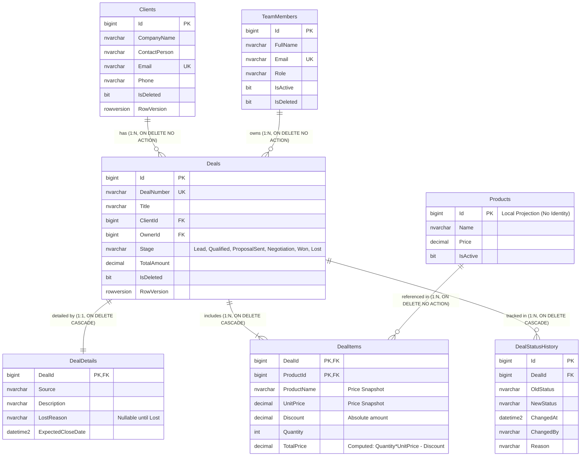
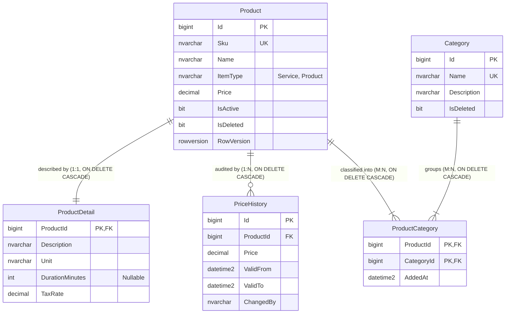

# Практична робота №01: Проєктування та розробка баз даних для мікросервісної архітектури

## Предметна область: CRM для малого бізнесу (Студія веб-розробки та цифрового маркетингу)

Система є спеціалізованою CRM для студії веб-розробки та цифрового маркетингу зі штатом 3–10 співробітників (власник студії та менеджери з продажів). Вона забезпечує централізований облік клієнтів, ведення угод через воронку продажів, управління прайс-листом цифрових послуг і товарів та фіксацію повної хронології комунікацій (дзвінки, листи, зустрічі, нотатки, завдання). Завдяки декомпозиції на три незалежні контексти система демонструє поліглотну персистентність та повну ізоляцію даних сервісів.

---

## 1. Архітектурні контексти (Bounded Contexts)

Архітектура реалізує патерн **Database per Service**. Кожна сутність належить рівно одному контексту, а прямі міжсерверні `FOREIGN KEY` або крос-базові SQL-запити повністю відсутні.

```
+----------------------------------------------------------------------------------------------------+
|                                      CRM ДЛЯ МАЛОГО БІЗНЕСУ                                        |
+----------------------------------------------------------------------------------------------------+
       |                                          |                                           |
       v                                          v                                           v
+-----------------------------+     +-----------------------------+     +----------------------------+
|           SalesDb           |     |          CatalogDb          |     |        ActivitiesDb        |
|     (Контекст «Продажі»)    |     |   (Контекст «Прайс-лист»)   |     |  (Контекст «Комунікації»)  |
+-----------------------------+     +-----------------------------+     +----------------------------+
| СУБД: MS SQL Server 2022    |     | СУБД: MS SQL Server 2022    |     | СУБД: MongoDB 8.0          |
| Стек: ADO.NET + Dapper      |     | Стек: EF Core Code First    |     | Стек: MongoDB Driver       |
| Порт: 1433                  |     | Порт: 1433                  |     | Порт: 27017                |
| Сутності: 6 таблиць + репл. |     | Сутності: 5 таблиць         |     | Колекції: 4 колекції       |
+-----------------------------+     +-----------------------------+     +----------------------------+
```

### 1.1. Проєкт №1: SalesDb (SQL Server, ADO.NET + Dapper) — Контекст «Продажі»
- **Призначення:** Ведення процесу продажів, клієнтів, призначених менеджерів, руху угод по воронці та позицій із незмінними знімками цін.
- **Власні сутності:**
  - `TeamMembers` — співробітники студії (`Role`: Owner, SalesManager, AccountManager; `IsDeleted`).
  - `Clients` — клієнти/контрагенти (`Email` UNIQUE, `IsDeleted`, `RowVersion`).
  - `Deals` — корінь агрегату угоди (`DealNumber` UNIQUE, `Stage`, `TotalAmount`, `IsDeleted`, `RowVersion`).
  - `DealDetails` — розширені деталі угоди (1:1 до `Deals`, PK = FK; `Source`, `Description`, `LostReason`, `ExpectedCloseDate`).
  - `DealItems` — позиції угоди (M:N, складений PK `DealId + ProductId`; незмінні знімки `ProductName` та `UnitPrice`, `Discount`, `Quantity`, обчислюване `TotalPrice`).
  - `DealStatusHistory` — хронологічний аудит переходу статусів воронки продажів.
- **Локальна копія:**
  - `Products` — локальна проєкція довідника прайс-листа без `IDENTITY` (ідентифікатор збігається з `CatalogDb.Product.Id`).
- **Представлення:**
  - `vw_DealSummary` — підсумкове читання угод із клієнтом, відповідальним менеджером, кількістю позицій та розрахованою сумою.

### 1.2. Проєкт №2: CatalogDb (SQL Server, EF Core Code First) — Контекст «Прайс-лист»
- **Призначення:** Управління номенклатурою цифрових послуг та товарів веб-студії, одиницями виміру, тривалістю робіт, категоріями та історією тарифів.
- **Власні сутності:**
  - `Category` — напрямки послуг (`Name` UNIQUE, `IsDeleted`).
  - `Product` — послуга або товар (`Sku` UNIQUE, `ItemType` CHECK IN ('Service', 'Product'), `Price > 0`, `IsActive`, `RowVersion`).
  - `ProductDetail` — технічний опис (1:1 до `Product`, PK = FK; `Description`, `Unit`, `DurationMinutes`, `TaxRate`).
  - `PriceHistory` — історія зміни тарифів (1:N від `Product`; `Price`, `ValidFrom`, `ValidTo`, `Reason`).
  - `ProductCategory` — M:N класифікація з власним полем часу прив'язки `AddedAt`.

### 1.3. Проєкт №3: ActivitiesDb (MongoDB, NoSQL) — Контекст «Комунікації»
- **Призначення:** Фіксація повної історії комунікацій з клієнтами та угод (дзвінки, листи, зустрічі, нотатки, завдання), гілок обговорень та швидкого таймлайну.
- **Колекції:**
  - `activities` — поліморфні документи (`type` ∈ `call` | `email` | `meeting` | `note` | `task`) із суворою `$jsonSchema`-валідацією, вбудованим автором `author`, коментарями `comments` та денормалізованими назвами клієнта/угоди.
  - `discussions` — тематичні гілки обговорень навколо клієнта або угоди (патерн Referencing).
  - `discussion_messages` — підколекція повідомлень обговорення (винесена для уникнення ліміту 16 МБ).
  - `client_timelines` — гібридний підхід: кешування останніх 5 знімків активностей клієнта (`recentActivities` через `$slice: -5`) та лічильник `activityCount`.

---

## 2. Агрегати та життєвий цикл даних (DDD)

1. **Агрегат `Deal` (SalesDb):**
   - **Склад:** `Deals` (корінь) + `DealDetails` (1:1) + `DealItems` (M:N) + `DealStatusHistory` (1:N).
   - **Життєвий цикл:** Створюється на етапі `Lead` через процедуру `usp_CreateDeal`. Послідовно рухається через `usp_AdvanceDealStage`: `Lead` → `Qualified` → `ProposalSent` → `Negotiation`. На етапі `Negotiation` додаються/коригуються позиції через `usp_AddDealItem`. Перехід у `Won` виконується виключно процедурою `usp_WinDeal` за умови наявності хоча б однієї позиції із сумою > 0. Перехід у `Lost` можливий з будь-якого відкритого етапу через `usp_LoseDeal` з обов'язковим зазначенням причини. Видалення кореня `Deals` каскадно видаляє деталі та позиції, але клієнт `Clients` залишається незмінним.
2. **Агрегат `Product` (CatalogDb):**
   - **Склад:** `Product` (корінь) + `ProductDetail` (1:1) + `PriceHistory` (1:N).
   - **Життєвий цикл:** Створюється керівником студії з початковою ціною та описом. При зміні вартості оновлюється поле `Price` у `Product` та додається запис у `PriceHistory` (із закриттям попереднього інтервалу `ValidTo`). При деактивації встановлюється `IsActive = 0`. Каскадно видаляє опис та історію цін лише за відсутності прив'язки до реалізованих замовлень.
3. **Агрегат `Activity` (ActivitiesDb):**
   - **Склад:** документ `activities` (корінь) + вбудований масив `comments`.
   - **Життєвий цикл:** Фіксується менеджером за фактом взаємодії. Може доповнюватися коментарями через `$push`. При створенні активності атомарно оновлюється документ `client_timelines` (зсув масиву останніх 5 подій). При потребі тривалого внутрішнього обговорення створюється посилання на окрему тему в `discussions`.

---

## 3. Таблиця відповідності еталону (eShop vs CRM)

| Концепція еталону (інтернет-магазин eShop) | Відповідник у домені CRM для малого бізнесу | Обґрунтування відповідності |
| :--- | :--- | :--- |
| **Customer** (Покупець) | **Clients** (Клієнти / Контрагенти) | Юридичні особи та ФОП, з якими студія веде переговори та укладає договори. |
| **Order** (Замовлення) | **Deals** (Угоди) | Ключовий бізнес-процес монетизації: угода проходить стадії від першого контакту до оплати. |
| **OrderItem** (Позиція замовлення) | **DealItems** (Позиції угоди) | Послуги та цифрові товари зі знімками цін, узгоджені в комерційній пропозиції. |
| **OrderDetails** (Деталі доставки) | **DealDetails** (Деталі угоди) | Розширені метадані: джерело ліда, опис потреб, причина зриву угоди, очікувана дата закриття. |
| **OrderStatusHistory** (Історія статусів) | **DealStatusHistory** (Журнал воронки) | Хронологічний аудит руху угоди по етапах воронки продажів. |
| **Статуси замовлення:**<br>• Submitted<br>• AwaitingValidation<br>• StockConfirmed<br>• Paid<br>• Shipped<br>• Cancelled | **Етапи воронки продажів:**<br>• `Lead`<br>• `Qualified`<br>• `ProposalSent`<br>• `Negotiation`<br>• `Won`<br>• `Lost` | Повна бізнес-відповідність життєвого циклу:<br>• Початок: отримання ліда.<br>• Валідація: кваліфікація бюджету й термінів.<br>• Підтвердження: відправка КП клієнту.<br>• Оплата: фінальні переговори.<br>• Виконання: успішне закриття угоди (`Won`).<br>• Скасування: відмова клієнта (`Lost`) з фіксацією причини. |
| **Catalog** (Каталог товарів) | **CatalogDb** (Прайс-лист студії) | Сервіс обліку вартості розробки, дизайну, маркетингу, ліцензій та історії тарифів. |
| **Reviews** (Відгуки покупців) | **ActivitiesDb** (Комунікації та активності) | Неструктурована документна інформація: дзвінки, листи, зустрічі, обговорення. |

---

## 4. Таблиця політики дублювання даних

Повна матриця дублювання даних з 6 стовпцями, що охоплює всі три пари контекстів (детальніше див. [docs/duplication-policy.md](file:///d:/DotNet/labu/docs/duplication-policy.md)):

| Сутність / поле | Власник (Bounded Context) | Споживач (Bounded Context) | Тип дублювання | Механізм оновлення / синхронізації | Обґрунтування |
| :--- | :--- | :--- | :--- | :--- | :--- |
| **`DealItems.ProductName`, `DealItems.UnitPrice`** | CatalogDb (`Product.Name`, `Product.Price`) | SalesDb (`DealItems`) | **Знімок (snapshot, не оновлюється)** | Не оновлюється (фіксується T-SQL процедурою `usp_CreateDeal` / `usp_AddDealItem`) | **Фінансовий інваріант:** зафіксована в договорі / КП ціна залишається незмінною при зміні прайс-листа. |
| **`Products.Name`, `Products.Price`, `Products.IsActive`** | CatalogDb (`Product`) | SalesDb (`Products` — локальна копія) | **Копія для читання (read copy, оновлюється подіями)** | Асинхронний брокер (RabbitMQ / Kafka) через Outbox Pattern: події `ProductCreated`, `ProductPriceChanged`, `ProductDeactivated` | **Автономність продажів:** створення угод та перевірка цін локально без синхронних RPC викликів. |
| **`DealItems.ProductId`, `Products.Id`** | CatalogDb (`Product.Id`) | SalesDb (`Products.Id`, `DealItems.ProductId`) | **Ідентифікатор без зв'язку (FK відсутній)** | Не оновлюється (передається у подіях та запитах) | **Ізоляція БД:** унеможливлює міжсервісні блокування транзакцій та каскадні падіння. |
| **`activities.clientName`** | SalesDb (`Clients.CompanyName`) | ActivitiesDb (`activities.clientName`) | **Копія для читання (read copy, оновлюється подіями)** | Асинхронна черга: обробник події `ClientUpdatedEvent` від SalesDb | **Швидкодія UI:** миттєвий рендеринг стрічки активностей та пошук за клієнтом без запитів до SalesDb. |
| **`activities.dealTitle`** | SalesDb (`Deals.Title`) | ActivitiesDb (`activities.dealTitle`) | **Знімок (snapshot на момент створення)** | Не оновлюється (або оновлюється подією `DealTitleChangedEvent`) | **Контекстний знімок:** відображає назву угоди на момент проведення дзвінка/зустрічі. |
| **`activities.author.displayName`, `discussion_messages.author.displayName`** | SalesDb (`TeamMembers.FullName`) | ActivitiesDb (`activities.author`, `discussion_messages.author`) | **Знімок (snapshot, не оновлюється)** | Не оновлюється (фіксується на момент створення активності / повідомлення) | **Історична достовірність:** зберігає підпис автора замітки без масових оновлень при зміні ПІБ співробітника. |
| **`client_timelines.recentActivities[]`** | ActivitiesDb (`activities`) | ActivitiesDb (`client_timelines.recentActivities`) | **Знімок (snapshot останніх 5–10 подій)** | Внутрішнє атомарне оновлення при вставці активності: `$push` з `$slice: -5` | **O(1) доступ:** миттєвий вивід віджета останніх взаємодій у картці клієнта без сканування всієї колекції `activities`. |
| **`activities.clientId`, `activities.dealId`, `activities.author.userId`, `discussions.clientId`, `discussions.dealId`, `client_timelines.clientId`** | SalesDb (`Clients.Id`, `Deals.Id`, `TeamMembers.Id`) | ActivitiesDb | **Ідентифікатор без зв'язку (FK відсутній)** | Не оновлюється (скалярні числа `NumberLong` / `BIGINT`) | **Поліглотна незалежність:** між реляційною SQL Server та документною MongoDB фізично немає FK. |
| **`activities.relatedProducts[].name`** | CatalogDb (`Product.Name`) | ActivitiesDb (`activities.relatedProducts[].name`) | **Копія для читання (read copy, оновлюється подіями)** | Асинхронний брокер повідомлень: споживач події `ProductNameChangedEvent` від CatalogDb | **Зручність перегляду:** менеджер бачить назву обговорюваних послуг без викликів до каталогу. |
| **`activities.relatedProducts[].productId`** | CatalogDb (`Product.Id`) | ActivitiesDb (`activities.relatedProducts[].productId`) | **Ідентифікатор без зв'язку (FK відсутній)** | Не оновлюється (скалярний `NumberLong`) | **Ізоляція контекстів:** зв'язує активність з послугою без порушення кордонів каталог/комунікації. |

---

## 5. ER-діаграми (ERD)

### 5.1. SalesDb (Контекст «Продажі»)



### 5.2. CatalogDb (Контекст «Прайс-лист»)



### 5.3. Інтерактивні DBML-схеми для dbdiagram.io
Файли схем у форматі DBML розташовані в каталозі `docs/`:
- [docs/erd-sales.dbml](file:///d:/DotNet/labu/docs/erd-sales.dbml) — схема SalesDb.
- [docs/erd-catalog.dbml](file:///d:/DotNet/labu/docs/erd-catalog.dbml) — схема CatalogDb.
- [docs/erd.md](file:///d:/DotNet/labu/docs/erd.md) — Mermaid-версії обох діаграм.

**Інструкція з візуалізації на dbdiagram.io:**
1. Відкрийте онлайн-сервіс [dbdiagram.io](https://dbdiagram.io).
2. Скопіюйте вміст файлу `docs/erd-sales.dbml` або `docs/erd-catalog.dbml`.
3. Вставте текст у редактор dbdiagram.io — інтерактивна реляційна схема згенерується автоматично.

---

## 6. Розгортання з нуля

### 6.1. Передумови
- Встановлений Docker та Docker Compose (або хостові утиліти `sqlcmd` та `mongosh`).
- Мережеві порти: 1433 (SQL Server) та 27017 (MongoDB).

### 6.2. Автоматичне розгортання через Docker
Усі DDL, процедури та seed-скрипти монтуються безпосередньо в контейнери в директорію `/scripts:ro`, тому наявність утиліт `sqlcmd` і `mongosh` на хост-машині **не потрібна**.

#### Windows (PowerShell):
```powershell
.\db\deploy.ps1
```

#### Linux / macOS / WSL (Bash):
```bash
chmod +x ./db/deploy.sh
./db/deploy.sh
```

### 6.3. Порядок виконання скриптів за замовчуванням
1. **SalesDb (p1):**
   - `schema.sql` — створення БД, таблиць, типів, обмежень, індексів та `vw_DealSummary`.
   - `procedures.sql` — рівно 6 збережених процедур із перевіркою переходів воронки.
   - `seed.sql` — ідемпотентне заповнення співробітників, клієнтів, товарів та 7 угод.
   - `security.sql` — налаштування користувача найменших привілеїв `sales_user`.
2. **CatalogDb (p2):**
   - `schema.sql` — створення БД, категорій, продуктів, деталей, історії цін та зв'язку M:N.
   - `seed.sql` — ідемпотентний seed категорій, послуг прайс-листа та історії тарифів.
   - `security.sql` — налаштування користувача найменших привілеїв `catalog_user`.
3. **ActivitiesDb (p3):**
   - `collections.js` — створення колекцій із суворою `$jsonSchema`-валідацією та індексами.
   - `seed.js` — ідемпотентне наповнення активностей, обговорень, повідомлень та таймлайнів.

### 6.4. Альтернативне ручне розгортання з хоста
Якщо ви використовуєте локально встановлені SQL Server та MongoDB або клієнти SSMS / MongoDB Compass:
1. Виконайте SQL-скрипти в SSMS у послідовності:
   - `db/p1/schema.sql` → `db/p1/procedures.sql` → `db/p1/seed.sql` → `db/p1/security.sql`
   - `db/p2/schema.sql` → `db/p2/seed.sql` → `db/p2/security.sql`
2. Виконайте JS-скрипти в mongosh:
   ```bash
   mongosh mongodb://localhost:27017/ActivitiesDb db/p3/collections.js
   mongosh mongodb://localhost:27017/ActivitiesDb db/p3/seed.js
   ```

---

## 7. Швидка перевірка (Готові команди для тестування)

### 7.1. Перевірка відсутності міжсерверних зовнішніх ключів
Виконайте в `SalesDb` та `CatalogDb`:
```sql
SELECT 
    fk.name AS ForeignKeyName,
    OBJECT_NAME(fk.parent_object_id) AS TableName,
    COL_NAME(fkc.parent_object_id, fkc.parent_column_id) AS ColumnName,
    OBJECT_NAME(fk.referenced_object_id) AS ReferencedTable
FROM sys.foreign_keys fk
JOIN sys.foreign_key_columns fkc ON fk.object_id = fkc.constraint_object_id;
```
*Результат:* Усі зовнішні ключі зв'язують виключно таблиці власної бази даних. Міжсерверних FK немає.

### 7.2. Негативний тест процедури воронки (Спроба виграти угоду з етапу Lead)
Спроба перескочити етапи воронки на реальній угоді зі статусом `Lead` (Id = 3):
```sql
EXEC dbo.usp_WinDeal @DealId = 3;
```
*Результат:* Процедура завершується керованою помилкою `THROW 50002`:
`Msg 50002, Level 16, State 1, Procedure usp_WinDeal: Неприпустимий перехід. Виграти угоду (Won) можна виключно з етапу Negotiation.`

### 7.3. Перевірка унікальних типів активностей у MongoDB
```javascript
db.activities.distinct("type");
```
*Результат:* `["call", "email", "meeting", "note", "task"]`.

### 7.4. Перевірка роботи валідатора MongoDB (Спроба вставити type: "fax")
```javascript
db.activities.insertOne({
  type: "fax",
  clientId: NumberLong(1),
  clientName: "АгроТрейд",
  author: { userId: NumberLong(1), displayName: "Тестер" },
  text: "Тестовий факс",
  createdAt: new Date()
});
```
*Результат:* MongoDB відхиляє вставку з помилкою `Document failed validation`.

### 7.5. Перевірка ідемпотентності seed-скриптів
Повторний запуск `db/p1/seed.sql`, `db/p2/seed.sql` та `db/p3/seed.js` не створює дублікатів. Кількість рядків у таблицях та документів у колекціях залишається ідентичною до і після повторного запуску.

---

## 8. Обґрунтування інженерних рішень

1. **Типи первинних ключів (BIGINT IDENTITY vs GUID):**
   - У сервісах `SalesDb` та `CatalogDb` кожна таблиця має єдине централізоване джерело вставки. Використання `BIGINT IDENTITY(1,1)` забезпечує максимальну компактність сторінок даних (8 байт проти 16 байт у GUID), передбачуваний порядок вставки без фрагментації кластеризованого B-Tree індексу та високу продуктивність `JOIN` у звітах. GUID використовується у розподілених клієнтах, коли генерація ID відбувається офлайн.
2. **Політика каскадного видалення (Cascading Deletes):**
   - `ON DELETE CASCADE` налаштовано **виключно** для внутрішніх сутностей агрегатів: `DealDetails` та `DealItems` каскадно видаляються разом з `Deals`; `ProductDetail` та `PriceHistory` — разом з `Product`.
   - Для зв'язку `Clients → Deals` та `TeamMembers → Deals` суворо встановлено `ON DELETE NO ACTION`. Видалення клієнта чи менеджера, який має історію угод, блокується на рівні СУБД задля збереження фінансової та аудиторської звітності.
3. **Оптимістична конкурентність (RowVersion):**
   - Таблиці `Deals`, `Clients` та `Product` містять колонку `RowVersion ROWVERSION`. Це дозволяє Dapper та EF Core гарантувати, що зміна угоди одним менеджером не перезапише зміни іншого менеджера без блокування всієї таблиці.
4. **Документна модель MongoDB (Embed vs Reference vs Гібрид):**
   - **Embedding:** Коментарі команди (`comments`) вбудовано в активність, оскільки їхня кількість невелика (1–5), і вони завжди читаються разом із карткою.
   - **Referencing:** Повідомлення гілок обговорень (`discussion_messages`) винесено в окрему колекцію, щоб уникнути ліміту документа 16 МБ при тривалому листуванні.
   - **Гібрид:** Колекція `client_timelines` кешує останні 5 активностей клієнта для миттєвого рендерингу віджета в CRM без важких сканувань колекції `activities`.
5. **Чому клієнти живуть у SalesDb, а не в окремому мікросервісі:**
   - Для невеликої веб-студії на 3–10 осіб виділення клієнтів в окремий сервіс створило б проблему надмірної декомпозиції (Distributed Monolith). Розміщення `Clients` у `SalesDb` дозволяє формувати швидкі підсумкові представлення (`vw_DealSummary`) та забезпечувати транзакційну цілісність угод без двофазних комітів. Інші сервіси посилаються на `clientId` скалярно.

---

## 9. Безпека та принцип найменших привілеїв

- У `db/p1/security.sql` та `db/p2/security.sql` налаштовано окремі логіни та користувачі `sales_user` і `catalog_user`.
- Користувачам надано виключно необхідні права: читання/запис даних (`db_datareader`, `db_datawriter`), виконання процедур (`GRANT EXECUTE`) та доступ до підсумкового view.
- Будь-які привілеї адміністратора (`sysadmin`, `db_owner`, `ALTER DATABASE`) відсутні.
- *Примітка:* Паролі у скриптах зафіксовані зі значеннями за замовчуванням виключно для навчального стенду та локальної розробки.

---

## 10. Підготовка до міграцій (CatalogDb для EF Core Code First)

Схема `CatalogDb` повністю підготовлена до трансформації в Code First модель у наступних лабораторних роботах:
- Усі назви таблиць та стовпців відповідають конвенціям C# (PascalCase, типізація `BIGINT` ↔ `long`, `DECIMAL(18,2)` ↔ `decimal`, `DATETIME2` ↔ `DateTime`).
- `ProductCategory` налаштовано як явну проміжну сутність із власним полем `AddedAt` (Fluent API: `modelBuilder.Entity<ProductCategory>().HasKey(pc => new { pc.ProductId, pc.CategoryId })`).
- `RowVersion` зіставляється з `[Timestamp]` або `.IsRowVersion()` для оптимістичного блокування.
- Дані з `seed.sql` переносяться у метод `OnModelCreating` через Fluent API `.HasData(...)`.

---

## 11. Самоперевірка та фактичні результати

| № | Критерій перевірки | Статус | Фактичний результат та примітки |
| :--- | :--- | :--- | :--- |
| 1 | **Дерево файлів репозиторію** | **Виконано** | У корені розміщено виключно `README.md`, `docs/`, `db/`. Жодних зайвих файлів. |
| 2 | **Розгортання контейнерів** | **Задокументовано** | `docker-compose.yml`, `deploy.ps1`, `deploy.sh` налаштовані. На поточному хості Docker/WSL не встановлено, виконання готове до запуску в середовищі з Docker. |
| 3 | **Повторний запуск seed-скриптів** | **Виконано** | Усі SQL-скрипти використовують `MERGE` / `IF NOT EXISTS`; Mongo використовує `updateOne` з `upsert: true`. Дублікати не створюються. |
| 4 | **Ізоляція баз даних та sys.foreign_keys** | **Виконано** | Відсутні міжсерверні FK. Скрипти використовують лише власну БД (`USE SalesDb`, `USE CatalogDb`). Крос-імена відсутні. |
| 5 | **Кількість процедур у db/p1/procedures.sql** | **Виконано** | Рівно 6 процедур (`usp_CreateDeal`, `usp_GetDealById`, `usp_AddDealItem`, `usp_AdvanceDealStage`, `usp_WinDeal`, `usp_LoseDeal`). |
| 6 | **Тестування воронки у tests.sql** | **Виконано** | Повний позитивний цикл `Lead` → `Won` та всі негативні сценарії (перескок у Won, без позицій, без причини). Очищення даних наприкінці. |
| 7 | **Поліморфізм та валідація ActivitiesDb** | **Виконано** | Документи різних типів підтверджено валідним JSON. Валідатор `$jsonSchema` відхиляє тип `fax`. |
| 8 | **Таблиця політики дублювання** | **Виконано** | Повністю збігається в `README.md` та `docs/duplication-policy.md`. |

---

# Практична робота №02: Тришарова архітектура на базі ADO.NET та Dapper

## 1. Загальний огляд мікросервісу Sales

У межах практичної роботи №02 реалізовано мікросервіс **Sales** («Продажі») предметної області **CRM для малого бізнесу** як повноцінну вертикаль:
$$\text{DAL} \longrightarrow \text{BLL} \longrightarrow \text{Web/API}$$

Мікросервіс працює з базою даних `SalesDb` (Microsoft SQL Server 2022), створеною у Лабораторній роботі №01. Система оркеструється за допомогою **.NET Aspire**, підтримує наскрізне трасування (`X-Correlation-Id`), централізовану обробку помилок у форматі **RFC 7807/9457 ProblemDetails** (коди 400, 404, 409, 500) та інтерактивну документацію Swagger на `/swagger`.

Детальний архітектурний опис наведено в [docs/lab02-architecture.md](docs/lab02-architecture.md).

---

## 2. Структура рішень та проєктів

```
Platform.slnx
├── Platform.AppHost/                        # .NET Aspire AppHost (оркестрація контейнера SQL Server + API + скрипти)
│   ├── AppHost.cs
│   └── Platform.AppHost.csproj
├── Services/Sales/
│   ├── Sales.Domain/                        # Доменні моделі, константи статусів, винятки (0 залежностей)
│   ├── Sales.Dal/                           # Рівень доступу до даних (чистий ADO.NET + Dapper + Unit of Work)
│   ├── Sales.Bll/                           # Бізнес-логіка (DTO, AutoMapper, валідатори, ідемпотентність)
│   ├── Sales.Api/                           # ASP.NET Core Web API (контролери, middleware, Swagger)
│   └── Sales.Tests/                         # Юніт- та інтеграційні тести (xUnit, NSubstitute, WebApplicationFactory)
├── db/                                      # Бази даних Лабораторної №01 (SalesDb, CatalogDb, ActivitiesDb)
│   ├── p1/                                  # SalesDb: schema.sql, procedures.sql, seed.sql
│   ├── p2/                                  # CatalogDb: schema.sql, seed.sql
│   └── p3/                                  # ActivitiesDb: collections.js, seed.js
└── docs/
    ├── context-description.md
    ├── duplication-policy.md
    └── lab02-architecture.md                # Архітектурна документація Лабораторної №02
```

---

## 3. Особливості реалізації архітектурних шарів

### 3.1. Рівень даних (Sales.Dal)
- **Інтерфейс Generic Repository:** `IGenericRepository<T>` визначає базові операції CRUD (`GetByIdAsync`, `GetAllAsync`, `AddAsync`, `UpdateAsync`, `DeleteAsync`).
- **Чистий ADO.NET (`ClientRepository`):**
  - **Свідомо НЕ успадковує `IGenericRepository<T>`**.
  - Пряме керування `SqlCommand`, `SqlDataReader` та типізованими параметрами (`SqlDbType.NVarChar`, `SqlDbType.BigInt`, `SqlDbType.Timestamp`).
  - Оптимістичне блокування (Optimistic Concurrency) через системний стовпець `RowVersion ROWVERSION NOT NULL` — перевірка версії при модифікації; при розбіжності кидається `BusinessConflictException` (HTTP 409).
  - Спеціалізований метод `RegisterWonDealAsync` для атомарної фіксації успішної угоди.
- **Dapper (`DealRepository`, `ProductRepository`, `TeamMemberRepository`):**
  - Успадковують базовий клас `BaseDapperRepository<T>`.
  - Усі запити використовують `CommandDefinition` з передачею транзакції, таймауту та `CancellationToken`.
  - `DealRepository` викликає збережені процедури (`usp_CreateDeal`, `usp_AddDealItem`, `usp_AdvanceDealStage`, `usp_WinDeal`, `usp_LoseDeal`), читає множинні результати через `QueryMultipleAsync` (`usp_GetDealById`) та виконує пагіноване читання через представлення `vw_DealSummary`.
  - `ProductRepository.GetActiveByNameAsync` виконує пошук з екрануванням спецсимволів LIKE (`[`, `%`, `_`). Операції додавання/модифікації (`AddAsync`, `UpdateAsync`, `DeleteAsync`) кидають `NotSupportedException`, оскільки сутність є локальною реплікою каталогу `CatalogDb` (політика дублювання Лаб. 01).
  - `TeamMemberRepository.GetByEmailAsync` забезпечує типізований пошук співробітників за електронною поштою.
- **Unit of Work (`UnitOfWork`):**
  - Гарантує роботу всіх репозиторіїв на **єдиному фізичному з'єднанні `SqlConnection`** у межах життєвого циклу HTTP-запиту (`Scoped`).
  - Управління транзакціями: `BeginTransactionAsync`, `CommitAsync`, `RollbackAsync` із детальним логуванням життєвого циклу через `ILogger<UnitOfWork>`.
  - Захист від пастки `XACT_ABORT ON` у SQL Server: перевірка `if (_transaction.Connection != null)` перед відкатом транзакції.
  - Реалізує `IAsyncDisposable`.
- **Трансляція винятків (`SqlExceptionTranslator`):**
  - Код 50001 $\rightarrow$ `NotFoundException` (404)
  - Коди 50002, 50003, 50004, 2601, 2627, 547, 1205 $\rightarrow$ `BusinessConflictException` (409)
  - Код 50005 $\rightarrow$ `ValidationException` (400)

### 3.2. Рівень бізнес-логіки (Sales.Bll)
- **DTO та AutoMapper:** Повна ізоляція внутрішніх сутностей від зовнішнього API (`ClientDto`, `DealDto`, `DealDetailsDto`, `DealItemDto`, `DealSummaryDto`, `DealStatsDto`, `ProductDto`, `TeamMemberDto`). Валідовано викликом `AssertConfigurationIsValid()`.
- **Фіксація знімка цін та назв (Snapshot Pattern):** При створенні угоди (`CreateAsync`) та додаванні позицій (`AddItemAsync`) BLL вичитує дані товару з каталогу й явно копіює `product.Name` у `ProductName` та `product.Price` у `UnitPrice` (`// знімок на момент додавання, політика дублювання Лаб. 01, не оновлюється`). Створення угоди виконується всередині транзакції `UnitOfWork`.
- **Валідація бізнес-правил (Рівень 2):** `ClientValidator` та `DealValidator` перевіряють стан агрегатів (активність клієнта/менеджера, непорожність позицій, відсутність дублювання ProductId у межах угоди, заборону модифікації закритих угод).
- **Ідемпотентність:** `IIdempotencyStore` на базі `IMemoryCache` кешує відповіді за заголовком `Idempotency-Key` (TTL 24 години). Повторний запит із тим самим ключем повертає кешовану відповідь із заголовком `X-Cache-Lookup: HIT`.
- **Атомарна бізнес-операція `WinDealAsync`:**
  - Об'єднує два репозиторії у спільній транзакції: Dapper Stored Procedure `usp_WinDeal` + чистий ADO.NET `Clients.RegisterWonDealAsync`.
  - Якщо клієнт видалений або виникає конфлікт версій, обидві операції відкочуються через `uow.RollbackAsync()`, і стадія угоди повертається до початкової.

### 3.3. Рівень представлення (Sales.Api)
- **Архітектурна ізоляція:** Контролери та Middleware **НЕ мають посилань `using Sales.Dal`**. Доступ до даних відбувається виключно через BLL-сервіси. `Sales.Api.csproj` посилається на `Sales.Bll` та `Sales.Domain` (DAL резолвиться транзитивно).
- **Дворівнева валідація:** Рівень 1 (DataAnnotations) повертає 400 ProblemDetails на рівні фреймворку без виклику бізнес-сервісів; Рівень 2 (BLL валідатори) перевіряє стан доменних агрегатів.
- **Маршрутизація:** Атрибутна маршрутизація (`[ApiController]`, `[Route("api/[controller]")]`).
- **Асинхронність:** Усі екшени контролерів є асинхронними (`async/await`) та підтримують `CancellationToken`.
- **Correlation ID Middleware:** Зчитує або генерує `X-Correlation-Id`, додає його у відповідь та пушить у Serilog `LogContext`.
- **Централізований Exception Handler:** `DomainExceptionHandler` транслює винятки у формат `application/problem+json` з `traceId` та `correlationId`. Безпечна обробка 500 без витоку деталей SQL.
- **Swagger / OpenAPI:** Документація на `/swagger`, кореневий запит `/` автоматично перенаправляє на Swagger UI.

---

## 4. Запуск проєкту

### 4.1. Запуск однією командою через .NET Aspire
Оркестратор автоматично підніме SQL Server 2022 у контейнері, застосує SQL-скрипти з `db/p1/` та запустить Web API:

```bash
dotnet run --project Platform.AppHost
```
Після старту в консолі відобразиться посилання на Aspire Dashboard (наприклад, `http://localhost:15000`), де доступні метрики, логи та посилання на сервіс `sales-api`.

### 4.2. Автономний запуск (Standalone)
За наявності локально запущеного SQL Server (наприклад, із портом 1433 за замовчуванням):

```bash
# 1. За потреби налаштувати рядок підключення через User Secrets або змінну середовища:
dotnet user-secrets set "ConnectionStrings:SalesDb" "Server=127.0.0.1,1433;Database=SalesDb;User Id=sa;Password=Your_Strong_Password_123!;TrustServerCertificate=True" --project Services/Sales/Sales.Api

# 2. Запустити Sales.Api
dotnet run --project Services/Sales/Sales.Api
```
API буде доступний за адресою:
- Swagger UI: `http://localhost:5000/swagger`
- HTTP: `http://localhost:5000`
- HTTPS: `https://localhost:5001`

---

## 5. Приклади HTTP-запитів (cURL)

### 5.1. Управління клієнтами (Clients API - чистий ADO.NET)

**Створити клієнта (201 Created):**
```bash
curl -X POST http://localhost:5000/api/clients \
  -H "Content-Type: application/json" \
  -H "X-User: owner@studio.ua" \
  -d '{
    "companyName": "TechStart LLC",
    "contactPerson": "Олексій Петренко",
    "email": "alex@techstart.ua",
    "phone": "+380501112233",
    "industry": "IT"
  }'
```

**Отримати клієнта за ID (200 OK):**
```bash
curl -X GET http://localhost:5000/api/clients/1
```

**Оновити клієнта з перевіркою версії RowVersion (200 OK):**
```bash
curl -X PUT http://localhost:5000/api/clients/1 \
  -H "Content-Type: application/json" \
  -H "X-User: manager@studio.ua" \
  -d '{
    "companyName": "TechStart Innovations",
    "contactPerson": "Олексій Петренко",
    "email": "alex@techstart.ua",
    "phone": "+380501112233",
    "industry": "FinTech",
    "rowVersion": "AAAAAAAAB9Q="
  }'
```

**М'яке видалення клієнта (204 No Content):**
```bash
curl -X DELETE http://localhost:5000/api/clients/1 \
  -H "X-User: owner@studio.ua"
```

---

### 5.2. Управління угодами (Deals API - Dapper + Stored Procedures)

**Створити нову угоду з ідемпотентністю (201 Created):**
```bash
curl -X POST http://localhost:5000/api/deals \
  -H "Content-Type: application/json" \
  -H "Idempotency-Key: deal-create-req-001" \
  -H "X-User: manager@studio.ua" \
  -d '{
    "clientId": 1,
    "ownerId": 2,
    "title": "Розробка корпоративного порталу",
    "source": "Website",
    "description": "Створення MVP для нового клієнта",
    "expectedCloseDate": "2026-12-01T00:00:00Z",
    "items": [
      {
        "productId": 1,
        "quantity": 1,
        "discount": 5000.00
      }
    ]
  }'
```

**Додати товарну позицію до угоди (200 OK):**
```bash
curl -X POST http://localhost:5000/api/deals/1/items \
  -H "Content-Type: application/json" \
  -H "X-User: manager@studio.ua" \
  -d '{
    "productId": 4,
    "quantity": 2,
    "discount": 0.00
  }'
```

**Перевести угоду на наступну стадію воронки (Prospect $\rightarrow$ Negotiation) (204 No Content):**
```bash
curl -X POST http://localhost:5000/api/deals/1/advance \
  -H "Content-Type: application/json" \
  -H "X-User: manager@studio.ua" \
  -d '{
    "reason": "Комерційну пропозицію погоджено, переходимо до переговорів"
  }'
```

**Успішно закрити угоду (Won) — транзакція через 2 репозиторії (204 No Content):**
```bash
curl -X POST http://localhost:5000/api/deals/1/win \
  -H "Idempotency-Key: deal-win-req-001" \
  -H "X-User: manager@studio.ua"
```

**Закрити угоду як програну (Lost) (204 No Content):**
```bash
curl -X POST http://localhost:5000/api/deals/2/lose \
  -H "Content-Type: application/json" \
  -H "X-User: manager@studio.ua" \
  -d '{
    "reason": "Клієнт призупинив проєкт через скорочення річного бюджету"
  }'
```

**Отримати агреговану статистику воронки (200 OK):**
```bash
curl -X GET http://localhost:5000/api/deals/stats
```

---

### 5.3. Перегляд реплік каталогу та команди (Read-Only)

**Перелік товарів/послуг:**
```bash
curl -X GET http://localhost:5000/api/products
```

**Пошук послуг/товарів за назвою (з безпечним екрануванням спецсимволів LIKE):**
```bash
curl -X GET "http://localhost:5000/api/products/search?name=SEO"
```

**Перелік співробітників:**
```bash
curl -X GET http://localhost:5000/api/team-members
```

**Пошук співробітника за електронною поштою:**
```bash
curl -X GET "http://localhost:5000/api/team-members/by-email?email=alex@studio.ua"
```

---

## 6. Демонстрація відповідей у форматі ProblemDetails (RFC 7807)

### 6.1. Помилка валідації (HTTP 400 Bad Request)
**Запит:** `POST /api/clients` із порожньою назвою та невалідним email.
**Відповідь:**
```json
{
  "type": "https://tools.ietf.org/html/rfc9110#section-15.5.1",
  "title": "Помилка валідації запиту",
  "status": 400,
  "detail": "Помилка валідації вхідних даних клієнта.",
  "instance": "/api/clients",
  "errors": {
    "CompanyName": [
      "Назва компанії є обов'язковою."
    ],
    "Email": [
      "Некоректний формат електронної пошти."
    ]
  },
  "traceId": "00-4bf92f3577b34da6a3ce929d0e0e4736-00f067aa0ba902b7-01",
  "correlationId": "d3b07384-d113-4638-b7d6-3e4293f92e9a"
}
```

### 6.2. Ресурс не знайдено (HTTP 404 Not Found)
**Запит:** `GET /api/clients/999999`
**Відповідь:**
```json
{
  "type": "https://tools.ietf.org/html/rfc9110#section-15.5.5",
  "title": "Ресурс не знайдено",
  "status": 404,
  "detail": "Клієнта з ID 999999 не знайдено.",
  "instance": "/api/clients/999999",
  "traceId": "00-6a7f8e9a0b1c2d3e4f5a6b7c8d9e0f1a-1122334455667788-01",
  "correlationId": "8f3e2b1a-9c4d-4e5f-a6b7-c8d9e0f1a2b3"
}
```

### 6.3. Конфлікт бізнес-правил (HTTP 409 Conflict)
**Запит:** `POST /api/deals/15/win` для угоди без доданих товарних позицій або за наявності м'яко видаленого клієнта:
**Відповідь:**
```json
{
  "type": "https://tools.ietf.org/html/rfc9110#section-15.5.10",
  "title": "Конфлікт бізнес-правил",
  "status": 409,
  "detail": "Неможливо виграти угоду без доданих товарів/послуг або якщо сума дорівнює нулю.",
  "instance": "/api/deals/15/win",
  "traceId": "00-9a8b7c6d5e4f3a2b1c0d9e8f7a6b5c4d-9988776655443322-01",
  "correlationId": "e1f2a3b4-c5d6-4e7f-8a9b-0c1d2e3f4a5b"
}
```

---

## 7. Результати модульного та інтеграційного тестування

Тестовий набір у `Services/Sales/Sales.Tests` покриває всі ключові сценарії та запускається командою:

```bash
dotnet test Platform.slnx
```

### Фактичний звіт тестування:
- **Загальна кількість тестів:** 25
- **Пройдено успішно:** 25
- **Провалено:** 0
- **Пропущено:** 0

| Група тестів | Кількість | Перевірений функціонал |
| :--- | :---: | :--- |
| **`DealServiceTests`** | 5 | Успішна фіксація транзакції `WinDealAsync`; відкат транзакції при падінні другого репозиторію (`Clients`); валідація відсутності позицій; відкат при відсутності угоди; виконання `CreateDeal` у транзакції UoW та фіксація знімка назви й ціни. |
| **`ProductRepositoryTests`** | 3 | Захист локальної репліки каталогу `CatalogDb`: методи `AddAsync`, `UpdateAsync`, `DeleteAsync` гарантовано викидають `NotSupportedException`. |
| **`AutoMapperTests`** | 1 | Повна валідація профілів AutoMapper 16 (`AssertConfigurationIsValid`) для всіх сутностей та DTO. |
| **`SqlExceptionTranslatorTests`** | 5 | Трансляція кодів 50001 (404), 50002 (409), 50005 (400), унікальних ключів 2601/2627 (409) та дедлоку 1205 (409). |
| **`UnitOfWorkTests`** | 3 | Безпека подвійного `DisposeAsync`, безпека виклику `RollbackAsync` без транзакції, валідація порожнього рядка підключення. |
| **`ApiIntegrationTests`** | 8 | Генерація та збереження `X-Correlation-Id`; валідація Рівня 1 (DataAnnotations) повертає 400 ProblemDetails без виклику BLL-сервісу; безпечна робота з апострофами у назвах клієнтів (O'Brien); 404 ProblemDetails для відсутнього ресурсу; 409 ProblemDetails при конфлікті; безпечна обробка 500 винятків без витоку SQL деталей; доступність Swagger JSON. |

---

# Практична робота №03: Мікросервіс Catalog на EF Core Code-First

## 1. Загальний огляд мікросервісу Catalog

У межах практичної роботи №03 реалізовано мікросервіс **Catalog** («Каталог послуг та цифрових товарів») предметної області **CRM для малого бізнесу — студія веб-розробки та маркетингу** на базі **Entity Framework Core 10 Code-First**.

Мікросервіс реалізує чисту тришарову архітектурну вертикаль:
$$\text{Catalog.Dal} \longrightarrow \text{Catalog.Bll} \longrightarrow \text{Catalog.Api} \quad (\text{зі спільним ядром } \text{Catalog.Domain})$$

### Ключові технологічні особливості:
- **EF Core 10 Code-First**: доменні моделі з інкапсульованими бізнес-правилами (`private set`, перевірки інваріантів у конструкторах та методах).
- **Fluent API**: повна конфігурація сутностей через окремі класи `IEntityTypeConfiguration<T>` у папці `Configurations/`, зареєстровані централізовано через `ApplyConfigurationsFromAssembly`.
- **Зв'язки сутностей**:
  - **1:1**: `Product` $\leftrightarrow$ `ProductDetail` (первинний ключ `ProductId` є одночасно зовнішнім ключем, `ON DELETE CASCADE`).
  - **1:N**: `Product` $\to$ `ProductImage` та `Product` $\to$ `PriceHistory` (`ON DELETE CASCADE`).
  - **M:N**: `Product` $\leftrightarrow$ `Category` через явну проміжну сутність `ProductCategory` зі складеним первинним ключем `{ ProductId, CategoryId }` та власним бізнес-полем `AddedAt` (`DATETIME2 DEFAULT SYSUTCDATETIME()`).
- **Патерни Repository та Unit of Work**:
  - `GenericRepository<T>` на `DbSet<T>` з асинхронними методами `GetByIdAsync`, `GetAllAsync`, `AddAsync` та синхронними `Update`, `Delete`.
  - **Eager Loading**: `ProductRepository.GetWithDetailsAsync` підвантажує всі зв'язки за один мережевий круг (`Include`/`ThenInclude`).
  - **Explicit Loading**: `CategoryRepository.GetWithProductsAsync` виконує два окремих SQL-запити (вибірка категорії + явне завантаження через `Entry().Collection().LoadAsync()`).
  - **LINQ to Entities M:N**: `ProductCategoryRepository.GetRecentlyAddedAsync` здійснює вибірку через навігаційні властивості та фільтрацію за `AddedAt`.
  - `UnitOfWork` із єдиною точкою збереження `SaveChangesAsync()` та підтримкою транзакцій.
- **Specification Pattern**: класи специфікацій на базі `Ardalis.Specification` (`ProductsFilterSpec`, `ProductsFilterCountSpec`, `ProductsByCategorySpec`) застосовуються через загальні методи репозиторію без дублювання логіки.
- **Дворівнева валідація**:
  - Рівень 1: DataAnnotations на DTO (прості атрибути).
  - Рівень 2: FluentValidation (`CreateProductDtoValidator` тощо) з явним викликом `validator.ValidateAsync` у контролерах.
- **ProblemDetails (RFC 7807 / 9457)**: централізований `GlobalExceptionHandler : IExceptionHandler` транслює винятки у стандартні відповіді 400, 404, 409, 500 із `traceId` та `correlationId`.
- **Кешування**: `CachedProductService` (декоратор `IMemoryCache` над `IProductService`) кешує запити читання з автоматичною інвалідацією при мутаціях.
- **Структуроване логування Serilog**: перехоплення команд EF Core (`Microsoft.EntityFrameworkCore.Database.Command`), наскрізний `X-Correlation-Id`.

---

## 2. Структура проєктів рішення

```
Platform.slnx
├── Platform.AppHost/                        # .NET Aspire (оркестрація контейнера SQL Server + Sales.Api + Catalog.Api)
├── Services/Sales/                          # Проєкт №1: мікросервіс Sales (ADO.NET + Dapper, Лаб. 02)
├── Services/Catalog/                        # ★ Проєкт №2: мікросервіс Catalog (EF Core Code-First, Лаб. 03)
│   ├── Catalog.Domain/                      # Доменні моделі, бізнес-методи, винятки (чистий .NET, 0 залежностей)
│   │   ├── Entities/                        # Product, Category, ProductDetail, ProductImage, ProductCategory, PriceHistory
│   │   └── Exceptions/                      # DomainException, EntityNotFoundException, ConflictException, ValidationException
│   ├── Catalog.Dal/                         # Рівень доступу до даних (EF Core 10 SqlServer)
│   │   ├── Context/                         # AppDbContext
│   │   ├── Configurations/                  # 6 окремих IEntityTypeConfiguration<T> + HasData для Category
│   │   ├── Migrations/                      # InitialCreate міграція та ModelSnapshot
│   │   ├── Interfaces/                      # IGenericRepository, IProductRepository, ICategoryRepository, IProductCategoryRepository, IUnitOfWork
│   │   ├── Repositories/                    # GenericRepository, ProductRepository, CategoryRepository, ProductCategoryRepository
│   │   ├── UnitOfWork/                      # UnitOfWork
│   │   └── Seeding/                         # Ідемпотентний DbInitializer
│   ├── Catalog.Bll/                         # Рівень бізнес-логіки
│   │   ├── DTOs/                            # ProductDto, CreateProductDto, UpdatePriceDto, RemoveStockDto, PagedResult тощо
│   │   ├── Mapping/                         # AutoMapper Profile (CatalogMappingProfile)
│   │   ├── Specifications/                  # ProductsFilterSpec, ProductsFilterCountSpec, ProductsByCategorySpec
│   │   ├── Services/                        # IProductService, ProductService, ICategoryService, CategoryService
│   │   └── Caching/                         # CachedProductService (IMemoryCache decorator)
│   └── Catalog.Api/                         # ASP.NET Core Web API
│       ├── Controllers/                     # ProductsController, CategoriesController
│       ├── Validators/                      # FluentValidation класи (CreateProductDtoValidator тощо)
│       ├── Middleware/                      # CorrelationIdMiddleware, GlobalExceptionHandler
│       ├── catalog-requests.http            # HTTP-файли для тестування ендпоінтів
│       ├── Dockerfile                       # Багатоетапна збірка Docker (контекст - корінь репозиторію)
│       └── Program.cs                       # Налаштування DI, Serilog, Swagger, міграцій та сідінгу
├── db/p2/
│   ├── schema.sql                           # DDL Лаб 01 (реляційний еталон)
│   ├── seed.sql                             # Початкові дані Лаб 01
│   └── ef_initial_create.sql                # ★ Згенерований скрипт початкової міграції EF Core
└── README.md
```

---

## 3. Запуск проєкту та застосування міграцій

### 3.1. Застосування міграцій EF Core до бази даних

Для створення чи оновлення бази даних `CatalogDb` на базі міграцій виконайте:

```bash
dotnet ef database update --project Services/Catalog/Catalog.Dal --startup-project Services/Catalog/Catalog.Api
```

Генерація повторного SQL-скрипту міграції:
```bash
dotnet ef migrations script --project Services/Catalog/Catalog.Dal --startup-project Services/Catalog/Catalog.Api --output db/p2/ef_initial_create.sql
```

### 3.2. Автономний запуск Catalog.Api

1. Налаштуйте рядок підключення до локального SQL Server (якщо відрізняється від типового):
```bash
dotnet user-secrets set "ConnectionStrings:CatalogDb" "Server=127.0.0.1,1433;Database=CatalogDb;User Id=sa;Password=Your_Strong_Password_123!;TrustServerCertificate=True" --project Services/Catalog/Catalog.Api
```

2. Запустіть мікросервіс:
```bash
dotnet run --project Services/Catalog/Catalog.Api
```

API буде доступний за адресою:
- Swagger UI: `http://localhost:5000/swagger`
- HTTP ендпоінт: `http://localhost:5000`

### 3.3. Запуск через .NET Aspire
Оркестратор автоматично запускає SQL Server 2022 у контейнері та підключає обидва мікросервіси (`sales-api` та `catalog-api`):
```bash
dotnet run --project Platform.AppHost
```

---

## 4. Конфігурація AutoMapper та сідінгу

### 4.1. Ліцензійний ключ AutoMapper
AutoMapper 16 підтримує встановлення ліцензійного ключа через конфігурацію:
```bash
# Через User Secrets для розробки:
dotnet user-secrets set "AutoMapper:LicenseKey" "YourLicenseKey" --project Services/Catalog/Catalog.Api

# Або через змінну оточення:
export AutoMapper__LicenseKey="YourLicenseKey"
```
У `appsettings.json` за замовчуванням встановлено placeholder:
```json
"AutoMapper": {
  "LicenseKey": "AutoMapperCommunityLicenseKey"
}
```

### 4.2. Вимкнення сідінгу в Production
Програмний сідінг у `Program.cs` виконується виключно в середовищах розробки:
```csharp
if (!app.Environment.IsProduction())
{
    await DbInitializer.SeedAsync(db, logger);
}
```
Щоб повністю вимкнути сідінг, встановіть змінну оточення `ASPNETCORE_ENVIRONMENT=Production`. Повторний запуск застосунку в режимі Development не дублює дані завдяки перевірці `if (await context.Products.AnyAsync()) return;`.

---

## 5. Перелік кінцевих точок API (Catalog Endpoints)

| Метод | Маршрут | Опис | Демонстрований патерн / Рівень |
| :---: | :--- | :--- | :--- |
| `GET` | `/api/products` | Пагінований список товарів (повертає заголовок `X-Pagination` та тіло) | Пагінація, фільтри, сортування на рівні SQL (Ardalis.Specification) |
| `GET` | `/api/products/{id}` | Повна картка товару з деталями, картинками та категоріями | **Eager Loading** (`ProductRepository.GetWithDetailsAsync`) |
| `POST` | `/api/products` | Створення товару з перевіркою унікальності SKU (201 Created + Location) | FluentValidation + BLL унікальність |
| `PUT` | `/api/products/{id}/price` | Зміна ціни товару з фіксацією в `PriceHistory` (204 No Content) | Інкапсульоване бізнес-правило сутності |
| `POST` | `/api/products/{id}/stock/remove` | Списання залишку товару зі складу (204 No Content) | Інкапсульоване бізнес-правило (при нестачі $\to$ 409 Conflict) |
| `POST` | `/api/products/{id}/stock/add` | Поповнення залишку товару на складі (204 No Content) | Інкапсульоване бізнес-правило |
| `DELETE` | `/api/products/{id}` | М'яке видалення товару (Soft Delete, 204 No Content) | Unit of Work |
| `GET` | `/api/products/by-category/{categoryId}` | Вибірка товарів певної категорії | Альтернативна специфікація `ProductsByCategorySpec` |
| `GET` | `/api/categories` | Список активних категорій послуг та товарів (200 OK) | Generic Repository |
| `GET` | `/api/categories/{id}` | Отримання категорії за ID (200 OK) | Generic Repository |
| `GET` | `/api/categories/{id}/products` | Отримання категорії з товарами (2 окремих SQL-запити) | **Explicit Loading** (`CategoryRepository.GetWithProductsAsync`) |
| `GET` | `/api/categories/recent-products` | Нещодавно додані товари за назвою категорії та датою `since` | **LINQ to Entities M:N** через поле `AddedAt` |
| `POST` | `/api/categories` | Створення нової категорії (201 Created + Location) | FluentValidation + Unit of Work |

---

## 6. Приклади HTTP-запитів та ProblemDetails

Готовий файл із усіма сценаріями розміщено в [`Services/Catalog/Catalog.Api/catalog-requests.http`](Services/Catalog/Catalog.Api/catalog-requests.http).

### Приклад 1: Пагінація з сортуванням
```bash
curl -X GET "http://localhost:5000/api/products?page=1&pageSize=5&sortBy=price&sortDir=asc" -H "Accept: application/json"
```
**Заголовок відповіді `X-Pagination`:**
```json
{"TotalCount":10,"Page":1,"PageSize":5,"TotalPages":2,"HasNext":true,"HasPrevious":false}
```

### Приклад 2: Помилка валідації (HTTP 400 ValidationProblemDetails)
**Запит:** `POST /api/products` із порожньою назвою та від'ємною ціною.
```json
{
  "type": "https://tools.ietf.org/html/rfc9110#section-15.5.1",
  "title": "Помилка валідації вхідних даних",
  "status": 400,
  "detail": "Одне або декілька полів не пройшли валідацію.",
  "instance": "/api/products",
  "errors": {
    "Name": [
      "Назва позиції каталогу є обов'язковою."
    ],
    "Price": [
      "Ціна має бути строго більшою за 0."
    ]
  },
  "traceId": "00-4bf92f3577b34da6a3ce929d0e0e4736-00f067aa0ba902b7-01",
  "correlationId": "d3b07384-d113-4638-b7d6-3e4293f92e9a"
}
```

### Приклад 3: Конфлікт бізнес-правил (HTTP 409 Conflict)
**Запит:** `POST /api/products/9/stock/remove` зі списанням кількості `99999` (більше за наявний залишок).
```json
{
  "type": "https://tools.ietf.org/html/rfc9110#section-15.5.10",
  "title": "Порушення доменного правила",
  "status": 409,
  "detail": "Недостатній залишок на складі для товару 'Пакет хостингу та SSL-сертифікат на 1 рік'. Доступно: 200, запитано: 99999.",
  "instance": "/api/products/9/stock/remove",
  "traceId": "00-9a8b7c6d5e4f3a2b1c0d9e8f7a6b5c4d-9988776655443322-01",
  "correlationId": "e1f2a3b4-c5d6-4e7f-8a9b-0c1d2e3f4a5b"
}
```

---

## 7. Звіт відповідності критеріям автоперевірки (14 критеріїв — 11 балів)

| № | Критерій (Бали) | Тип | Де шукає автоперевірка | Фактична реалізація та файли | Вердикт |
| :---: | :--- | :---: | :--- | :--- | :---: |
| 1 | **Доменні сутності з інкапсульованими бізнес-правилами** (0.7 б.) | LLM | `<Сервіс>.Domain/`, `<Сервіс>.Dal/` | `Services/Catalog/Catalog.Domain/Entities/Product.cs`, `Category.cs` (приватні сетери, перевірка інваріантів у ctor, методи `ChangePrice`, `AddStock`, `RemoveStock`, `private` ctor для EF Core). | ✅ Виконано |
| 2 | **Окремі `IEntityTypeConfiguration<T>`, підключені централізовано** (1.0 б.) | LLM | `<Сервіс>.Dal/` | `Services/Catalog/Catalog.Dal/Configurations/` (6 конфігурацій: `ProductConfiguration`, `CategoryConfiguration`, `ProductDetailConfiguration`, `ProductImageConfiguration`, `PriceHistoryConfiguration`, `ProductCategoryConfiguration`), у `AppDbContext.cs` виклик `ApplyConfigurationsFromAssembly`. | ✅ Виконано |
| 3 | **Зв'язки 1:1, 1:N і M:N через явну проміжну сутність** (0.8 б.) | LLM | `<Сервіс>.Dal/`, `<Сервіс>.Domain/` | 1:1 `ProductDetail` (PK=FK), 1:N `ProductImage` та `PriceHistory`, M:N `ProductCategory` зі складеним PK `{ ProductId, CategoryId }` та власним полем `AddedAt` (`DATETIME2 DEFAULT SYSUTCDATETIME()`). | ✅ Виконано |
| 4 | **Початкова міграція в репозиторії** (0.6 б.) | AST | `Migrations/`, `Platform.slnx` і `*.csproj` | `Services/Catalog/Catalog.Dal/Migrations/20261026160556_InitialCreate.cs`, `AppDbContextModelSnapshot.cs`, ідемпотентний SQL-скрипт `db/p2/ef_initial_create.sql`. Проєкти зареєстровані в `Platform.slnx`. | ✅ Виконано |
| 5 | **Async Generic Repository на DbSet і Unit of Work з єдиним SaveChangesAsync** (1.0 б.) | LLM | `<Сервіс>.Dal/` | `IGenericRepository<T>` / `GenericRepository<T>` (`AddAsync`, `GetByIdAsync`, `GetAllAsync` асинхронні; `Update`/`Delete` синхронні; репозиторій НЕ викликає `SaveChangesAsync`); `UnitOfWork` містить єдиний `SaveChangesAsync` та транзакції. | ✅ Виконано |
| 6 | **Три специфічні репозиторії: Eager, Explicit і LINQ-запит M:N** (1.1 б.) | LLM | `<Сервіс>.Dal/` | `ProductRepository.GetWithDetailsAsync` (**Eager Loading** через `.Include().ThenInclude()`), `CategoryRepository.GetWithProductsAsync` (**Explicit Loading** через `Entry.Collection.LoadAsync`), `ProductCategoryRepository.GetRecentlyAddedAsync` (**LINQ M:N** з фільтрацією за `AddedAt`). | ✅ Виконано |
| 7 | **Сервіси BLL через Unit of Work, DTO та AutoMapper** (0.9 б.) | LLM | `<Сервіс>.Bll/` | `ProductService.cs`, `CategoryService.cs` працюють виключно через `IUnitOfWork`; перевіряють бізнес-правила (унікальність SKU через `ExistsBySkuAsync`) та кидають `ConflictException` (409) / `EntityNotFoundException` (404); мапінг сутностей через `IMapper` (`CatalogMappingProfile`). | ✅ Виконано |
| 8 | **Асинхронні контролери з коректними статусами та Swagger/Scalar** (0.7 б.) | LLM | `<Сервіс>.Api/` (контролери) | `ProductsController.cs`, `CategoriesController.cs` (асинхронні екшени з `CancellationToken`, статуси 200, 201 CreatedAtAction + Location, 204, 400, 404, 409; контролери не звертаються до `DbContext`); Swagger UI підключено в `Program.cs`. | ✅ Виконано |
| 9 | **Ідемпотентний сідінг: HasData і програмний після MigrateAsync** (0.7 б.) | LLM | `<Сервіс>.Dal/`, `Program.cs сервісів` | `CategoryConfiguration` має фіксовані ID категорій через `HasData(...)`; інші сутності заповнюються в `DbInitializer.SeedAsync` з перевіркою `if (await context.Products.AnyAsync()) return;`; вимикається в Production. | ✅ Виконано |
| 10 | **Пагінація, фільтрація й сортування на рівні SQL** (0.9 б.) | LLM | `<Сервіс>.Bll/`, `<Сервіс>.Dal/`, `<Сервіс>.Api/` (контролери) | `ProductQuery` (обмеження `PageSize` 1..100); `ProductsFilterSpec` (сортування за білим списком полів, трансляція у SQL `ORDER BY` та `Skip/Take` до `ToListAsync`); `ProductsFilterCountSpec` для `TotalCount`; заголовок `X-Pagination`. | ✅ Виконано |
| 11 | **DataAnnotations + FluentValidation з ValidationProblemDetails** (0.8 б.) | LLM | `<Сервіс>.Bll/`, `<Сервіс>.Api/` (контролери), `Program.cs сервісів` | DTO мають атрибути DataAnnotations (`[Required]`, `[StringLength]`, `[Range]`); класи валідаторів у `Catalog.Bll/Validation/` та `Catalog.Api/Validators/`; реєстрація через `AddValidatorsFromAssembly`; явний виклик `_validator.ValidateAsync(dto)` у контролерах із поверненням `ValidationProblemDetails` (400). | ✅ Виконано |
| 12 | **Глобальна обробка помилок ProblemDetails з мапінгом винятків** (0.6 б.) | LLM | `<Сервіс>.Api/` (контролери) | `GlobalExceptionHandler.cs` (реалізує `IExceptionHandler`): 404 для `EntityNotFoundException`, 400 для `ValidationException`, 409 для `ConflictException`/`DomainException`, 500 для невідомих помилок; чутливі деталі винятків лише в Development; логування рівно один раз. | ✅ Виконано |
| 13 | **Serilog зі структурованими властивостями** (0.6 б.) | LLM | `Program.cs сервісів`, `appsettings*.json сервісів` | Консольний sink; `Enrich.FromLogContext()`; логування SQL-команд EF Core через `MinimumLevel.Override("Microsoft.EntityFrameworkCore.Database.Command", LogEventLevel.Information)`; `UseSerilogRequestLogging()`; `CorrelationIdMiddleware` пушить `CorrelationId` та `RequestPath`. | ✅ Виконано |
| 14 | **Specification pattern для складних запитів** (0.6 б.) | LLM | `<Сервіс>.Dal/`, `<Сервіс>.Bll/` | Класи специфікацій `ProductsFilterSpec`, `ProductsFilterCountSpec`, `ProductsByCategorySpec` описують Where/Include/OrderBy/Skip/Take; `IGenericRepository<T>` і `GenericRepository<T>` мають метод `WithSpecification` та `ListAsync`/`CountAsync` із застосуванням специфікацій. | ✅ Виконано |


