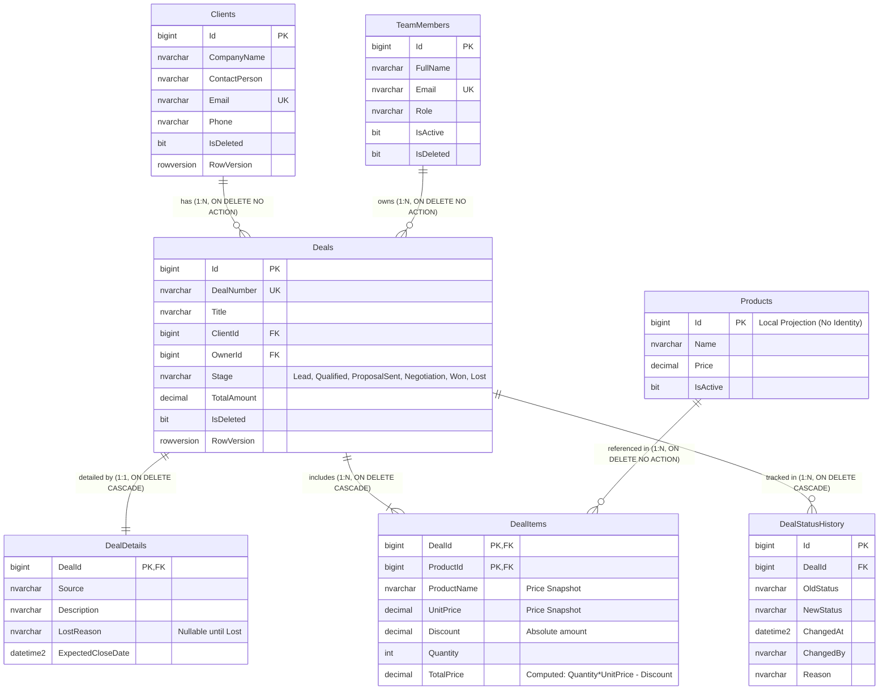
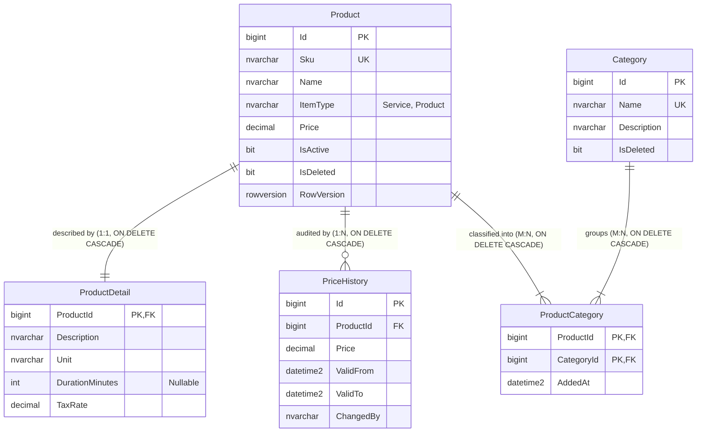

# ER-діаграми баз даних CRM (Mermaid)

Цей документ містить офіційні ERD для мікросервісних баз даних **SalesDb** та **CatalogDb**, побудовані у форматі Mermaid.

---

## 1. SalesDb (Контекст «Продажі»)

---

## 2. CatalogDb (Контекст «Прайс-лист»)

