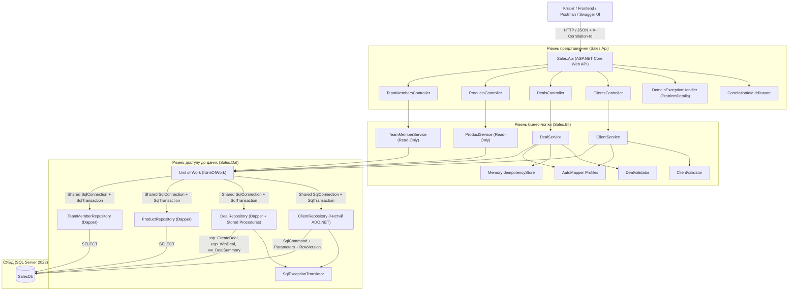
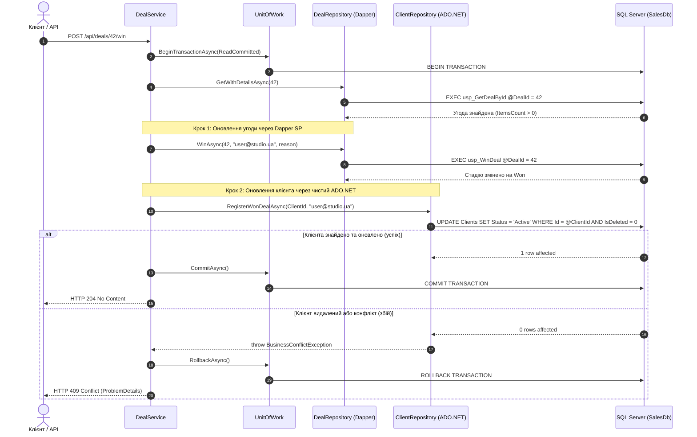

# Архітектура мікросервісу Sales (Лабораторна робота №02)

## 1. Загальний огляд

У межах практичної роботи №02 реалізовано повноцінну тришарову архітектурну вертикаль (**DAL → BLL → API**) для мікросервісу **Sales** (предметна область «CRM для малого бізнесу — студія веб-розробки та маркетингу»). Сервіс взаємодіє з базою даних `SalesDb` (Microsoft SQL Server 2022), спроєктованою в Лабораторній роботі №01.

### Шари системи
1. **Sales.Domain**: Доменні моделі, константи статусів угод, доменні винятки (`NotFoundException`, `BusinessConflictException`, `ValidationException`). Не має залежностей від інших проєктів рішення.
2. **Sales.Dal**: Рівень доступу до даних на базі **чистого ADO.NET** та **Dapper**. Реалізує патерни **Repository** та **Unit of Work** із підтримкою транзакцій на єдиному фізичному з'єднанні `SqlConnection`.
3. **Sales.Bll**: Рівень бізнес-логіки. Містить DTO, профілі AutoMapper, валідатори бізнес-правил (Рівень 2), in-memory кеш для ідемпотентності та сервіси домену. Забезпечує атомарність складних операцій.
4. **Sales.Api**: Рівень представлення (ASP.NET Core Web API). Забезпечує атрибутну маршрутизацію, наскрізне трасування за допомогою кореляційного ідентифікатора (`X-Correlation-Id`), централізовану обробку винятків у форматі **RFC 7807 / 9457 ProblemDetails** (коди 400, 404, 409, 500) та інтерактивну документацію Swagger/OpenAPI.
5. **Platform.AppHost**: Оркестратор на базі **.NET Aspire**, який автоматично запускає SQL Server 2022 у контейнері, ініціалізує базу скриптами з `db/p1/` (`schema.sql`, `procedures.sql`, `seed.sql`), інжектує рядок підключення та запускає `Sales.Api`.

---

## 2. Діаграма архітектурних шарів



---

## 3. Репозиторії: Чому розділено чистий ADO.NET та Dapper

### 3.1. Репозиторій на чистому ADO.NET (`ClientRepository`)
`ClientRepository` **свідомо НЕ успадковує `IGenericRepository<T>`**.
**Обґрунтування:**
1. **Оптимістичне блокування (Optimistic Concurrency):** Таблиця `Clients` містить стовпець системного версіонування `RowVersion ROWVERSION NOT NULL`. Оновлення клієнта вимагає прямого порівняння бінарного масиву `byte[]` у предикаті `WHERE Id = @Id AND RowVersion = @RowVersion`. При розбіжності версій повертається 0 змінених рядків, що транслюється у `BusinessConflictException` (HTTP 409).
2. **Контроль над `SqlCommand` та параметрами:** У чистому ADO.NET тип кожного параметра (`SqlDbType.NVarChar`, `SqlDbType.BigInt`, `SqlDbType.Timestamp`), точний розмір та `DBNull.Value` вказуються явно, що виключає неявні приведення типів (`implicit type conversion`) на стороні SQL Server та дозволяє ефективно перевикористовувати плани запитів.
3. **Специфічні доменні методи:** Репозиторій реалізує атомарну реєстрацію виграних угод `RegisterWonDealAsync`, яка оновлює статус клієнта на `Active` та фіксує автора оновлення, гарантуючи перевірку прапорця `IsDeleted`.

### 3.2. Репозиторії на Dapper (`DealRepository`, `ProductRepository`, `TeamMemberRepository`)
Усі три репозиторії успадковують `BaseDapperRepository<T>`, який імплементує спільний контракт `IGenericRepository<T>`.
**Обґрунтування:**
1. **Висока продуктивність мікро-ORM:** Dapper генерує динамічний IL-код для швидкісного мапінгу результатів запитів на C#-об'єкти практично без накладних витрат у порівнянні з чистим DataReader.
2. **Робота зі збереженими процедурами та множинними вибірками (`QueryMultipleAsync`):**
   - Метод `DealRepository.GetWithDetailsAsync` викликає процедуру `usp_GetDealById`, яка за один мережевий круг (roundtrip) повертає 4 набори результатів: заголовок угоди, деталі (`DealDetails`), позиції (`DealItems`) та історію переходів стадій (`DealStatusHistory`). Dapper зчитує їх через `QueryMultipleAsync` з мінімальним latency.
   - Метод `DealRepository.CreateAsync` передає позиції угоди у вигляді JSON через параметр `@ItemsJson NVARCHAR(MAX)` у процедуру `usp_CreateDeal`, яка парсить їх за допомогою `OPENJSON`.
3. **Обов'язкове використання `CommandDefinition`:** Усі запити до Dapper передаються через `CommandDefinition` із зазначенням активної транзакції, таймауту та токена скасування `CancellationToken`.
4. **Спеціалізовані методи пошуку та захист репліки каталогу:**
   - `ProductRepository.GetActiveByNameAsync(name)`: безпечний пошук активних послуг/товарів із екрануванням спеціальних символів SQL LIKE (`[`, `%`, `_`) через `EscapeLikePattern`.
   - `ProductRepository.AddAsync`, `UpdateAsync`, `DeleteAsync`: кидають `NotSupportedException` із чітким повідомленням, оскільки `Products` у `SalesDb` є локальною реплікою каталогу `CatalogDb` (політика дублювання Лаб. 01); модифікації дозволені лише в первинному контексті Catalog.
   - `TeamMemberRepository.GetByEmailAsync(email)`: швидкий пошук співробітника студії за електронною поштою через типізований параметр Dapper.

---

## 4. Патерн Unit of Work та управління транзакціями

Клас `UnitOfWork` гарантує, що всі репозиторії в межах одного HTTP-запиту працюють на **єдиному фізичному з'єднанні `SqlConnection`** та ділять спільну `SqlTransaction`:

```csharp
public class UnitOfWork : IUnitOfWork
{
    private readonly SqlConnection _connection;
    private readonly ILogger<UnitOfWork>? _logger;
    private SqlTransaction? _transaction;

    public IClientRepository Clients => _clients ??= new ClientRepository(_connection, () => _transaction, _options);
    public IDealRepository Deals => _deals ??= new DealRepository(_connection, () => _transaction, _options);
    public IProductRepository Products => _products ??= new ProductRepository(_connection, () => _transaction, _options);
    public ITeamMemberRepository TeamMembers => _teamMembers ??= new TeamMemberRepository(_connection, () => _transaction, _options);
    ...
}
```

Усі переходи життєвого циклу транзакції (`BeginTransactionAsync`, `CommitAsync`, `RollbackAsync`) логуються за допомогою `ILogger<UnitOfWork>`.

### Пастка `XACT_ABORT ON` у SQL Server
Якщо збережена процедура кидає помилку з увімкненим `SET XACT_ABORT ON`, SQL Server автоматично завершує серверний стан транзакції. У клієнтському драйвері `Microsoft.Data.SqlClient` властивість `_transaction.Connection` стає `null`. Виклик методу `_transaction.RollbackAsync()` у такому разі призведе до `InvalidOperationException: This SqlTransaction has completed; it is no longer usable`.
`UnitOfWork` враховує цю пастку та безпечно перевіряє `if (_transaction.Connection != null)` перед відкатом:
```csharp
if (_transaction.Connection != null)
{
    await _transaction.RollbackAsync(ct);
}
```

---

## 4.1. Знімок цін та назв у BLL (Snapshot Pattern)

Згідно з політикою дублювання Лаб. 01, ціна та назва товару/послуги на момент включення в комерційну пропозицію мають залишатися незмінними навіть при подальшій зміні тарифів у каталозі `CatalogDb`.
У `DealService.CreateAsync` та `DealService.AddItemAsync`:
1. BLL вичитує актуальну інформацію про товар через `_uow.Products.GetByIdAsync(item.ProductId)`.
2. Явно копіює `product.Name` у `ProductName` та `product.Price` у `UnitPrice`:
   ```csharp
   // знімок на момент додавання, політика дублювання Лаб. 01, не оновлюється
   var dealItem = new DealItem
   {
       DealId = dealId,
       ProductId = product.Id,
       ProductName = product.Name,
       UnitPrice = product.Price,
       Quantity = item.Quantity,
       Discount = item.Discount
   };
   ```
3. Створення угоди з позиціями `DealService.CreateAsync` виконується всередині транзакції `UnitOfWork` (`BeginTransactionAsync` $\to$ `usp_CreateDeal` $\to$ запис історії статусу $\to$ `CommitAsync`), що гарантує атомарність.

---

## 5. Діаграма транзакції: Закриття угоди (`WinDealAsync`)

Метод `DealService.WinDealAsync` демонструє розподілену атомарну операцію, яка задіює **два різні репозиторії** (Dapper Stored Procedure + чистий ADO.NET) у єдиній транзакції.



---

## 6. Мапінг доменних винятків на ProblemDetails (RFC 7807 / 9457)

Централізований клас `DomainExceptionHandler` транслює внутрішні винятки у стандартний формат `application/problem+json`:

| Виняток у коді | Код помилки SQL Server | HTTP Статус | Заголовок ProblemDetails (`title`) | Опис та поведінка |
| :--- | :--- | :---: | :--- | :--- |
| `ValidationException` | 50005 | **400 Bad Request** | Помилка валідації запиту | Містить словник `errors` з іменами полів та описами порушень |
| `ArgumentException` | — | **400 Bad Request** | Некоректний запит | Неприпустимі аргументи або параметри пагінації |
| `NotFoundException` | 50001 | **404 Not Found** | Ресурс не знайдено | Сутність із вказаним ID відсутня у базі даних |
| `BusinessConflictException` | 50002, 50003, 50004, 2601, 2627, 547, 1205 | **409 Conflict** | Конфлікт бізнес-правил | Неприпустимий перехід воронки, оптимістичний конфлікт (RowVersion), дублікат ключа, спроба виграти порожню угоду |
| Будь-який неперехоплений виняток | Інші SQL помилки | **500 Internal Server Error** | Внутрішня помилка сервера | Безпечне загальне повідомлення клієнту без витоку деталей БД/трасування стеків |

Кожен об'єкт `ProblemDetails` автоматично збагачується розширеннями:
- `instance`: URI запиту (наприклад, `/api/deals/42/win`).
- `traceId`: W3C Trace Identifier поточного запиту.
- `correlationId`: Наскрізний кореляційний ідентифікатор із заголовка `X-Correlation-Id`.

---

## 7. Оркестрація за допомогою .NET Aspire (`Platform.AppHost`)

Проєкт `Platform.AppHost` оркеструє всі компоненти системи:
1. Запускає контейнер `mcr.microsoft.com/mssql/server:2022-latest` із надійним паролем `Your_Strong_Password_123!`.
2. Використовує динамічні порти, що запобігає конфліктам із портами локальної машини розробника.
3. Завантажує файли `schema.sql`, `procedures.sql` та `seed.sql` із каталогу `db/p1/` та передає їх у `salesDb.WithCreationScript(...)`, гарантуючи автоматичне розгортання схеми бази даних при старті контейнера.
4. Проєкт `sales-api` автоматично отримує рядок підключення до `SalesDb` через інжекцію залежностей `.WithReference(salesDb)` та очікує повної готовності бази даних `.WaitFor(salesDb)`.

---

## 8. Повний перелік кінцевих точок API (Endpoints Matrix)

| Метод | Маршрут | Опис | Рівень доступу до даних |
| :---: | :--- | :--- | :--- |
| `GET` | `/api/clients` | Отримати список клієнтів (з пагінацією та пошуком за назвою) | Чистий ADO.NET (`ClientRepository.GetPagedAsync`) |
| `GET` | `/api/clients/{id}` | Отримати деталі клієнта за ID | Чистий ADO.NET (`ClientRepository.GetByIdAsync`) |
| `POST` | `/api/clients` | Створити нового клієнта | Чистий ADO.NET (`ClientRepository.AddAsync`) |
| `PUT` | `/api/clients/{id}` | Оновити клієнта з перевіркою версії `RowVersion` | Чистий ADO.NET (`ClientRepository.UpdateAsync`) |
| `DELETE` | `/api/clients/{id}` | М'яке видалення клієнта (`IsDeleted = 1`) | Чистий ADO.NET (`ClientRepository.DeleteAsync`) |
| `GET` | `/api/deals` | Пагінований список угод через представлення `vw_DealSummary` | Dapper (`DealRepository.GetPagedSummariesAsync`) |
| `GET` | `/api/deals/{id}` | Повна агрегована картка угоди з 4 наборами даних | Dapper (`DealRepository.GetWithDetailsAsync`, `usp_GetDealById`) |
| `POST` | `/api/deals` | Створити нову угоду з позиціями (транзакція UoW) | Dapper (`DealRepository.CreateAsync`, `usp_CreateDeal`) |
| `POST` | `/api/deals/{id}/items` | Додати позицію до угоди (знімок ціни та назви) | Dapper (`DealRepository.AddItemAsync`, `usp_AddDealItem`) |
| `POST` | `/api/deals/{id}/advance` | Перевести угоду на наступну стадію воронки | Dapper (`DealRepository.AdvanceStageAsync`, `usp_AdvanceDealStage`) |
| `POST` | `/api/deals/{id}/win` | Успішно закрити угоду (транзакція: Dapper SP + ADO.NET) | Dapper + ADO.NET (`usp_WinDeal` + `RegisterWonDealAsync`) |
| `POST` | `/api/deals/{id}/lose` | Закрити угоду як програну з фіксацією причини | Dapper (`DealRepository.LoseAsync`, `usp_LoseDeal`) |
| `GET` | `/api/deals/stats` | Агрегована статистика угод за стадіями | Dapper (`DealRepository.GetStatsAsync`) |
| `GET` | `/api/products` | Список активних товарів та послуг каталогу | Dapper (`ProductRepository.GetActiveAsync`) |
| `GET` | `/api/products/search` | Пошук послуг/товарів за назвою з екрануванням LIKE | Dapper (`ProductRepository.GetActiveByNameAsync`) |
| `GET` | `/api/products/{id}` | Деталі товару/послуги за ID | Dapper (`ProductRepository.GetByIdAsync`) |
| `GET` | `/api/team-members` | Список активних менеджерів та співробітників студії | Dapper (`TeamMemberRepository.GetActiveAsync`) |
| `GET` | `/api/team-members/by-email` | Пошук співробітника за адресою електронної пошти | Dapper (`TeamMemberRepository.GetByEmailAsync`) |
| `GET` | `/api/team-members/{id}` | Деталі співробітника за ID | Dapper (`TeamMemberRepository.GetByIdAsync`) |

---

## 9. Покриття тестами (Test Suite: 25 тестів)

| Тестовий клас | Кількість | Перевірений функціонал |
| :--- | :---: | :--- |
| **`DealServiceTests`** | 5 | Атомарний коміт `WinDealAsync`; відкат транзакції при падінні оновлення клієнта; валідація непорожності позицій; відкат при неіснуючій угоді; збереження знімка назви та ціни товару під час створення угоди всередині транзакції UoW. |
| **`ProductRepositoryTests`** | 3 | Перевірка захисту від модифікації локальної репліки каталогу: `AddAsync`, `UpdateAsync`, `DeleteAsync` кидають `NotSupportedException`. |
| **`AutoMapperTests`** | 1 | Повна валідація конфігурації `AssertConfigurationIsValid` (усі DTO та сутності з урахуванням конфігурації ліцензійного ключа AutoMapper). |
| **`SqlExceptionTranslatorTests`** | 5 | Трансляція кодів 50001 (404), 50002 (409), 50005 (400), порушення унікальності 2601/2627 (409) та взаємного блокування 1205 (409). |
| **`UnitOfWorkTests`** | 3 | Безпека подвійного `DisposeAsync`; безпечний виклик `RollbackAsync` без активної транзакції; валідація порожнього рядка підключення. |
| **`ApiIntegrationTests`** | 8 | Наскрізне трасування `X-Correlation-Id`; валідація Рівня 1 (DataAnnotations) повертає 400 ProblemDetails без звернення до BLL; коректна обробка апострофів у назвах компаній (O'Brien); 404 ProblemDetails; 409 ProblemDetails; безпечна обробка 500 Internal Server Error без витоку деталей SQL; доступність OpenAPI / Swagger. |

